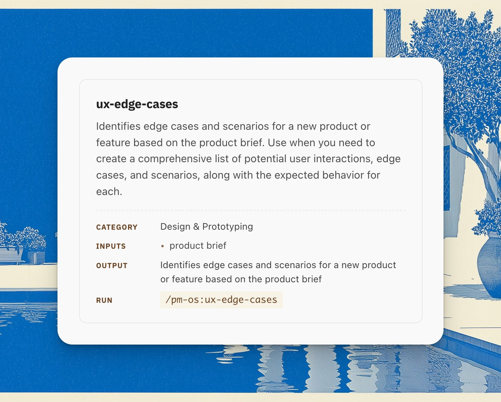

# /edge-cases：一个专抓「漏掉的边界情况」的简单 skill

> 原文：George（[@nurijanian](https://x.com/nurijanian)），《/edge-cases: a simple skill to catch missed edge cases》，X 长文，2026 年 7 月 6 日发布。
>
> 本文为全文翻译，未做删节。分节标题、加粗、配图与链接均对应原文；译注仅在必要处用括号补充。

我 examples 文件夹里放着一份真实的 PRD——一个从 Shopify 到 QuickBooks 的连接器。翻到功能一，里面有那么一句，一字不差：

> "订单可能有两笔以上，它们的金额之和应当等于这笔 payout（结算款）的总额。（如果对不上，那就是哪里出问题了 😁）"

一个 emoji。就落在本该写错误处理的位置上。这份 PRD 自己点出了它的失败条件——钱对不上——然后对"对不上时系统该做什么"一个字也没写。一个笑脸，翻页，进入下一个功能。

说实话，我理解。人类工程师读到这行，会哼一声，然后在需求评审（refinement）上问："那钱对不上时我们怎么办？"缺口变成一个提问，提问变成一个答案，而这一切都发生在任何东西上线之前。那个 emoji 当了很多年的承重墙，没人注意到，因为另一端永远有一个人类接着它。

AI 编程 Agent 不会哼那一声。把这份 PRD 喂给 Claude 或 Cursor，它不会在 😁 那里停下来。它会挑一个看起来说得通的做法——打条警告日志，发票照记——然后信心十足地写下去，转向下一个功能。代码能编译，因为你没写的测试不会失败。直到账对不平，才有人发现。

## 那么，写规格这件事到底变了什么？

我想我最后落到的是这么一点：你写规格的理由变了，或者至少，失败模式变了。人类读者加上不完整的规格，产出的是一次追问，烦人但可挽回。Agent 读者加上不完整的规格，照样把错的代码发出去，而这件事难抓得多。

给工程团队写规格的 PM，身边一直有个他自己也许都没意识到的兜底：别人的困惑。给 Agent 写规格的 PM，这个兜底被抽走了。没有人故意把它拿走，它只是悄悄地不在了。

## 我在它身上跑的那一遍

解决办法不是"多想边界情况"——那种在评审前写给自己的模糊提醒。我写过这种提醒，没用。据我所知真正有用的是：一个结构化的流程，横跨八个类别，每次都跑，按同一个顺序跑——用户类型、使用场景、意外输入与系统故障、用户误操作、功能之间的相互作用、负载、安全与隐私、可访问性。顺序是有意义的，因为它能抓到你个人总是忘掉的那几类，而每个人都有自己总是忘掉的那几类。

于是我把这套流程跑在那份连接器 PRD 上。规格本身看上去是完成的：八个功能，链接到了正确的 Shopify 与 QuickBooks API 文档，还有一条验收测试。一笔 2,000 美元的 payout，由三笔交易组成，进入 QuickBooks 后变成三张发票，每张都带着 Shopify ID、总额、税、折扣、运费，以及一条指回该订单的链接。读起来很完整。读起来像是可以直接交给 Agent 了。

这一遍跑回来 27 个场景。下面是完整的三行，每一行旁边写着我的诚实猜测：如果规格保持沉默，Agent 会交出什么。

**那条 😁 句本身。** 场景：各笔交易金额之和 ≠ payout 金额。这一遍给出的预期行为：暂停这笔 payout 的记账，在后台把它标记为"对账失败"，同时显示两个数字和差额，通知管理员；而且关键的一点——不要只把金额恰好对得上的那几张发票记掉、然后悄悄跳过其余的。Agent 实际会交出的：一行日志，然后全速前进，因为"哪里出问题了 😁"里面没有任何一条指令说"停下"。

**退款。** 场景：一笔 2,000 美元的 payout，实际是 2,300 美元的扣款减去 300 美元的退款。预期：退款变成 QuickBooks 里的一张 credit memo（贷记单），并且在写入任何东西之前，扣款加退款加手续费仍然要对得上 payout 总额。Agent 实际会交出的：一张 -300 美元的"发票"，或者干脆把退款悄悄跳过，因为规格里唯一那条测试只包含三笔干净的扣款，别的什么都没有。

**那个标签。** 场景：管理员手动给一个连接器从未处理过的订单打上"Booked"标签。预期：这个标签永远不会被当作事实来源，连接器维护自己的已处理账本，所以被打错标签的订单照样会被开票。Agent 实际会交出的：把这个标签当成状态，因为验收测试检查的就是"标签会出现"，而这是规格里唯一提到过的状态信号。一次手滑贴错标签，那笔订单就永远从开票流程里掉了出去——静默地。

同一轮里还跑出另外三个漏项，它们押着同一个韵：重跑会造出重复发票，因为没有任何地方要求幂等；鉴权失败会让一笔 payout 记到一半挂在空中，没有检查点；NZD 金额被写进了 USD 的 QuickBooks 文件，因为测试里从没指名过币种。一共六个缺口，而那份规格里唯一的一条验收测试——那笔干净的 2,000 美元 payout——从每一个缺口里笔直穿了进去。

## 这算天才吗？不算

我自己会提的反对意见是：一个资深的工程师大概能抓住这里的绝大多数。幂等、限流、token 刷新，这些对任何做过集成的人都是基本功。如果门槛是"没有工程师能想到的洞见"，这一遍过不了这道坎，而且我认为任何清单都过不了。

但这从来不是它的活儿。它的活儿是：这张表在评审之前就存在，由写规格的那个人产出，而不是在三次评审会上一个一个地冒出来，或者更糟——根本不冒出来，因为读者是 Agent，而 Agent 不会对着 emoji 哼那一声。这一遍花了二十分钟。它的替代方案是：六个本该被明确定义的行为决策，被一个代码生成器，在凌晨两点，在某人的会计系统里，隐式地做掉。

而且这些漏项不是随机的。每一个都是同一个问题换了身衣服：当钱不像 happy path 假设的那样加得起来时，会发生什么。如果要为这份规格为什么漏掉全部六个找一套理论，我猜是因为 happy path 里永远只有干净的扣款，而真实的 payout 里有退款、手续费、调整，还有某人手滑贴上的标签。

## 唯一那个动作

所以，在下一份规格进入评审、或者被粘进某个 Agent 的上下文窗口之前，拿这八个类别对着它跑一遍。你会带着一件具体的东西离场：一条发给工程频道的消息，点名规格没有覆盖的场景，要求为每个场景给出明确定义的行为。跳过这条消息，同一个缺口还是会在后面冒出来——在一场会开到一半的时候，而规格上署的是你的名字。于是你开始对一份自己写的文档说"我们线下再谈"，我干过这事，感觉不好。

说实话，难的部分不是知道边界情况存在。所有人都知道边界情况存在。难的是在评审四十分钟后就要开始的时候，坐下来把完整的八类流程在每一份规格上都跑一遍。

PM OS 把这一遍流程作为现成的 skill 交付，它跑在你自己的公司上下文上，所以回来的场景表是被你的产品和你的用户塑造过的，而不是一张通用清单。

这一层"规格硬化"，与战略、调研、决策那几条工作流并排放着。

## [今天就去拿到并装上。](https://prodmgmt.world/x/case-spec-missed_070726)

---

**参考来源**

- 原文（X 长文）：https://x.com/nurijanian/status/2074047145859228099
- 作者：George（@nurijanian），[prodmgmt.world](https://prodmgmt.world)、PM OS / AI PM OS
- 原文发布：2026-07-06
- 配图（原件直链，仓库内已本地化至 `assets/2026-07-06-edge-cases-skill/`）
  - 封面：https://pbs.twimg.com/media/HMh-1CIbQAAb4MZ.jpg
  - 文中技能卡片截图：https://pbs.twimg.com/media/HMh7TuFbAAElLQ6.jpg
- 文中链接：PM OS 安装页 https://prodmgmt.world/x/case-spec-missed_070726

**术语对照**

| 原文 | 译文 | 说明 |
| --- | --- | --- |
| PRD | 产品需求文档 | 原文直接用缩写，译文中保留 |
| refinement | 需求评审 | 英文团队里指需求澄清与拆解会议，文中保留英文以便对照 |
| payout | payout（结算款） | 平台一次结算给商户的款项，是一笔总额 |
| charge | 扣款 | 组成 payout 的单笔客户支付 |
| credit memo | 贷记单 | QuickBooks 中用于冲销/退款的单据 |
| happy path | happy path | 一切顺利、无异常的理想路径 |
| table stakes | 基本功 | 入行必备的最低要求 |
| idempotency | 幂等 | 同一操作重复执行不产生额外副作用 |
