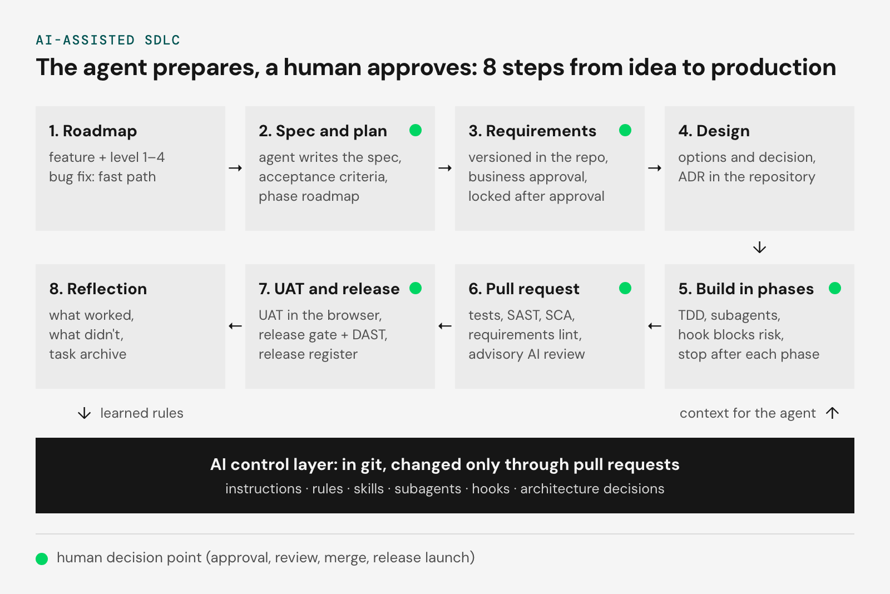

# 受监管行业里的 AI 辅助 SDLC：一个真实案例

> 原文：Tomasz Grynkiewicz，《AI-assisted SDLC in a regulated industry: case study》，Netguru 博客，2026 年 11 月 2 日发布，约 3,100 词。
>
> 本文为全文翻译，未做删节：含全部小节、四张表格、八步流程图与文末 FAQ；配图已本地化，链接均保留。

我们为一个受监管行业的客户，在一个多租户 SaaS 平台上跑 AI 辅助的 SDLC：由 Claude Code 写代码、写需求、写测试。这个 agent 拥有的权限不会超过一名初级工程师：三级 CI 闸门和五个人工决策点，把每一次改动都拴在一条需求、一个测试和一次发布上。

这个项目上的大部分代码，都是工程师和 agent 一起写出来的；而无论由谁写，每一次改动都要过同一套质量闸门。

## 什么是 AI 辅助 SDLC？

AI 辅助 SDLC 是一种[软件开发生命周期（SDLC）](https://www.netguru.com/blog/sdlc-methodologies)：AI 编码 agent 承担从规格到发布的每一步工作，由人类批准其中真正重要的决策。

所有用来引导 agent 的东西（指令、规则、技能与 hook）都存放在仓库里，只能通过经过评审的 pull request 修改。CI 闸门对每一次改动一视同仁地检查，不论作者是人还是模型。

本案例研究讲的是我们如何为受监管行业的团队运行这套模式：编码 agent 写代码、写需求、写测试，而 CI 闸门与人工审批留下完整的审计痕迹。

## 挑战：一个要接受审计的 AI agent

挑战在于：让 AI agent 在一个受监管的 SaaS 平台上写代码，同时不削弱审计、可追溯性和安全管控。这个平台为多个租户管理产品数据，对变更、评审与审批有一套受控流程。

- **技术栈**：.NET 后端，TypeScript 与 React 前端，Azure 云
- **团队**：我们的工程师与客户的工程师在同一个共享仓库里工作
- **AI 工具**：Claude Code，本地与 CI 流水线都在用，配一套从想法到部署的结构化工作流
- **行业要求**：审计痕迹、需求可追溯、变更控制、高安全性、数据隔离

我们的指导原则很简单：AI agent 不拥有任何初级工程师不该有的权限。它不合并代码，不推送到受保护分支，也无法接触密钥。它做的每一件事都会在仓库或 pull request 里留下痕迹，审计员可以据此还原谁做了什么、为什么这么做。

这套通用方法（用在我们内部产品上的版本）我们在[agentic 开发：生产级](https://www.netguru.com/blog/agentic-development-production-grade)一文里描述过。本文展示的是：当客户的流程需要被审计时，哪些地方会变——正是我们的 [AI 开发服务](https://www.netguru.com/services/ai-development-services)覆盖的那类项目。

## AI 辅助 SDLC 如何端到端运转

AI 辅助 SDLC 里的每一次改动都走同一条八步路径，改动本身的复杂度决定它要用到其中几步。每一步都有 agent 参与，其中有五个节点由人类批准。

1. **路线图**：每个功能被评定一个 1 到 4 级的复杂度；缺陷修复走快速通道。
2. **规格与计划（人工决策）**：agent 写出规格说明、验收标准和阶段路线图。
3. **需求（人工决策）**：需求在仓库里做版本管理，由业务方批准，批准后锁定。
4. **设计**：给出可选方案与决策，记录为仓库里的架构决策记录（ADR）。
5. **分阶段构建（人工决策）**：测试驱动开发、子 agent、一个拦截高风险操作的 hook，以及每个阶段结束后的暂停。
6. **Pull request（人工决策）**：测试、静态应用安全测试（SAST）、软件成分分析（SCA）、需求 lint，以及一次建议性的 AI 评审。
7. **UAT 与发布（人工决策）**：在浏览器里做用户验收测试（UAT）、带动态应用安全测试（DAST）的发布闸门，以及发布登记簿里的一条记录。
8. **复盘**：哪些有效、哪些无效，以及任务归档。学到的规则作为上下文回到 agent 那里。

八个步骤之下是那层 AI 控制层：指令、规则、技能、子 agent、hook 和架构决策，全部存放在 git 里，只能通过 pull request 修改。它在每一步给 agent 提供上下文，而复盘中习得的规则又回流进这一层。

复杂度在开始时就评定。小的修复从任务直接跳到实现、再到 pull request，而 CI 依然会报告它们触及了哪些需求。

较大的功能需要一份规格和一组需求，最复杂的那类还要额外走一个设计阶段和验收测试。维护同样走这个循环：一次事故或一个缺陷会作为任务回来，它的教训喂给 agent 规则。

## 需求如何变成代码

在我们这套 AI 辅助 SDLC 里，需求被当作代码对待：与实现一起放在仓库里做版本管理，业务工具只用来评审和批准它们。因此每一次代码改动都知道自己触及哪些需求。

- **需求层级**：用户需求、功能需求、技术需求各自携带稳定的 ID，批准后永不改变。
- **需求由计划派生**：agent 根据已批准的规格和验收标准起草需求，由人类评审。
- **可追溯性**：每条需求都指向实现它的代码、验证它的测试，以及一旦改动就可能破坏它的区域。
- **审批循环**：草稿、评审、批准。批准后内容锁定，此后任何改动都会被自动检出。
- **CI 闸门**：如果较大的功能没有需求，或者改动触及了未批准的需求，pull request 会失败。
- **影响分析**：在每一个 pull request 上（包括小的修复），CI 都会报告这次改动影响了哪些需求。

需求追溯矩阵不是一份每次发布才更新一次的文档。CI 在每一个 pull request 上检查它：报告一次改动触及了哪些需求，阻止对未批准需求的修改，并让没有需求的较大功能直接失败。可追溯性之所以保持最新，是因为构建依赖它。

## 仓库与 CI/CD 如何约束 agent

仓库与 CI/CD 对 agent 施加与工程师相同的规则，并在三个层级上机械地强制执行，而不是只写在制度文件里。底层的分支策略是严格的：单一主干开发线、受保护分支只能通过 pull request 抵达、统一的分支命名，以及不允许改写共享历史。

下表说明每个层级强制什么、何时运行。

| 层级 | 运行时机 | 强制内容 |
|---|---|---|
| 1. agent 会话内的守卫 | agent 每次编辑与每条命令之前 | 拦截受保护分支、历史改写、密钥和环境配置文件；阻止已登记技术债与临时性代码标记的增长；合并、基础设施与数据库操作需人类同意 |
| 2. Pull request 闸门 | 每个 pull request | 构建与测试（单元、集成、端到端）、需求校验与影响分析、密钥扫描、依赖与漏洞检查、静态安全分析、技术债检查、建议性 AI 评审 |
| 3. 发布闸门 | 每次发布之前 | 架构规则测试、全量代码扫描、运行环境上的 DAST，然后把部署绑定到某一次提交和某一次 CI 运行 |

第一级守卫（level 1）是一个 Claude Code hook，在 agent 每次编辑和每条命令之前运行。它拦截受保护分支、密钥和历史改写；任何合并、基础设施或数据库改动之前都会征求人类同意。CI 会测试这个 hook 本身，所以没人能悄悄把它关掉而不被团队发现。

## 测试与安全如何与 AI agent 协作

用 AI agent 做测试有一条压倒一切的原则：一个测试只有在缺少它所验证的行为时会失败，才算数。AI 很容易生成什么也没证明的"绿灯"测试，所以这条原则被写进 agent 的指令和代码评审里。更广泛的问题我们在[测试 AI agent](https://www.netguru.com/blog/testing-ai-agents)和[质量保证](https://www.netguru.com/services/quality-assurance)服务中讨论。

### 测试金字塔

- **单元测试与集成测试**：集成测试跑在真实的服务器与数据库上，验证系统状态，而不只是响应。
- **架构测试**：关键规则（例如端点保护、数据隔离、禁用模式）写成会让构建失败的测试。
- **端到端测试**：每个测试自己准备数据，因此彼此独立、可以并行；不稳定的测试进隔离区，而不是阻塞流水线。
- **对比测试**：关键输出产物与已批准的参考版本做比对。

### 过程中的安全

- **agent 作业程序（技能）**：例如加固一个端点就是一套固定步骤，CI 逐步检查。
- **只减不增的债务**：既有问题被登记在册；新增一次违规就让构建失败，扩容登记册需要人工批准。
- **全量扫描集**：SAST、DAST、带软件物料清单（SBOM）的依赖分析，以及密钥检测。

CI 里的 AI 评审器只有读取和评论权限。它逐个 pull request 检查安全规则违规、数据隔离问题、事务一致性以及测试缺口，每条发现都指向代码中的具体位置。它把改动的内容当作数据而非指令，从而防止提示注入。

## 规则、技能与模式如何做版本管理

一切用来引导 AI agent 的东西，包括规则、技能和模式，都是仓库里的文件，只能通过经过评审的 pull request 修改，和代码一样。没有开发者保留私有 prompt。

下表说明引导 agent 的七个层次及其各自的作用。

| 层次 | 作用 |
|---|---|
| 项目指令 | 每个 agent 会话自动加载的约定、命令与禁令；整个仓库一份、每个应用各一份 |
| 架构规则 | 不可打破的规则；其中一部分由测试强制执行 |
| agent 规则 | 按技术划分的标准，只在该技术适用的地方加载，带优先级 |
| 技能 | 可重复任务的逐步作业程序，例如加固端点或补充测试 |
| 子 agent | 权限受限的专职角色，例如只读评审者 |
| hook 与权限 | 硬性禁令，以及 agent 必须征求人类同意的节点 |
| 模式与决策 | 架构模式与架构决策记录（ADR） |

**持续学习。** 每个任务之后，agent 会写一份复盘，教训被提炼成主题规则，并记录它们来自哪里、被确认过多少次。习得的规则优先级低，永不覆盖人写的规则，且如果长期未被再次确认就会过期。

**按任务选模型。** 业务逻辑、安全和高风险工作用最强的模型；文档、机械性改动和辅助型子 agent 用较轻的模型。

## 人类在哪里批准改动

凡是到达受保护分支、生产环境或客户手里的改动，都由人类批准：AI 准备，人类决定。五个决策点是：

1. **规格与计划批准**：agent 准备规格、验收标准与计划；在写出任何代码之前，由开发者批准。
2. **需求的业务批准**：只有已批准的需求会被锁定，也只有它们能作为构建的基础。
3. **每个构建阶段后的评审**：在较大任务上，agent 完成一个阶段就停下；评审通过后才开始下一个。
4. **带强制代码所有者评审的 pull request**：AI 评审只是建议，绝不替代批准；合并由人类完成。
5. **不可逆操作**：合并、密钥、基础设施、直接的数据库操作和发布上线，都需要人类明确同意。

还有两条规则保护人类在 AI 辅助 SDLC 中的控制权。AI 自行学到的规则，永远不能覆盖人设定的规则。任何对安全闸门范围的改动都需要安全团队批准，因此 agent 永远不会放松自己的护栏。我们曾在[AI agent 的真实陷阱](https://www.netguru.com/blog/ai-agents-pitfalls)一文中谈过为什么 agent 需要这些限制。

## AI 的行为如何保持可审计

AI 的行为之所以可审计，是因为仓库是唯一事实来源：agent 的每一步都会在仓库或 pull request 里留下产物。

对任何一次改动，审计员都能还原出：谁动的（人还是 AI 模型）、做了什么、为什么、依据是什么。每次提交都记录哪个模型参与其中，pull request 记录谁批准，任务文档记录设计推理。测试结果、日志和安全报告作为 CI 产物归档。

下表把典型的审计问题映射到答案所在之处。

| 审计问题 | 答案在哪 |
|---|---|
| 哪些代码是 AI 写的，用的哪个模型？ | 每次提交元数据里的模型标记 |
| 谁批准了这次改动？ | pull request 及其评审与讨论记录 |
| 为什么这样设计？ | 任务文档（规格、验收标准、计划）与架构决策记录 |
| agent 一步步做了什么？ | 每个阶段后存进仓库的任务执行状态，它也让被中断的工作可以续跑 |
| AI 评审检查了什么？ | 带结论与发现的 pull request 评论 |
| 这次改动触及哪些需求，它们被测到了吗？ | CI 影响报告，以及需求到代码与测试的链接 |
| 已批准的需求被改过吗？ | 与批准版本的自动比对 |
| 最终上线的是什么？ | 只追加的发布登记簿，关联到提交、CI 运行与闸门证据 |

## 遥测如何衡量质量、模型与成本

我们这套 AI 辅助 SDLC 的遥测同时衡量三件事：代码质量、模型使用情况和成本。目的是说明 AI 花了多少钱、交付了什么，而不只是用了多少 token。

- **质量**：每次改动的 CI 闸门结果、单独统计的不稳定测试、AI 评审结论、需求的测试覆盖率，以及登记技术债务的偿还速度
- **AI 使用**：由 AI 共同撰写的改动占比，以及按任务类型划分的模型构成，取自提交元数据
- **成本与模型使用**：通过 OpenTelemetry 导出到组织可观测性栈的 agent 遥测，包含按团队和模型划分的 token 与成本、会话数、被接受与被拒绝的改动提案，另有模型供应商用量报告（CI 与开发者使用不同的密钥）
- **共享看板**：把成本与结果放在一起

共享看板把成本摆在结果旁边。它跟踪每次合入改动的成本、首次运行就通过 CI 的改动占比、AI 评审的准确率，以及从任务到部署的时长。光看 token 数量看不出 AI 在 SDLC 里是否划算，而这四个指标可以。

## 这套模式在 .NET 之外也适用吗？

适用，因为它真正的核心是仓库、CI、规则和技能，而不是某种语言。这个项目上我们用的是 .NET 和 TypeScript。换成移动平台、Java 或 Angular，你只需要补上该技术的规则、技能和闸门，机制不变。

下表说明框架的每一部分如何迁移到另一个技术栈。

| 能力要求 | 框架如何满足 | 迁移到其他技术栈 |
|---|---|---|
| iOS / Swift、Android / Kotlin | 按平台划分的规则与技能，同一套质量闸门 | Linter 与静态分析、单元与 UI 测试、自动化构建、移动应用安全扫描 |
| Java 与 .NET 后端 | 架构规则即测试、集成测试、安全闸门 | .NET 不变；Java 使用等价的架构测试、集成测试与依赖分析工具 |
| Angular 前端 | lint、单元测试、带隔离数据的端到端测试 | Angular 沿用同一套模式 |
| 从需求到维护 | 路线图、规格、需求、分阶段构建、验收测试、复盘；修复时做影响分析 | 不变；需求可与客户工具（如 Jira、Confluence）同步 |
| 仓库与 CI/CD 集成 | agent 在本地工作，也在流水线里担任评审者 | 平台无关（GitHub、GitLab、Azure DevOps、Jenkins） |
| 自动化测试与安全 | 测试金字塔、SAST、DAST、依赖分析、SBOM、密钥检测、AI 评审 | 同一批类别，工具按技术栈选型 |
| 规则、技能与模式的版本管理 | 一切都在仓库里，改动走 pull request，习得规则带来源 | 一个组织级共享规则仓库，加上各团队的规则 |
| 人在回路 | 明确定义的人类决策点，AI 没有合并权限 | 贴合既有的审批流程 |
| AI 日志与可审计性 | 提交里的模型标记、任务文档、pull request 里的评审、发布登记簿 | 不变，另加 agent 会话的集中日志 |
| 质量、模型与成本遥测 | 来自 CI 的质量指标、来自仓库的模型使用情况 | 基于 OpenTelemetry 与供应商报告的成本与用量看板 |

## 实践中学到了什么

这套 AI 辅助 SDLC 的实践经验，来自五个场景——它们的机制起到了作用，或者教会了我们一些东西。

**把评审发现变成 CI 规则。** 一次独立技术评审提出的发现变成了任务，其中许多变成了 CI 里强制执行的规则。既有债务被登记在册，agent 按固定程序逐步偿还；新债务无法产生，因为它会让构建失败。

**受监管行业里的"需求即代码"。** 在 AI 辅助下，我们构建了管理需求、校验需求、做影响分析并与客户审批流程同步的工具。迁移旧规格时，agent 把每一条需求与当前代码核对，每一处不一致都由客户决定。

**数据隔离测试。** 工作从一份关于系统行为的书面分析开始。agent 在真实基础设施上准备测试，客户批准需求，测试发现的问题作为独立任务进入待办。

**证明闸门真的会拦。** 我们刻意触发了每一道关键闸门，例如用一次失败的测试和一个植入的假密钥，并把每次拦截的证据存入发布登记簿。

**教训：一个什么也没证明的绿灯测试。** 在某个本地环境里，系统有一部分静默启动失败，测试却依然通过。这个教训写进了给人和 agent 的指令，也变成了一条规则：一个测试必须在缺少它所验证的行为时失败。当流程抓不住这类错误时，AI 很容易犯。

## 这套模式什么时候值得用

当每一次改动都必须被记录时，这套 AI 辅助 SDLC 模式就有意义，例如受监管行业和需要外部审计的项目。

如果你打算把 AI 编码 agent 引入一个需要审计痕迹的交付流程，[请联系我们的团队聊聊你的项目](https://www.netguru.com/estimate-project)。

## FAQ

### AI 编码 agent 能自己合并 pull request 吗？

不能。在这套模式里，agent 没有合并权限：代码所有者评审每一个 pull request，合并由人来执行。

### 怎么阻止 AI agent 写出什么也没证明的测试？

每个测试必须在缺少它所验证的行为时失败。这条规则写在 agent 的指令和代码评审中，集成测试则针对真实服务器与数据库检查系统状态。

### 如何保护 AI 代码评审器不被提示注入？

CI 里的评审器只能读取和评论，并且把改动内容当作数据而非指令。

### 哪个 AI 模型负责哪类任务？

最强的模型负责业务逻辑、安全和其他高风险工作。较轻的模型负责文档、机械性改动和辅助型子 agent。

### agent 自己学到的规则会怎么样？

它们优先级低，并记录来源与被确认的次数。它们永不覆盖人类规则，若未被再次确认就会过期。

### 这套 AI 辅助 SDLC 能配合 GitHub、GitLab 或 Azure DevOps 吗？

可以。agent 既在本地运行，也在流水线里运行，因此这套模式不依赖具体 CI 平台：GitHub、GitLab、Azure DevOps 或 Jenkins 都能用，需求也可以与 Jira、Confluence 这类工具同步。

---

**参考来源**

- 原文：https://www.netguru.com/blog/ai-assisted-sdlc-regulated-industry
- 作者：Tomasz Grynkiewicz，[Netguru](https://www.netguru.com)
- 原文发布：2026-11-02
- 配图：封面图与「八步 AI 辅助 SDLC」示意图，取自原文，存于 `assets/2026-11-02-ai-assisted-sdlc-regulated-industry/`

**术语对照**

| 原文 | 译文 | 说明 |
| --- | --- | --- |
| AI-assisted SDLC | AI 辅助 SDLC | 软件开发生命周期，缩写保留 |
| gate | 闸门 | CI gate / release gate，指强制检查点 |
| human decision point | 人工决策点 | 原文强调"人类批准"，非"人类执行" |
| ADR | 架构决策记录 | Architecture Decision Record |
| hook | hook | Claude Code 的强制拦截点，保留原文 |
| subagent | 子 agent | 权限受限的专职角色 |
| SAST / DAST / SCA / SBOM | 保留原文 | 静态/动态应用安全测试、软件成分分析、软件物料清单 |
| technical debt register | 技术债登记册 | 只允许缩小、扩容需人工批准的债务清单 |
| release register | 发布登记簿 | 只追加的发布记录，关联提交与 CI 运行 |
| prompt injection | 提示注入 | 把改动内容当作数据而非指令来防 |
