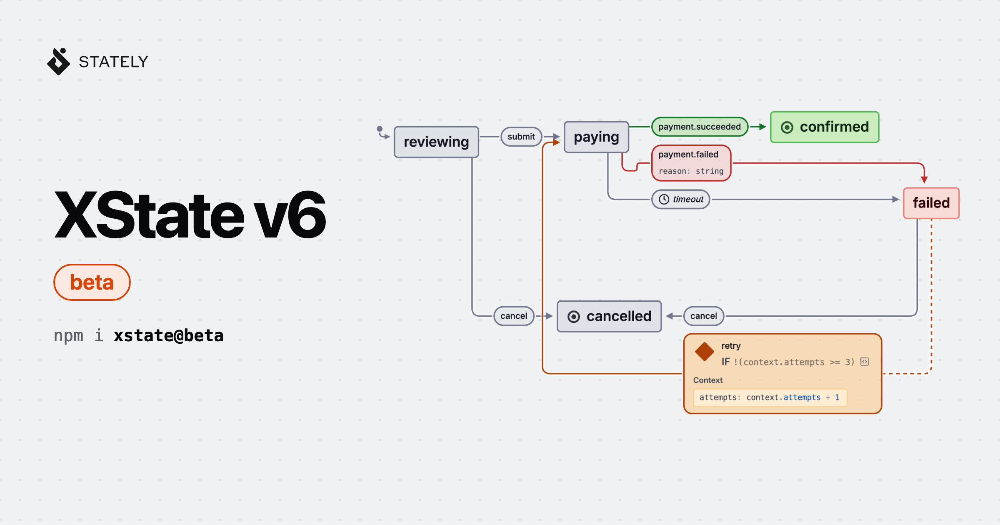

# 发布 XState v6 beta

> 原文：David Khourshid，《Announcing XState v6 beta》，Stately 博客，2026 年 11 月 5 日发布，约 3,600 词。
>
> 本文为全文翻译，未做删节：14 个小节、13 段代码、16 条新特性条目与全部链接均保留；代码保持原样未译。

XState v6 的首个 beta 发布：这是一个新的大版本，重点是让状态机更容易读、更容易写、更容易验证，并且能跑在任何地方。



今天，我们发布 XState v6 的首个 beta。这是一个新的大版本，重点是让状态机（以及状态图）更容易读、更容易写、更容易验证，并且能跑在任何地方。

距离 XState v5 发布已将近三年，中间发生了很多事。今天它有超过 3 万星标、每周下载量超过 800 万次，比以往更多的团队在生产环境里使用它，用在各种场景：UI 逻辑、后端工作流，以及越来越多地用在 AI agent 上。与此同时，代码的写法也变了（变得很多），说实话，这一点比任何其他因素都更影响了这个版本。

XState 是一个**完全开源（MIT）、零依赖**的状态管理与编排方案，建立在状态机、状态图和 actor 模型之上。**XState 可以编排任何逻辑**，从 promise 到状态机、状态图，以及介于两者之间的一切。

你现在就可以装 `xstate@beta` 来试 XState v6 beta：

```
npm i xstate@beta
```

我们认为核心 API 已经稳定，正式版发布前只会在反馈强烈、确实需要的情况下才做破坏性改动。少数较新的 API（例如持久化执行）仍标记为实验性。

## 现在，状态机由 agent 写了

越来越多的代码由 AI agent 写出来，其中也包括状态机。而 agent 写起 XState 的状态机和状态图来，*确实非常擅长*。这很合理：XState 从 2015 年就有了，因此积累了多年的文档、示例、讨论和开源代码。状态图本身可以追溯到 [David Harel 1987 年的论文](https://www.sciencedirect.com/science/article/pii/0167642387900359)，而这些核心概念（状态、事件、transition、守卫、并行状态、历史状态、actor 等）从那以后就没变过。模型对这些概念很熟；它们过去卡住的地方是语法。

原因在于，模型是从多年的 v4/v5 代码里学 XState 的，所以它们经常写出旧语法，比如用 `cond` 而不是 `guard`，或者用 `interpret(...)` 而不是 `createActor(...)`。而多数模型的训练数据里还没有 v6……这完全没关系！

我们没有去指望模型记住正确的版本，而是把 v6 设计成：agent（或者像你这样的人类！）可以只从眼前的代码、类型和文档里就得到正确答案，并且让错误尽可能早地被抓住。落到实处就是：

- **要学的 API 少得多了**。transition 就是普通函数（符合 JS 习惯），action creator 和守卫辅助函数都去掉了。
- **类型强得多**。schema 驱动类型化的事件与 context，类型错误会直接告诉你哪里不对。
- **文档随包发布**。每次安装都带着这个确切版本的文档，其中还包括一份专门写给 agent 的指南。
- **不跑你代码的工具**。新的 CLI 可以检查、校验、模拟、测试机器定义，并返回 JSON。
- **处处都是纯 transition**。同一台状态机可以跑在内存里、无服务器函数里，或者持久化执行的主机上。

我们来看其中几项。

## transition 就是函数

在 XState v5 里，一个 transition 是一个带 `target`、`guard`、`actions` 属性的对象。动作要用 action creator 创建，比如 `assign(...)`、`raise(...)`、`sendTo(...)`、`emit(...)`；守卫可以用 `and(...)`、`or(...)`、`not(...)` 这类高阶守卫组合。这套能用，但要学的 API 很多（也让 agent 很容易写错），而且本该放在一起的逻辑被拆散到不同属性里：

```
// XState v5
import { setup, assign, emit } from 'xstate';
const feedbackMachine = setup({
  guards: {
    hasFeedback: ({ context }) => context.feedback.trim() !== '',
  },
}).createMachine({
  // ...
  states: {
    editing: {
      on: {
        submit: {
          guard: 'hasFeedback',
          target: 'submitted',
          actions: [
            assign({ attempts: ({ context }) => context.attempts + 1 }),
            emit(({ context }) => ({
              type: 'feedback.submitted',
              feedback: context.feedback,
            })),
          ],
        },
      },
    },
    // ...
  },
});
```

在 XState v6 里，transition 可以就是一个普通函数。它接收当前的 `context` 与 `event`（以及更多东西），返回下一个状态和若干 context 更新。副作用用 `enq` 入队，而不是直接执行：

```
// 🆕 XState v6
import { setup } from 'xstate';
const feedbackMachine = setup({
  // ...
}).createMachine({
  // ...
  states: {
    editing: {
      on: {
        submit: ({ context }, enq) => {
          if (context.feedback.trim() === '') return;
          enq.emit({ type: 'feedback.submitted', feedback: context.feedback });
          return {
            target: 'submitted',
            context: { attempts: context.attempts + 1 },
          };
        },
      },
    },
    // ...
  },
});
```

这里没有 `guard` 属性；如果函数什么都不返回（也没有入队任何东西），这个 transition 就不会发生。也没有 action creator 了。`enq.raise(...)`、`enq.sendTo(...)`、`enq.emit(...)`、`enq.spawn(...)` 之类替代了它们，其他任何副作用就是 `enq(fn)`。条件是普通 JavaScript（`if`、`&&`、`||`、`!`），而 TypeScript 的类型收窄会贯穿每个分支——这在此前守卫与动作分开声明时是*做不到*的。这一点怎么强调都不过分：**transition 函数带来的类型安全强得多。**

这些 transition 函数依然是纯的。`enq` 只是*记录*（内部入队）副作用，actor 会在算出下一个状态之后执行它们。所以一个 transition 仍然是 `(state, event) => [nextState, effects]`，这一点后面会变得重要。而当没有逻辑要跑时，你依然可以写普通的 transition 对象，比如 `{ target: 'submitted' }`。

[在我们的文档里读更多关于 transition 的说明](https://stately.ai/docs/xstate/v6/transitions)。

## 类型安全强得多

在 XState v5 里，你用 `types: {} as { ... }` 声明类型……这实在算不上最地道的写法。在 XState v6 里，你改为声明 `schemas`，用 [Zod](https://zod.dev) 或任何其他 [Standard Schema](https://standardschema.dev) 库（如果只需要 TypeScript 类型，也可以用 `types<T>()`）：

```
import { z } from 'zod';
import { setup, createActor } from 'xstate';
const feedbackMachine = setup({
  schemas: {
    context: z.object({ feedback: z.string(), attempts: z.number() }),
    events: {
      'feedback.update': z.object({ feedback: z.string() }),
      submit: z.object({}),
    },
  },
}).createMachine({
  // ...
});
const actor = createActor(feedbackMachine).start();
actor.send({ type: 'feedback.update', feedback: 'Love it' });
actor.send({ type: 'submit' });
```

用 `actor.send(...)` 发出的事件会依据你的事件 schema 做类型检查，所以事件类型拼错、或者载荷缺字段，都是一个类型错误。`on: { ... }` 里拼错的事件键、以及不符合 context schema 的 context 更新，同样如此：

```
on: {
  // Type error: Event type 'sumbit' is not declared in schemas.events.
  sumbit: { target: 'submitted' }, 
},
```

这一点对 agent 尤其有用，因为类型错误几乎是最便宜的反馈回路，而 agent 甚至不需要读过任何文档，就能明白 `Event type 'sumbit' is not declared in schemas.events` 是什么意思。

由于 schema 是真实的值（不只是类型），像可视化编辑器这样的工具也能读取它们，你还可以拿它们做运行时校验。另外还有两种让 context 更精确的新方式：

- **类型状态（typestate）**。每个状态可以声明在该状态下有效的 context 形状，`snapshot.matches(...)` 会相应地收窄 context。[读更多关于类型状态的内容](https://stately.ai/docs/xstate/v6/typestates)。
- **状态输入（state input）**。一个状态可以声明一份类型化的 `input` 载荷，在进入该状态时必须提供，且只在该状态处于活动期时存在；这样你就不需要为了某个状态才用得上的字段而写可选 context 属性。[读更多关于状态输入的内容](https://stately.ai/docs/xstate/v6/state-input)。

## 小型状态机回来了

我们在 XState v5 里弃用了 `@xstate/fsm`，很多人希望它回来。有时你只想要一台小型的扁平状态机，用于一个开关或表单的某一步，而不想引入 actor 运行时。在 XState v6 里它回来了，代号 `xstate/fsm`，而且比以前更小：压缩并 gzip 后约半 KB（`@xstate/fsm` 约 2 KB）。

```
import { setup, types } from 'xstate/fsm';
const toggleMachine = setup({
  schemas: {
    context: types<{ count: number }>(),
    events: { toggle: types<{}>() },
  },
}).createFSM({
  initial: 'inactive',
  context: { count: 0 },
  states: {
    inactive: {
      on: {
        toggle: ({ context }) => ({
          target: 'active',
          context: { count: context.count + 1 },
        }),
      },
    },
    active: {
      on: { toggle: { target: 'inactive' } },
    },
  },
});
const [state] = toggleMachine.transition(toggleMachine.initialState, {
  type: 'toggle',
});
state.value; // 'active'
```

它使用与完整状态机相同的语法（transition 函数、`{ target }` 对象、schema 和类型状态），所以当你需要嵌套状态、副作用或调用的 actor 时，只要改成从 `xstate` 导入 `setup`，把 `createFSM` 换成 `createMachine`，配置可以不动。FSM 也是一种 actor 逻辑，因此它可以配合 `xstate` 里的 `createActor(...)`、`transition(...)`、`initialTransition(...)` 使用；而 `xstate/fsm` 本身并不导入 actor 运行时。

[在我们的文档里读更多关于 `xstate/fsm` 的内容](https://stately.ai/docs/xstate/v6/fsm)。

## 给 agent（和人）的文档与工具

`xstate` 包现在自带文档，放在 `node_modules/xstate/docs`，与你安装的确切版本一致。其中包含一份[面向 agent 的指南](https://stately.ai/docs/xstate/v6/agents)，写明了编写 v6 状态机的规则。把你的 agent 指向 `node_modules/xstate/docs/agents.md`，它就不会再写 `cond` 了（前提是它足够聪明）。

如果它不够聪明，XState v6 会告诉它该写什么。残留的 v5 配置——比如 `cond`、`types`，或者被移除的 actor 选项——会抛出错误，并点明替代写法：

```
createActor(machine, { systemId: 'payments' });
// Error: The "systemId" actor option was renamed. Use "registryKey":
// createActor(logic, { registryKey }), and look the actor up with system.get(registryKey).
```

生产构建则抛出简短的错误码（例如 `XState error E8`），并附上[错误参考](https://stately.ai/docs/xstate/v6/errors)的链接。开发构建还会冻结 context，因此就地修改会抛错，而不是悄悄把状态搞坏；当某个事件没有匹配到任何 transition 时，它还会给出警告。

`xstate` 包还带一个 CLI。它的命令作用于 JSON 格式的机器定义并返回 JSON，其中没有一个会运行你的应用代码：

- `xstate inspect` 报告定义的结构与图。
- `xstate validate` 校验一个定义。
- `xstate simulate` 为一串事件计算 transition，但不执行副作用。
- `xstate test` 检查安全性与可达性性质。
- `xstate replay` 重放一次失败检查中的反例。
- `xstate diff` 报告两个定义之间的结构变化。

```
npx xstate simulate review.json events.json
```

状态机可以用 `machineToJSON(...)` 和 `machineFromJSON(...)` 与 JSON 互相转换，这对把状态机当作数据存储、生成状态机，或者让它们在别的工具间往返很有用。另外 `npx xstate migrate` 能把 XState v5 代码迁移到 v6（下面会细说）。

## 会说 v6 的可视化编辑器

我们还在做一个新的可视化编辑器，它支持 XState v6。下面是一个用 XState v6 写的小型结账（checkout）状态机，由编辑器的只读视图渲染（原文此处是交互式嵌入视图，静态页面无法保存）：

那台状态机里的 `retry` transition 是一个函数，而编辑器依然能显示它的条件和它的 context 更新。

编辑器也能对 v6 代码做双向编辑。借助 Editor Sync，你可以把代码库里的状态机在可视化编辑器里打开——无论是通过 [Stately Editor 的 VS Code 扩展](https://marketplace.visualstudio.com/items?itemName=statelyai.stately-editor)，还是在终端里运行 [`statelyai open`](https://stately.ai/docs/packages/cli#open)。改图，改动会写回源码；改代码，图会更新。这些编辑是确定性的，因此同一个可视化改动总是产生同一处代码改动。

## actor 与持久化执行

在 XState v5 里，**actor** 成为主要关注点，这一点没变。actor 天然适合长时运行的逻辑，比如要等好几天审批的后端工作流，或者会停下来等人输入的 agent。但长时运行的逻辑必须能在崩溃、重启和部署中活下来，而活下来正是持久化执行的全部意义。

早在 2022 年，我就在[一个 GitHub 讨论](https://github.com/statelyai/xstate/discussions/3434#discussioncomment-3084629)里写过，我希望 XState 的「原子单元」是 `(state, event) => [nextState, effects]`。事实证明，这恰好就是持久化执行所需要的。Restate、Inngest、Trigger、Cloudflare Workflows、Temporal 这类持久化执行平台，其工作方式在概念上是把工作流的每一步「记下来」（journaling），从而能在失败之后重放或恢复。而当逻辑是一个把副作用当数据返回的纯函数时，这件事容易得多。

在 XState v6 里，transition 是纯的、副作用有稳定的 ID、actor 有确定性的地址，因此持久化宿主可以记录副作用，并确定性地重放一个工作流。新的（实验性的）`xstate/durable` 模块让你通过一个小适配器，把执行循环交给持久化宿主：

```
import { createDurable } from 'xstate/durable';
const durable = createDurable(orderMachine, {
  // How your durable host sends events, schedules timers,
  // runs actions, and waits for the next event
  enqueueRootEvent: (_source, event) => host.enqueue(event),
  scheduleTimer: (source, timer, delay) =>
    host.schedule({ address: source.address, timer, delay }),
  cancelTimer: (source, timer) =>
    host.cancelTimer({ address: source.address, timer }),
  executeAction: (action, { id }, runtime) =>
    host.runAction(id, () => action.exec(runtime)),
  waitForEvent: ({ id }) => host.waitForEvent(id),
});
const output = await durable.run(input); 
```

`durable.run(...)` 方法是一个循环的简写，这个循环看起来应该很眼熟：

```
let [state, effects] = durable.initialTransition(input);
await durable.executeEffects(effects);
while (state.status === 'active') {
  [state, effects] = durable.transition(state, await durable.waitForEvent());
  await durable.executeEffects(effects);
}
```

状态机本身并不知道（也不关心）自己是在持久化地运行。没有什么专门的「step」词汇要学；状态机调用的一个 promise actor 就是一个被记录的步骤，而这些 actor 之间的状态让工作流的进展变得可见。同一台状态机也可以用 `createActor(...)` 跑在内存里。

XState v6 被设计为能与任何持久化执行宿主配合工作，我们很快会发布 Temporal、Restate、Rivet、Cloudflare 等的示例。如果你不需要持久化宿主，持久化的快照也包含待触发的延迟 transition，所以一个三天的 `after` 延迟在部署之后依然有效——只要你还原 actor。

[在我们的文档里读更多关于持久化执行的内容](https://stately.ai/docs/xstate/v6/durable-execution)。

## 给 agent 用的状态机

Agent 本身也非常适合用状态机来描述。一个 agent 就是一个循环：调用模型，可能调用一些工具，检查结果，决定接下来做什么。当这个循环是隐式的，就很难说清 agent 被允许做什么（或者它为什么做了那件事）。把循环变成状态机，控制流就归状态机所有；模型只能在当前状态允许的事件里做选择。

我们在 XState 仓库里加了十几个[agent 示例](https://github.com/statelyai/xstate/tree/next/examples)，包括工具循环、human-in-the-loop 审批、模型回退、流式响应、RAG 流水线、结构化输出、MCP 服务器，以及多 agent 编排。

我们还在做 [Stately Agent](https://github.com/statelyai/agent) 2.0（目前处于 alpha），它建立在 XState v6 之上。有了它，你可以检查（而无需调用模型）一个 agent 是否永远不可能到达 `refundedOverLimit` 这样的状态、从它的事件日志重放一次运行，甚至让它自我改进自己的工作流。后续文章会细说。

## 其他所有改动

XState v6 里还有一大堆新特性。以下是我最喜欢的几项：

- **并行区域不再互相重置**。进入并行状态某个区域的 transition 不再退出并重置它的兄弟区域；某个区域内部的 `reenter: true` transition 也只重新进入该区域。[读更多关于并行状态的内容](https://stately.ai/docs/xstate/v6/parallel-states)。
- **状态级的 `onError`**。任何状态都可以在自身活动期间，用 `onError` transition 处理来自其 actor 和副作用的错误。
- **未处理事件**。`onUnhandledEvent` actor 选项和 `isUnhandled(...)` 辅助函数，能告诉你某个事件没有匹配到任何 transition。
- **选择状态**。`type: 'choice'` 状态让分支逻辑变成声明式的，替代一串 `always` transition。[读更多关于选择状态的内容](https://stately.ai/docs/xstate/v6/choice-states)。
- **状态超时**。任何状态都可以有 `timeout` 和 `onTimeout` transition，退出状态时超时会自动取消。[读更多关于超时的内容](https://stately.ai/docs/xstate/v6/timeouts)。
- **时长字符串**。延迟可以写成 `'500ms'`、`'5s'`，或 `'PT1M30S'` 这样的 ISO 8601 时长。
- **路由状态**。带 `route` 的状态可以通过 `xstate.route` 事件直接导航到，这对 URL 驱动的导航和深链接很有用。[读更多关于路由状态的内容](https://stately.ai/docs/xstate/v6/route-states)。
- **`actor.select(...)`**。从 actor 的快照派生出带记忆、可订阅的值。
- **内部事件**。状态机可以在内部抛出的、但无法从 actor 外部发送的事件。
- **`createAsyncLogic(...)`**。重建的 promise actor，带超时、`AbortSignal` 支持和事件发射。
- **`createStepLogic(...)`**。用单个 transition 函数定义的有状态 actor 逻辑，就像一台迷你状态机。
- **`enq.listen(...)` 与 `enq.subscribeTo(...)`**。以声明方式对子 actor 发出的事件或快照做出反应。
- **actor 注册表**。通过 `registryKey` 在系统中任意位置查找 actor，不必层层传引用。
- **快照版本化**。给持久化快照打上状态机的 `version`，在恢复时迁移旧快照。
- **`createStateConfig(...)`**。把一份完整类型化的状态定义在单独文件里，再组合进状态机。
- **`@xstate/effect`**。一个新的（beta）集成，用于把 XState 和 [Effect](https://effect.website) 一起用。

下面是选择状态和状态超时放在一起的样子：

```
states: {
  routing: {
    type: 'choice',
    choice: ({ context }) => {
      if (context.isVip) return { target: 'vipFlow' };
      return { target: 'waitingForApproval' };
    },
  },
  vipFlow: {},
  waitingForApproval: {
    timeout: 5_000,
    onTimeout: { target: 'escalated' },
    on: { approve: { target: 'approved' } },
  },
  // ...
}
```

## 我们删掉了什么（以及为什么）

v6 的大多数破坏性改动，都源于我们希望每件事只有一种显然的做法。当更新 context 有三种写法时，人类必须把三种都学会，而 agent 会很乐意把它们混着用。

- **action creator**（`assign`、`raise`、`sendTo`、`sendParent`、`forwardTo`、`emit`、`log`、`cancel`、`spawnChild`、`stopChild`、`enqueueActions`）被移除，改用 transition 函数和 `enq`。
- **高阶守卫**（`and`、`or`、`not`、`stateIn`）被移除，改用 `&&`、`||`、`!` 和 `snapshot.matches(...)`。
- **字符串 transition**，例如 `on: { submit: 'submitted' }`，被移除，改用 `{ target: 'submitted' }`，这样 transition 永远只有一种形状。
- **`types: {} as { ... }`** 被 `schemas` 取代，typegen（`tsTypes`）也没了——schema 让你不必做代码生成就能获得推断。
- **`fromPromise(...)`、`fromCallback(...)`、`fromObservable(...)` 和 `fromTransition(...)`** 被 `createAsyncLogic(...)`、`createCallbackLogic(...)`、`createObservableLogic(...)` 和 `createStepLogic(...)` 取代。
- **`@xstate/immer`** 被移除，因为 transition 函数直接返回 context 更新。你依然可以在 XState 里用 Immer。
- **`createActor(machine, { snapshot })`** 被 `xstate/persist` 的 `restoreActor(machine, snapshot)` 取代，后者会校验并迁移快照、并恢复它的子 actor。框架钩子（`useMachine`、`useActor`、`useActorRef`）接受恢复好的 actor，而不是 `snapshot` 选项。[读更多关于持久化的内容](https://stately.ai/docs/xstate/v6/persistence)。
- **`@xstate/inspect`** 被移除，改用 `createActor(...)` 上的 `inspect` 选项和 [Stately Inspector](https://stately.ai/docs/inspector)。inspection 协议也精简到两种事件类型，`@xstate.actor` 和 `@xstate.transition`，信息一点没少。
- **`interpret(...)`**，这个 `createActor(...)` 的遗留别名，终于消失了。

## 从 XState v5 迁移

迁移的大部分工作是机械性的，所以我们做了一个 codemod：

```
npx xstate migrate 'src/**/*.ts' --dry
```

这个 codemod 会重命名导入、把字符串 target 转成 `{ target }` 对象、把 `types` 转成 `schemas`、把 v5 的 action、守卫和 action creator 改写成 transition 函数，并把无法转换的部分报告出来，让你手工迁移。你也可以把 v6 和 v5 装在一起，一次迁移一台状态机。我们已经在数百个真实状态机和示例上测试过 v6（以及迁移路径），正式版发布前还会再加数百个。

[阅读从 XState v5 迁移到 v6 的完整指南](https://stately.ai/docs/xstate/v6/xstate-v5-to-v6)，里面列出了每一处改动，包括少数不会表现为类型错误的运行时行为变化。

XState v5 依然受支持，所以不必急着迁移；如果你今天就需要一个稳定版本，用 v5。

## 70 多个 alpha 之后

v6 的第一个 alpha 发布于 2026 年 6 月，此后我们发布了 70 多个 alpha。这些版本里的大量改动，来自把真实世界的 v5 状态机迁移到 v6，以及观察 agent 写 v6 代码、并修掉所有绊住它们的地方（这也是我们为 v6 [重写了文档](https://stately.ai/docs/xstate/v6/quick-start)的原因）。

感谢所有为 v6 做出贡献的人，包括 Asaf Katz、Sandro Maglione、Mateusz Burzyński、Joel Hooks、Mark Xian、Yang Bai、Ben Freed、Christian Rishøj、Jayesh Bhade、Ruben Fricke、Saad Abdullah 和 Žan Mlakar，也感谢每一位试过 alpha 并报告问题的人。

## 为什么我认为现在建模更重要

Agent 添加功能（和 bug）的速度，比任何人评审的速度都快。当一个 agent 能在几分钟内写出上千行代码时，逐行阅读并不是理解一个系统在做什么的现实方式；你需要一份更高层的、真正能看能查的行为模型。

状态图正是为此发明的；David Harel 1987 年在给复杂的航电系统建模时想出了它。一份状态图说明系统可以处于哪些状态、在每个状态下响应哪些事件、以及接下来会发生什么。我认为未来几年这一点会变得更重要，尤其是随着形式化验证变得对日常软件可行——现在 agent 能帮着写规格了。状态机是门槛最低的形式化模型之一，而在 XState 里，这份模型就是实际运行的代码。

用 XState v6，你现在已经可以：

- 用 `xstate test` 检查状态机的安全性与可达性，用 `xstate replay` 重放任何反例。
- 用 [`@xstate/test`](https://stately.ai/docs/xstate/v6/model-based-testing) 从状态机生成测试路径和随机事件序列，并用覆盖率给 CI 设闸。
- 用 Stately Agent 2.0（alpha）检查一个 agent 是否无法到达你标记为不安全的状态。

我们会长期继续做 XState。XState 现在是、将来也永远是一个开放而独立的库，这一点不会变。

## 试一试

```
npm i xstate@beta
```

框架集成也都有 beta 了：`@xstate/react@beta`、`@xstate/vue@beta`、`@xstate/svelte@beta`、`@xstate/solid@beta`，以及 `@xstate/test@beta` 和 `@xstate/scxml@beta`。

在真实项目里试试 XState v6（或者把你的 agent 指过去），然后告诉我们哪里坏了。你可以在 [Discord](https://discord.gg/xstate) 和 [GitHub Discussions](https://github.com/statelyai/xstate/discussions) 找到我们。Beta 只是一个过渡状态；你越早反馈，我们越早能 transition 到稳定版。

---

**参考来源**

- 原文：https://stately.ai/blog/2026-11-05-xstate-v6-beta
- 作者：David Khourshid（[@DavidKPiano](https://x.com/DavidKPiano)），Stately
- 原文发布：2026-11-05
- 配图：文章封面图，取自原文，存于 `assets/2026-11-05-xstate-v6-beta/`；文中「编辑器只读视图」与「重试 transition」两处原文为交互式嵌入可视化，静态抓取无法保存，已在正文标注位置

**术语对照**

| 原文 | 译文 | 说明 |
| --- | --- | --- |
| state machine / statechart | 状态机 / 状态图 | statechart 指 Harel 状态图，含层级与并行 |
| transition | transition | 保留原文；对应「状态转换」，v6 的核心概念 |
| guard | 守卫 | v6 中由普通 `if`/`&&`/`||` 取代，仅作为概念保留 |
| action creator | action creator | v5 的 `assign`/`raise`/`emit` 等，v6 已移除 |
| effect | 副作用 | `enq` 只记录副作用，由 actor 在算完下一个状态后执行 |
| actor | actor | 保留原文，XState 的运行单元（状态机、promise、回调等） |
| typestate | 类型状态 | 每个状态自带一份有效 context 形状 |
| durable execution | 持久化执行 | 用 journal + 重放让长时工作流活过崩溃与部署 |
| codemod | codemod | 代码自动改写工具，保留原文 |
| safety and reachability | 安全性与可达性 | 形式化验证里的两类性质检查 |
