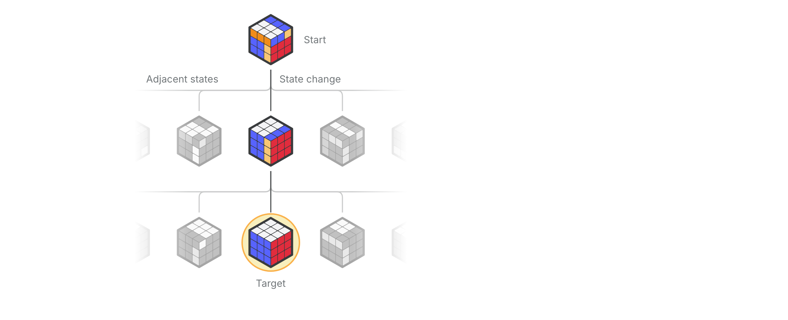
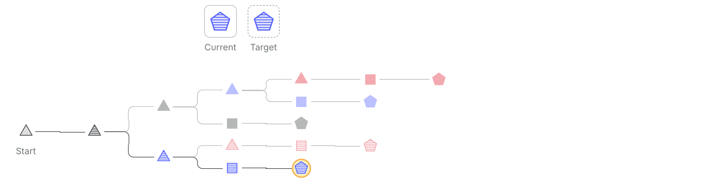
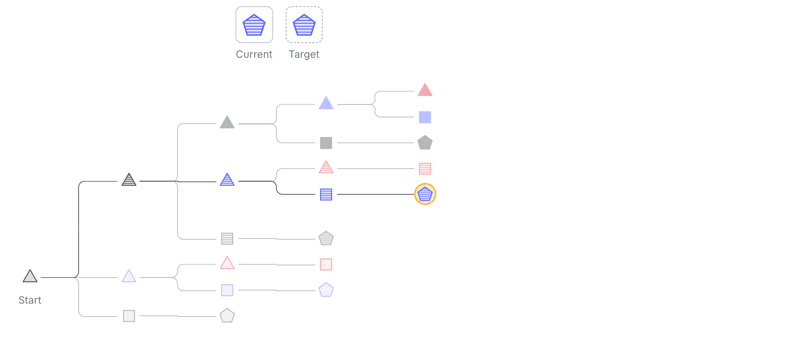
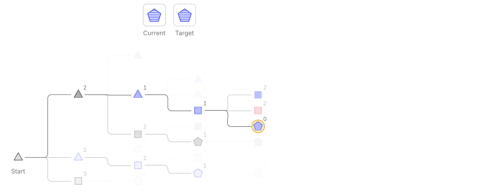
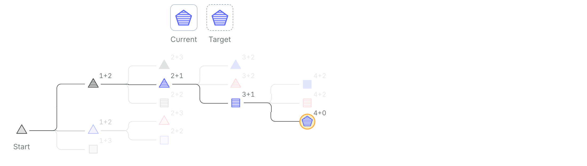

# 设计是一个搜索问题

> 原文：Matt Ström-Awn，《Design is a search problem》，mattstromawn.com，2026-11-11 发布。
>
> 本文为全文翻译，未做删节。分节标题、配图、术语表与脚注均对应原文；原文 4 处可播放的搜索树动画已逐帧推进到终态、以静态图片呈现。

*2026 年 11 月 11 日*

十年前，我在一家设计公司上班，最怕听到一句话："这个挺好看的，能不能再看几个别的方案？"我不是那种"来几个方案"的人。我把自己想象成 Paul Rand——乔布斯找他要多个方案时，他是这么回绝的："不。我会替你解决问题，然后你付我钱。你不一定要用这个方案。想要方案，去找别人。"[1] 可我没胆子这么回绝客户，于是乖乖地又设计了几个别的方案。[2]

最近，我得以和这个领域里最好的一些设计师共事。看他们的数字工作区——Figma、Paper、Claude Design，或者别的什么——我能看到成百上千个画板和变体，铺成一张漫无边际的网格，代表设计方向上一个个分叉的平行宇宙。有时还能看到一些小面板，上面排满了旋钮，可以一路扫过各种可能性，让一个人看到上千种组合，只为了挑出一个完美样本。方案，多得不能再多。

这让我觉得自己像个外星人。我的文件里只有几个画板；当然，我会反复打磨里面的细节，但打磨的时候我很少把整个多元宇宙摆在眼前。我也会给自己画一两个旋钮，但通常只针对某个我没法轻易在脑子里想象的变量。我是不是就是个很差劲的设计师？

假设（并希望）答案是否定的，我想重新捡起一条我时不时会拽一拽的线索：作为设计师，我们做的都只是在一片浩瀚的可能性宇宙里找出那个正确的解。这个解是存在的，而且我们通常一眼就能认出来。所以我们称之为"设计"的绝大部分事情，不过是在漆黑的房间里摸索一只黑猫。不同的设计师有不同的摸法。有人随着生成式 AI 的出现改变了摸法，但说到底，设计是一个搜索问题。

计算机科学在搜索问题上已经研究了几十年。根据具体搜索问题的特点，有各种各样的算法和策略，能带来更快、更直接、或者计算上更高效的求解路径。我们可以把我最喜欢的几位科学家（说的就是你，Claude Shannon）在这方面的丰富研究成果，用到设计过程上，来打磨我们自己的手艺。

"搜索"在计算机科学里有自己的一套正式词汇。我在文末放了一份术语表；需要的时候，我会用[带下划线的词]链到定义上去。

要想象[搜索](#search)是怎么运作的，可以想想魔方。一个打乱的魔方就是起始[状态](#state)；你每转一次就是一次[状态变化](#state-change)，通向一个[相邻](#adjacent)状态。六个面上所有可能的颜色组合（标准的 3×3 魔方有 4300 亿亿种）构成了[搜索空间](#search-space)。搜索的过程，就是评估从魔方当前状态出发能够到达的那些[候选](#candidate)；我们想要的状态，是每一面都是纯色的那个复原魔方。

*图 1：魔方的每一种可能的版本都是一个状态，每转一次就是一次状态变化，通向一个相邻状态。*

现在，来看几种基础搜索算法，以及它们怎么用在设计上。

## 深度优先搜索

就搜索算法而言，[深度优先搜索](https://en.wikipedia.org/wiki/Depth-first_search)（depth-first search，DFS）简单到不能再简单。它是这么做的：

1. 从当前状态出发，寻找我们还没访问过的相邻状态。
2. 如果找到一个，就移过去。是哪一个无所谓。
3. 如果一个都没有，回到上一个状态，从第 1 步重新开始。
4. 重复，直到抵达目标，或者再没有状态可去。

*图 2：深度优先搜索认准它找到的第一个变化就一路走到底，撞墙了才回头。评估了 16 个解。*

从设计的角度说，这就像走树篱迷宫：每个岔口随便挑一个方向，一直走到死胡同为止。作为设计流程它不怎么样，但用来入门前述这些概念挺好。

## 广度优先搜索

[广度优先搜索](https://en.wikipedia.org/wiki/Breadth-first_search)（breadth-first search，BFS）只复杂一点点，并且开始更像设计过程了。

1. 从起始状态出发，访问每一个相邻状态。
2. 从这些状态出发，访问每一个我们还没访问过的相邻状态。
3. 继续下去，每一轮都离起点更远一步。
4. 重复，直到抵达目标，或者再没有状态可去。

*图 3：广度优先搜索先试遍每一个单独的变化，再试每一对变化，如此类推。评估了 21 个解。*

DFS 和 BFS 都是朴素算法：搜索过程中我们不会主动评估候选。它们适用于搜索空间小、和/或评估成本低的问题。

但最有意思的搜索问题，很多既不小也不便宜。以国际象棋为例：赢棋就是一个搜索问题。但它的搜索空间大得难以想象，[3] 这也是为什么直到 2000 年代中期，计算机才能可靠地战胜特级大师。

我做过的大多数产品设计问题，看起来都更像国际象棋，而不是魔方。设计涉及的搜索空间有几百个维度——尺寸、间距、层级、颜色、动效、交互、响应式等等。而评估相对昂贵：除了改个按钮或换个颜色，我们往往得先把东西发出去，才真正知道它行不行。

处理这类问题还有另外一些算法，而且它们越复杂，就越像是设计的过程。

## 束搜索

[束搜索](https://en.wikipedia.org/wiki/Beam_search)（beam search）是我们第一个要看的、会在移动之前真正评估候选的算法。

1. 从起始状态出发，给每一个相邻状态打分。
2. 留下最好的三个，其余丢掉。
3. 给我们留下的那三个各自的相邻状态打分，同样只留最好的三个。
4. 重复，直到留下的某个状态就是目标，或者再没有状态可去。

*图 4：束搜索按"还有多少个参数看着不对"给每个选项打分，每轮只保留最好的三个。评估了 21 个解。*

它叫"束搜索"，是因为这就像用手电筒的一束光照向新的状态；上图的"束宽"是 3。束搜索就是我当年在 agency 里做活时最常用的那种"给我看几个方案"的做法。它的局限就在束宽上：束越窄越快越便宜，但可能在某一步错过最好的解。

这里正是引入[启发式](#heuristic)（heuristic）这个概念的重要时刻。大多数情况下，在真正找到之前，我们并不*知道*自己手上的是不是理想候选。既然这个事实绕不过去，我们就得挑一个测试，来把好候选和坏候选分开。启发式通常意味着取舍：它可以又快又便宜但容易出错，也可以又慢又贵但准确。

问题在这儿：束搜索经常找不到最优解！它完全取决于你的束宽和启发式的质量。比如，想要的那个状态藏在一个得分很低的上游分支后面，算法可能永远都找不到它。把束宽设成无穷大可以解决这个问题，但那就退回成一个稍微花哨点的 BFS 了，又慢又低效。

当我搞明白束搜索的缺陷——仅仅检查几个选项挑出最好的那个，可能并不会通向最优解——我对那些"多给我几个方案"的客户的那点情绪，算是被证明了。

可设计师们还在用手电筒，因为 AI 给了我们一支更好的手电筒：给一个 SaaS 网站做几个方案，以前要一周，现在只要几秒。光束变得如此之宽，以至于"给我 10 个方案"感觉像是让 AI 走向最佳设计的一条有效路径。

但这仍然不是我的设计方式。再次假设我并不是注定待在设计圈的最底层，我想也许还有另一个算法，可以解释为什么我倾向于探索如此之少的分支。

## A\*

[A\*](https://en.wikipedia.org/wiki/A*_search_algorithm)（A-star）是大多数寻路背后的算法，从地图 App 到电子游戏里的角色都是。

1. 从起始状态出发，给每一个相邻状态打分，分数由两部分组成：
  - 从起点走到它花了多少次变化，加上
  - 启发式：我们估计还要多少次变化才能到达目标。
2. 把它们全都放进一张"接下来可能访问的状态"清单里。
3. 移动到清单上分数*最低*的那个状态。它未必与当前状态相邻！给这个新状态的相邻状态打分，并加入清单。
4. 重复，直到抵达目标。

*图 5：A\* 给每种可能性的打分是"已经做了多少次变化 + 估计还差多少次变化"。中途它会回头重新考虑之前的候选。评估了 14 个解。*

这和束搜索很像，但有几个转折：

1. A\* 的启发式里包含了*到目标的[距离](#distance)*这个概念。
2. A\* 并不总是从相邻状态平滑地走到相邻状态。

最后这点很关键：和束搜索不同，A\* 可以往回走。如果当前这条路离目标越来越远，它的分数就会往上爬。最后总会有先前的某个候选看起来更好，于是我们就回到它那儿。

更重要的是，A\* 探索得多不多，几乎完全取决于我们启发式的质量。如果估计得完美，A\* 会直奔解而去。

A\* 很贴合我的设计方式。我在探索上更有章法，只会顺着一个思路走，直到感觉它正在偏离那个解。我通常只在旧探索还有希望时才把它留着；把每一种可能的变体都详尽记录下来，会让我很有压力。

整篇文章我都没提它，但在我的 A\* 式做法里，品味[4] 确实是有用的；虽然有很多设计师品味比我好，但我有的那点品味是多年设计里硬挣来的，我可以用它嗅出通往最优解最快的那条路。

## 结语

AI 给了我们一条更宽的束，但还没有给我们一个更好的启发式。我们仍然是在为人做设计，所以我们在机器人面前仍然有一手：我们可以用共情，甚至用自己的偏见和人类的局限，去摸出那个对的解。

与此同时，理解设计过程一如既往地重要。这种自我审视——因为对自己的短板感到绝望而去研究搜索算法——给我的工具箱里添了几件工具。这些算法有许多变体，也许能描述你自己的搜索过程；还有一些更古怪的变体，或许值得一试。

把设计称为搜索问题，可能显得太简化了。创造力去哪儿了？但带着人性、谦逊和好奇，用一个调校得当的算法去追求最优解，能帮我们设计得更快、更高效。

*特别感谢 [Josh Petersel](https://joshpetersel.com) 对本文草稿的反馈。*

## 术语表

- **相邻（adjacent）**：两个状态之间只隔一次状态变化，就是相邻。
- **候选（candidate）**：我们正在考虑的一个状态。
- **距离（distance）**：把一个状态变成另一个状态所需的变化次数。通常我们把距离定义为从一个状态到另一个状态所需的*最少*变化次数。
- **启发式（heuristic）**：一个我们认为能把好候选和坏候选分开的测试。之所以要用它，是因为通常只有真找到了，我们才知道自己手上的就是理想候选。启发式意味着取舍：它可以又快又便宜但容易出错，也可以又慢又贵但准确。
- **搜索（search）**：通过评估一组候选，抵达某个期望状态（在一组固定标准上得分良好）的过程。
- **搜索空间（search space）**：所有可能状态的集合。我们叫它"空间"，是因为其中常常有可以搜索的"维度"，比如一个形状的宽和高，我们可以类比物理空间的维度。有时这些维度是字面意义上的，比如导航 App 在 A 点和 B 点之间选最佳路线。
- **状态（state）**：从搜索开始到结束的移动过程中的一个可能落点。我们从"初始状态"开始；评估候选的过程中我们可能改变"当前状态"；过程的终点是"最终状态"（它未必是"期望状态"）。
- **状态变化（state change）**：也叫变异（mutation）。系统在两个状态之间移动的方式。

## 脚注与参考

1. 据 Steve Jobs 在[《Steve Jobs 谈与 Paul Rand 共事》](https://www.paulrand.design/life/videos/1993-steve-jobs.html)中的讲述，1993 年。
2. 客户几乎总是选了最初那一版（或者至少是那句经典的"把 A 做一版，再加点 B 和 C"）。
3. Claude Shannon 估计是 10¹²⁰。作为对照，可观测宇宙里大约有 10⁸⁰ 个原子。
4.  说那句台词啊，Bart！

---

**参考来源**

- 原文：[Design is a search problem](https://mattstromawn.com/writing/design-is-a-search-problem/)，作者 Matt Ström-Awn，mattstromawn.com，2026-11-11。
- 配图：图 1 取自原文内联 SVG（另存为矢量件）；图 2–5 为原文可播放的搜索树动画，已逐帧推进到终态后截为静态图（淡出的节点表示未被访问的候选，节点旁数字是算法给的分值）；图 6 为原文脚注 4 的 GIF。

**术语对照**

| 英文 | 中文 | 说明 |
| --- | --- | --- |
| search | 搜索 | 通过评估候选抵达期望状态的过程 |
| state | 状态 | 搜索过程中的一个可能落点 |
| state change | 状态变化 | 也叫 mutation，状态之间的移动方式 |
| adjacent | 相邻 | 只隔一次状态变化 |
| search space | 搜索空间 | 所有可能状态的集合 |
| candidate | 候选 | 正在考虑的状态 |
| heuristic | 启发式 | 用来分辨好/坏候选的测试或估分，暗含取舍 |
| distance | 距离 | 状态之间的最少变化次数 |
| depth-first search (DFS) | 深度优先搜索 | 一条路走到底再回头 |
| breadth-first search (BFS) | 广度优先搜索 | 一层一层向外铺开 |
| beam search | 束搜索 | 每层只保留分数最好的若干候选，宽度即"束宽" |
| A\* (A-star) | A\* 搜索 | 已走步数 + 剩余距离估计，能回头捡回旧候选 |
| beam width | 束宽 | 束搜索每轮保留的候选数 |
| taste | 品味 | 作者用来判断"是否已接近解"的内隐启发式 |
