# 所有代码都是 slop，除了我的：如何用 agent 写代码？

> 原文：kaize（[@0x_kaize](https://x.com/0x_kaize)），《All code is slop, except mine. How to Write Code With Agents?》，X 长文，2026-11-14 发布。
>
> 本文为全文翻译，未做删节。分节标题、加粗、列表、引用与配图均对应原文；文中 23 张配图为 Lauren Tan 演讲幻灯片截图，图注沿用原文（原文未提供描述性图注）。原文中「她在副项目里还用了同样的办法，任何名为 tick(.)hot.ts 的文件……」一段重复出现两次，译文按原位置同样保留两次。

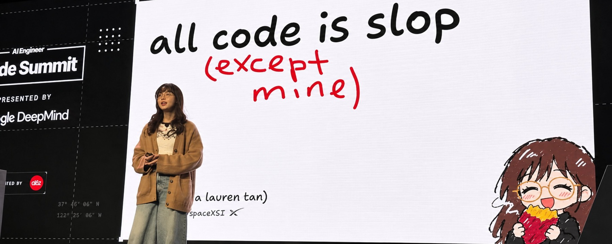

Lauren Tan，X 上的 @poteto，向生产环境提交了 3,000 多个 pull request，而她整个团队在过去一个月里提交了大约 11,000 个。

不寻常的地方不是 PR 数量本身的增长，而是被拒绝的 PR 数量反而下降了。

**事情的经过是这样的：**几天前，在旧金山 AI Engineer Code Summit 的台上，她详细讲了她和团队究竟是怎么做到的，

**并把这场演讲命名为《所有代码都是 slop，除了我的》。**

下面是这场分享的完整拆解，也是一份**用 agent 正确写代码**的实操指南。

另外，我会把其中我认为最重要的几件事标上 [RULE]，请务必记住。

建议先收藏，因为你一定会回来翻：

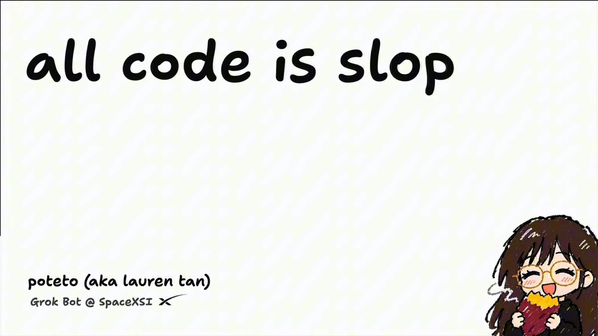

## 每个人的代码都是 slop

Lauren 用了一个几乎所有开发者都会心一笑的段子开场。

我们自己写代码时，叫它「手艺」；别人做一模一样的事，我们叫它「SLOP」（随手堆出来的烂代码）。

她的观点是：「slop」根本算不上一个定义。它只是我们用来指代「不是自己写的、也没完全看懂的代码」的一个词，但很多人给它附加了一个并不正确、而且各不相同的含义。

在 agent 出现之前很久，人类的代码库里就一直是满满的 slop 代码。所以真正的问题不是 AI 写的代码算不算「slop」。

真正的问题是：你有没有建起一套系统，把那堆代码变成你真正可以信任的东西。

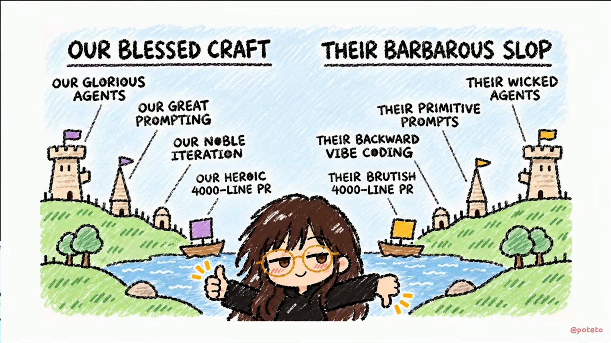

## 演讲背后的数字

为了证明这不是纸上谈兵，Lauren 在屏幕上放出了自己的数据。三月，她发了 68 个 PR（pull request）。

七月：1,113 个 PR
八月：2,401 个 PR
十月：3,127 个 PR

合计：10,732 个 PR（从三月算起）。

**算一下就知道：**

3,000 PR/月 = 100 PR/天
没有任何一个人能靠人力做到这个量

**但最有意思的部分，是她怎么做到的：**

她并不是简单地开始加班、开更多 agent。她花了大约半年时间，在他们的工作方式之上建了一套系统，正是这套系统让她能以这么高的速度发 PR 而不牺牲质量。

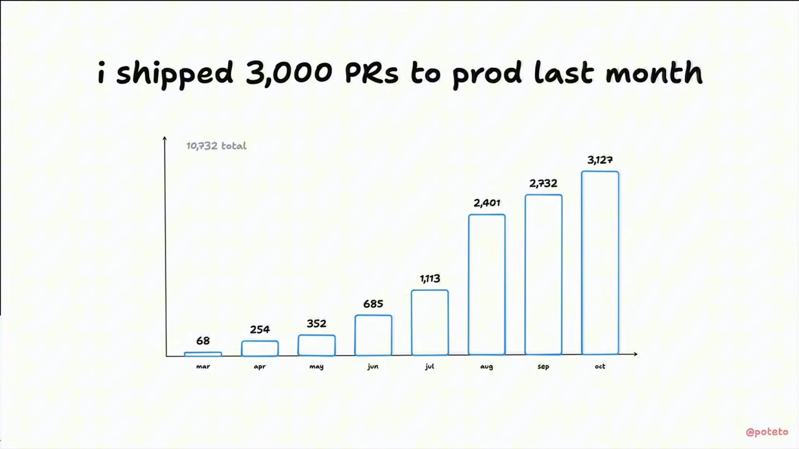

**这就带出这场演讲的核心观点：**

在 agent 出现之前，只有极少数出色的工程师能产出这种规模的产品，他们被叫作「编程机器」。现在，任何人都可以成为那样的人。

如今的关键技能不是打字更快，而是把产品快速推向市场而不牺牲质量。

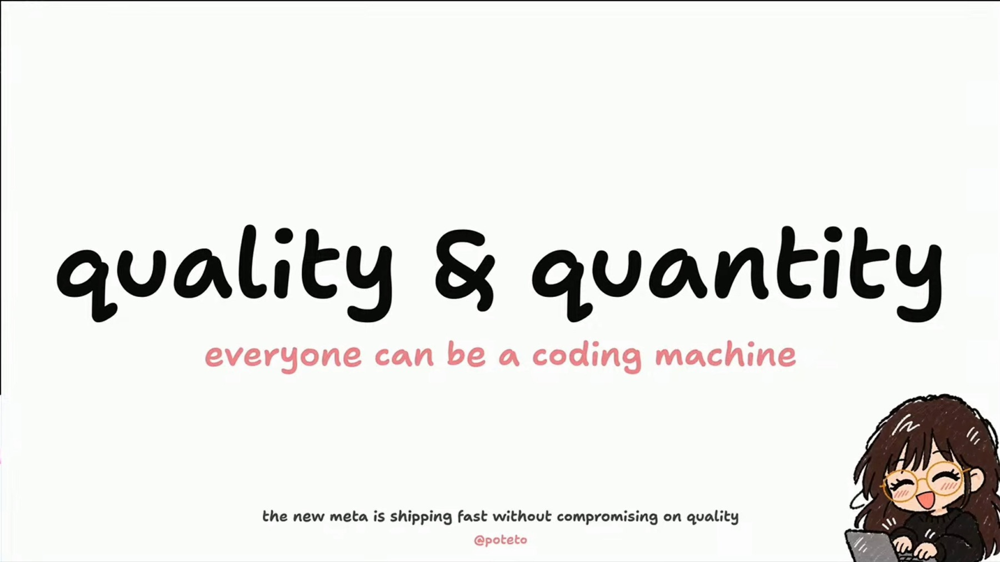

## 归根到底是一个「信任」

按 Lauren 的说法，这一切都归结到一条曲线。

**你越信任你的 agent，你就能同时跑越多：**

> 信任水平低，就跑一个 agent，盯着它。
> 信任水平高，就跑几百、几千个 agent。

但你只有信任它们、有把握到不需要读每一行代码的时候，才能跑起这么大的数量。

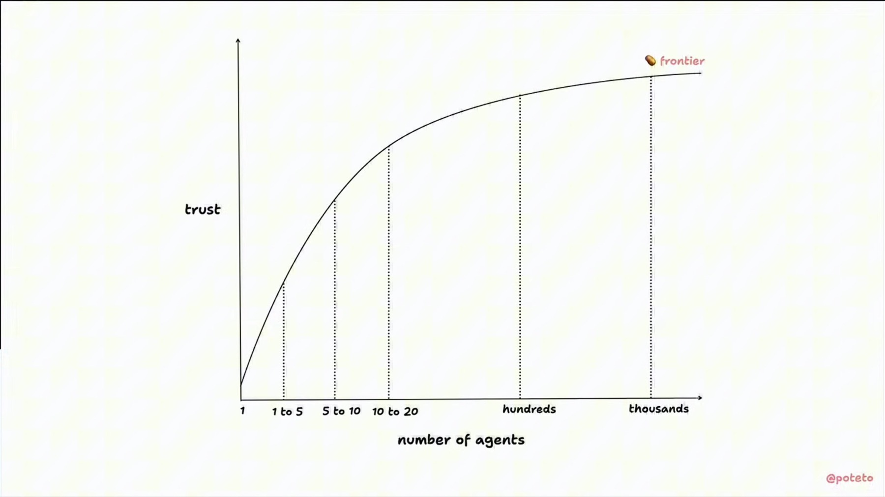

**问题是，大多数人卡在这条曲线的底部：**

agent 写出 SLOP 代码，人来看，找出错误，打回去，循环无限重复。

在这个循环里，人永远是那个「瓶颈」。

而主要目标，是换到一个不同的循环：agent 写出高质量的代码并自己检查，你只在真正需要你的判断时才介入。

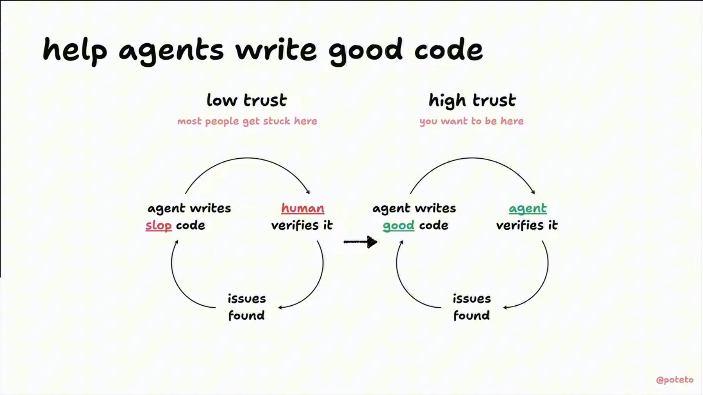

## Poteto 金字塔

那么，怎么从一层走到下一层？

**Lauren 用一个倒金字塔来解释：**

1）最上面是代码库本身：设计良好的 API、干净的架构、以及定期重构。
2）静态分析：lint 规则、类型、编译器、测试和 CI。
3）验证：形式化验证，以及运行时的验证。
4）文档：规则、最佳实践，以及 AGENTS.md 文件。
5）人工评审。

**道理很简单：**

越靠上的那一层，越值得投入精力；越往下走，每修一次错就越贵。

大多数人做的恰好相反。他们不断把 AGENTS.md 写得更长，所有东西都靠人工检查——这是用最贵的方式，换来最低的确定性。

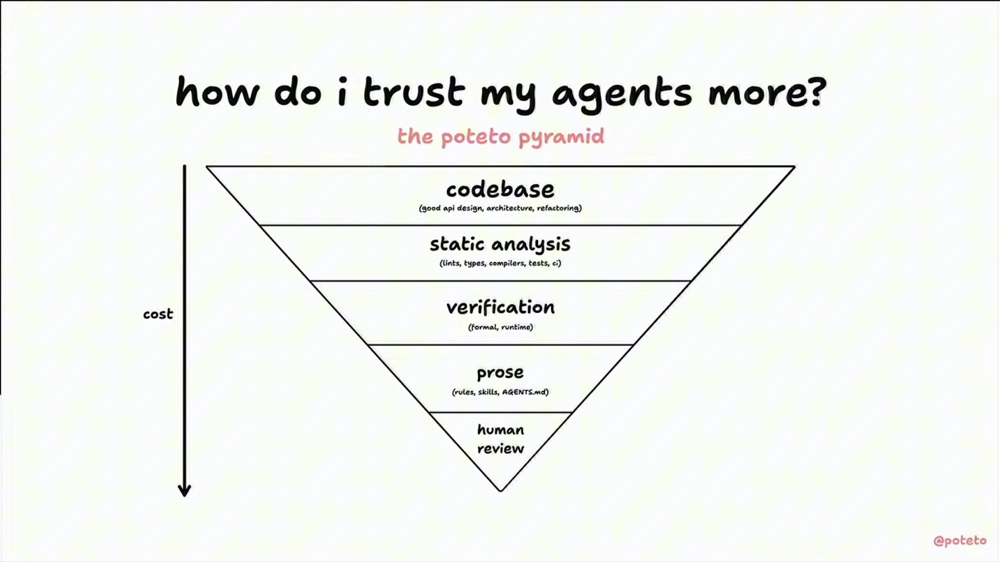

## 代码就是记忆

正是这个想法，会彻底改变你对整个项目的看法。

agent 从你的代码里学到的，比从你给它的一切其他东西里学到的都多。每一处绕路、每一个「先这么糊一下」、每一笔技术债，都会悄悄变成下一个 agent 抄走的模板。

**RULE 1：你的代码就是 agent 的记忆。**

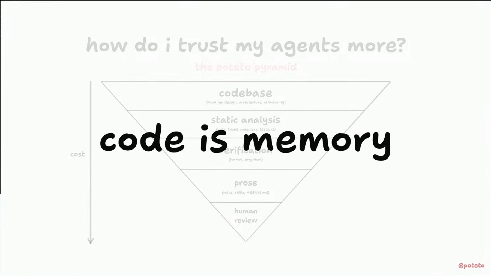

**Lauren 把代码库比作一座花园：**

代码不再以几个整齐的 pull request 的形式到来，而是像水流一样持续灌进来。

2024 年那会儿，她大概一天评审三个 PR；而现在这个数字正在接近三百。

在一座以这种速度生长的花园里，你今天放过的一株杂草，到下个月就会长得到处都是。所以保持代码库干净，比以往任何时候都更重要——这样 agent 才始终有好的范例可学。

**RULE 2：你还是应该隔一段时间亲自读一读代码。**

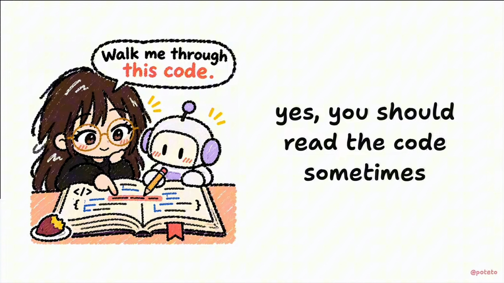

## Dune：一个为 agent 而建的框架

为了让上面这一切落地，团队做了 **Dune**——Grok Bot 就跑在它上面，你可以把它理解成「给 Electron 应用用的 Next.js」。

这个框架本身没有任何魔法，它的特别之处在于内建的约束：

一个功能一个文件夹；严格限制什么能 import、能 import 到哪里；以及代码里完全没有注释。

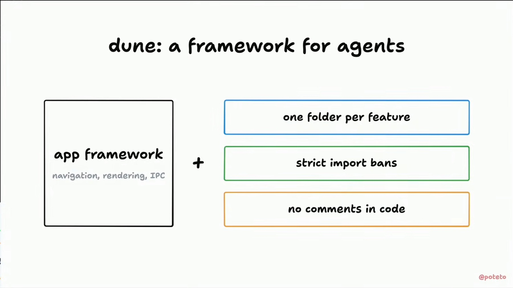

我们可以从这些约束里学到一课：微妙之处往往导致疏忽。

任何「要用对就得小心判断」的东西，早晚会被 agent 用错。

Lauren 最喜欢的例子是 React 里的 **useEffect**。

**它很有用，但太容易被误用，以至于大家开玩笑说：**

「你得有博士学位才能把它用对，而开发者还是一直出错。」

于是团队干脆在产品代码里禁用了它，只留给 Dune 的内部机制使用。

一整类错误就此消失，代码评审里也没人需要再去专门找了。

他们没有去给开发者解释那些微妙之处，而是造了一个「那些微妙之处根本不存在」的 API。

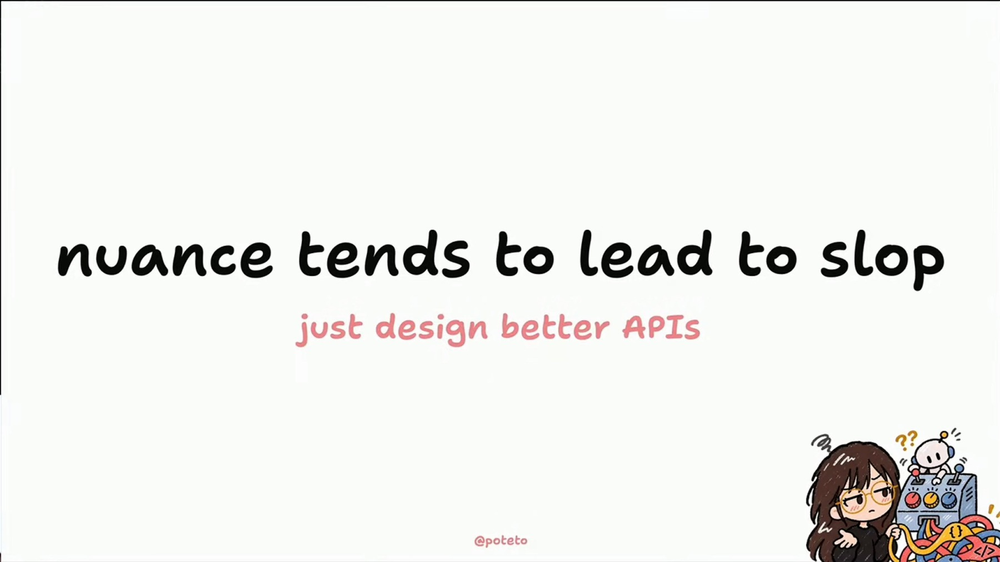

文件夹也是一样。在 Cursor 这个项目里，团队反复撞上同一个低效做法：

agent 把主 Electron 进程里的代码 import 进了渲染进程，导致长任务执行时间过长、界面卡顿。

在 Grok Bot 里，文件夹结构本身就在告诉 agent 它被允许做什么。渲染进程和主进程放在彼此完全无法互相 import 的文件夹里，连类型都不行；两者之间唯一的桥，是一个共享公共类型的文件夹。

Lauren 在副项目里也用了同样的办法：任何名为 tick(.)hot.ts 的文件，每一次 tick 都会执行，因此不允许分配内存。

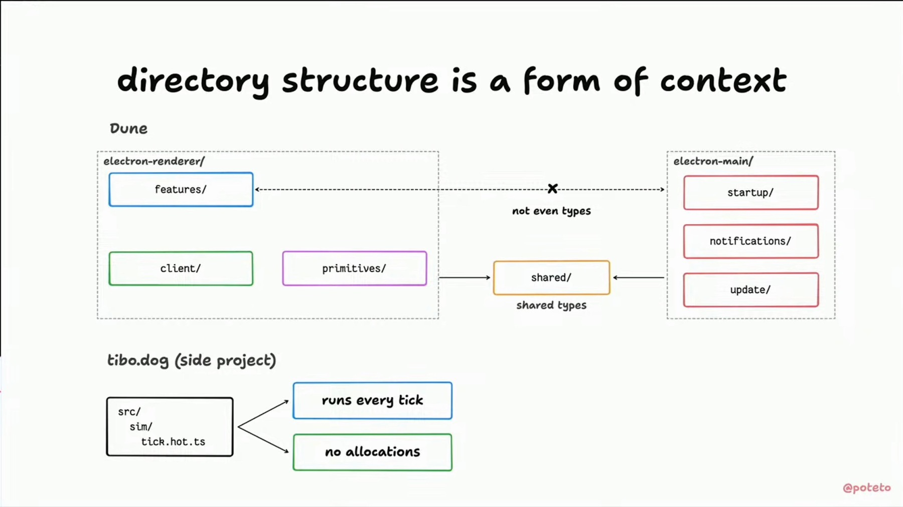

## 当 agent 开始找借口

最让 Lauren 意外的，是 agent 使用 Markdown 的方式。它们把帮助文件、注释和笔记当成一个「解释自己为什么没按该有的方式做事」的地方。或者恰好相反：你给了它一条小小的指令，它把它当成一条永远不能再被打破的铁律。

Lauren 在副项目里也用了同样的办法：任何名为 tick(.)hot.ts 的文件，每一次 tick 都会执行，因此不允许分配内存。

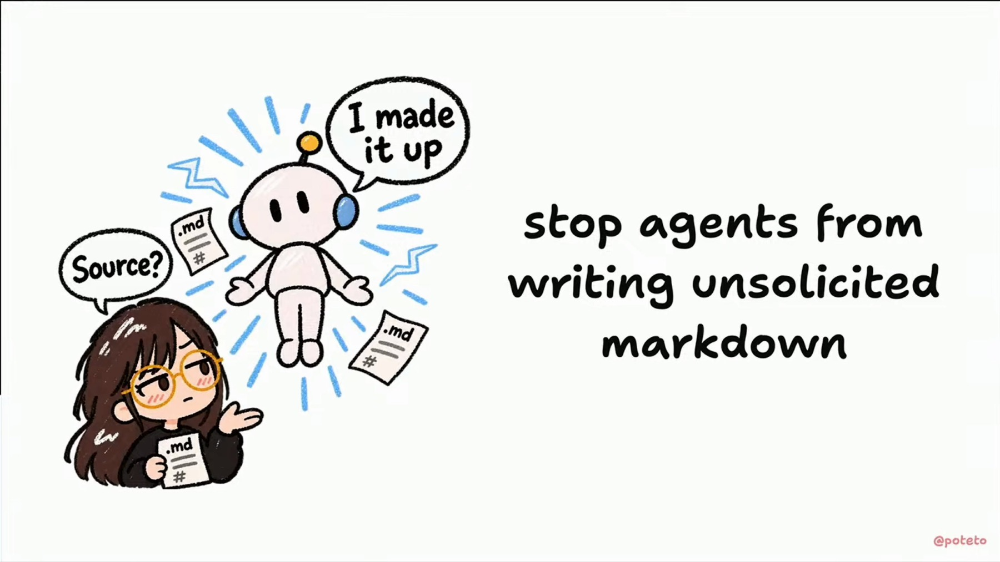

**如果不做这件事，会变成什么样：**

9 月 9 日，一位开发者用一个临时加的 setTimeout 调用修掉了界面上的一处闪烁，并留下一条注释，说明「正确的修法需要更大的改动」。

10 月 3 日，同一个绕路写法被抄进了一个共享模块。

到 10 月 17 日，应用里已经有 183 个定时器。

以如此快的节奏被创建和销毁的定时器，会迫使系统频繁做垃圾回收，表现出来就是卡顿和掉帧。

一次 SLOP FIX，靠一条注释获得了合法性，在大约五个星期里蔓延到了整个应用。

**RULE 3：不要让 agent 在 Markdown 里写那些没人要求它写的东西。**

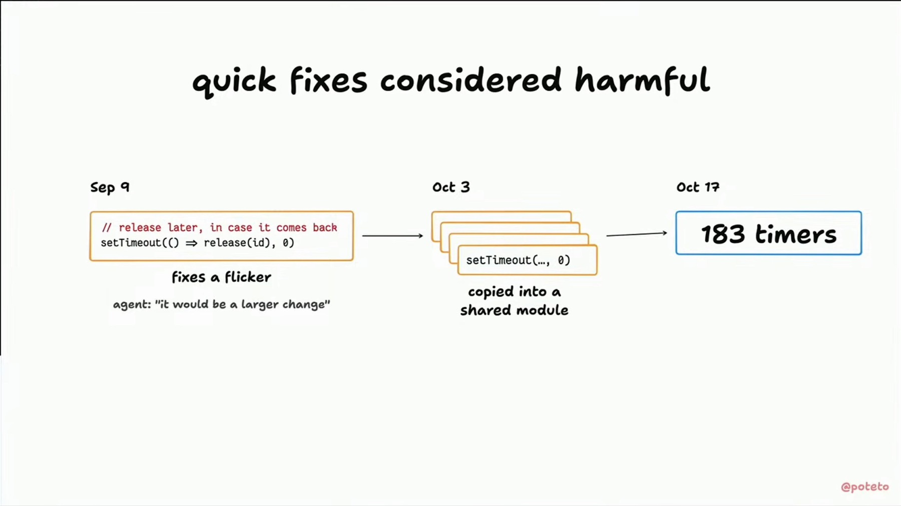

这正是 Grok Bot 团队把几乎全部注释都删掉的原因。

注释会过期，很少有人读，而开发者拿它来为糟糕的代码找理由。

最糟的是，注释规范根本没法强制执行。

7 月 31 日，代码库里有 65,824 条注释；今天还有 1,227 条。

如果你想做同样的事，Lauren 的 pstack 插件里有一个专门为此设计的 /no-comments 命令：[github](https://github.com/cursor/plugins/blob/main/pstack/skills/no-comments/SKILL.md)

**RULE 4：用 agent 写代码时，永远不写注释。**

这不适用于你自己亲手写的代码，也不适用于学习过程。另外，如果你在一个团队里工作，你很可能**不得不**写注释，因为这已经是长期以来的标准做法。

但随着时间推移，我们大概会慢慢离开这个既定惯例，再也不写注释。

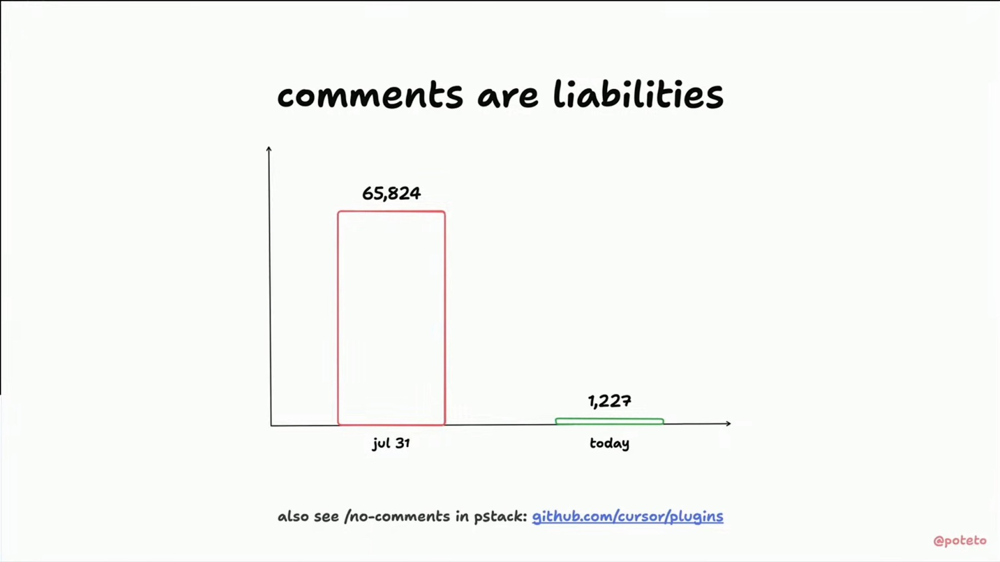

## 一条改变一切的规则

这场演讲里，最重要的那条收获，是下面这一条：

**重要规则：每当你修一次 agent 的代码，都不要往规则文件里再加一行。**

把那次修复变成一条 lint 规则，或者重构代码，让这个错误从此不可能再发生。她团队里的自定义 lint 规则数量从七月的 7 条，增长到十一月的 167 条，而每一条都代表着一类「以后再也不需要人工去发现」的错误。

这样做得足够多，你会注意到需要检查的东西越来越少。到某个点你会发现，几乎没什么可检查的了——而那时，agent 就能开始自己提交它的大部分工作了。

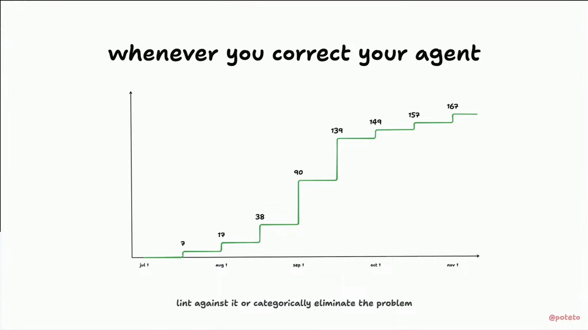

## 验证是最重要的一步

第二个重要的经验，关于代码评审。

在 Grok Bot 团队，代码评审现在主要是分析辅助材料：视频、截图、示意图，以及形式化证明。

但它肯定不包括把每一行代码都从头读一遍这件事。

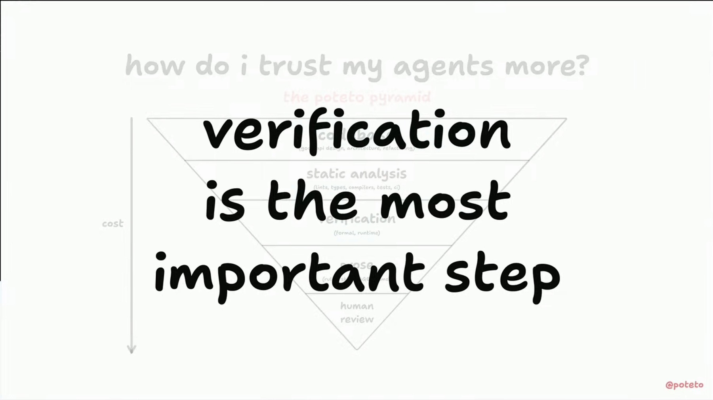

为了说明这为什么重要，Lauren 引用了 Cindy Sridhar（@copyconstruct）相隔六个月的两条帖子。

五月时，Cindy 很沮丧，因为她的团队合并了几个 AI 生成的 PR，里面藏着不易察觉的错误，修它们花了好几天的人工评审。

她的结论是：如果把后续返工的时间都算上，「速度」其实并没有提升。

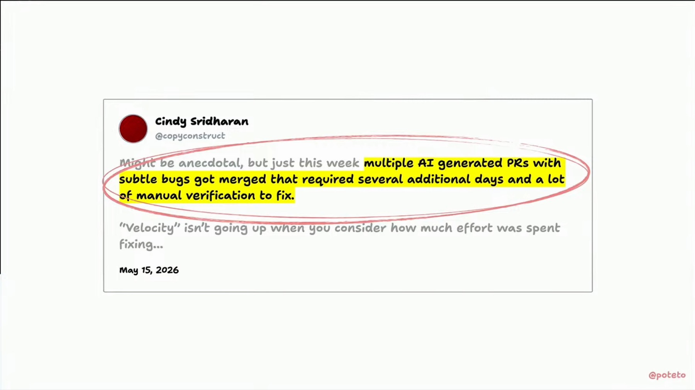

到了十一月，她又回到同一个话题，指出自己已经不再面对这些问题。

只有一件事变了：她建立了一套像样的验证流程。

她现在每天大约 70% 的 token 花在验证补丁上，只有 20%–30% 用于写补丁。

Lauren 说，这和她自己的体验完全吻合。

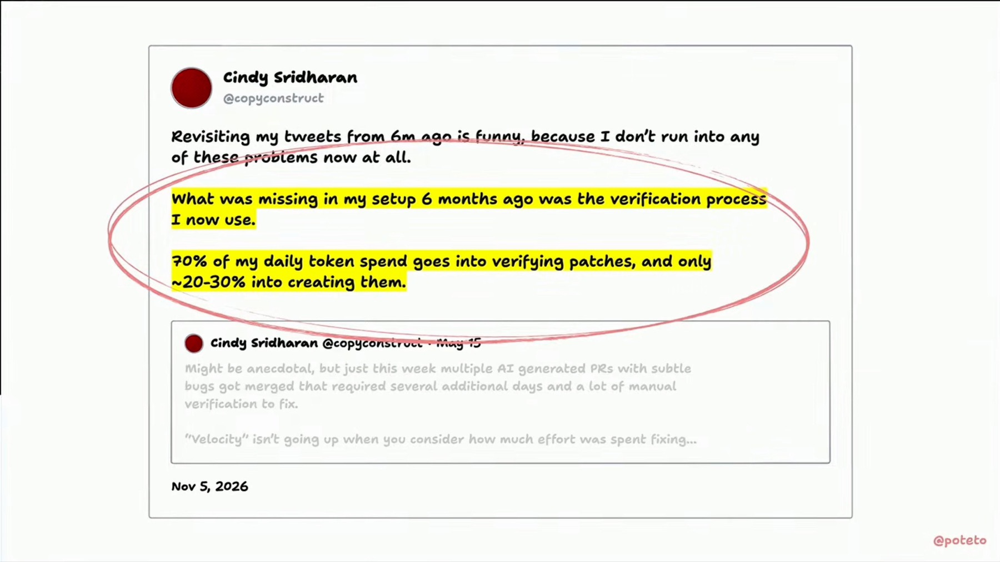

Cindy 所说的「验证」，是一整套覆盖所有阶段的方法：从单元测试、发布前的 fuzz 测试，到「金丝雀」部署和发布后的监控。

有意思的是，这里面没有一样是新东西。

清单上的每一项都是经典的软件开发方法，只不过以前要实施和维护它们，成本和人工都太高。

agent 让这些方法变得可负担，这正是 Lauren 认为我们正在进入测试的「黄金时代」的原因。

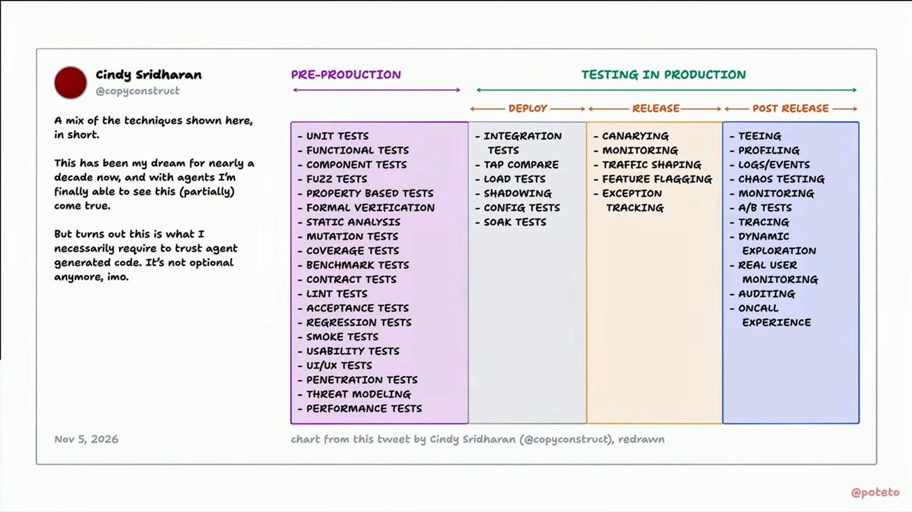

## 让 agent 自己检查自己的工作

在 Grok Bot 团队，测试从执行阶段就开始了：agent 必须能启动真实的应用，并验证自己工作的结果。

这件事之所以可行，靠的是两个组件：

**1）Function Map（功能地图）**

它描述有哪些功能、用户怎么访问它们、以及用什么确认每一个功能是正常的。

**2）命令行工具**

它控制正在运行的应用：按名字点击按钮、截图、并保存为证据。

由于这些工具是可复用的，它们同时也省 token——agent 不用每次重新造一遍。

在 **pstack** 里，有一个 **/create-verification-skill** 命令来配置这套流程。

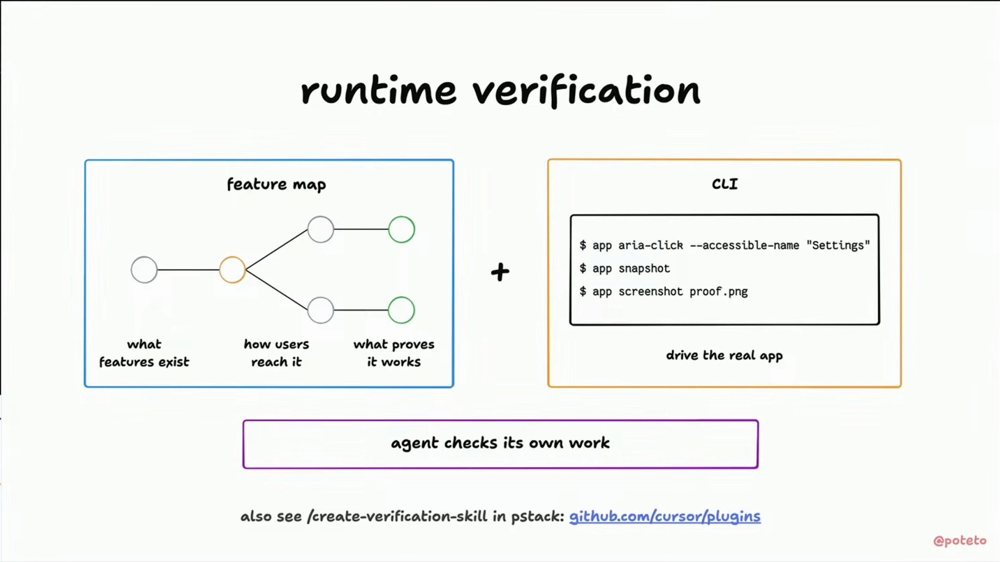

**此外，团队还在试验形式化验证：**

> 他们用 TLA+ 给状态机建模，比如通知在多台设备之间同步，并验证所有可能的状态都被处理了。

> 他们用 Lean 从代码生成证明，比如确保他们自己的虚拟化库不会引起闪烁或抖动。

Lauren 很小心地避免把这个叫作「万灵药」，因为它只是又一层保障，但它确实已经帮他们抓到过真实的 bug。

**pstack** 里也包含 **/create-formal-verification-skill** 命令。

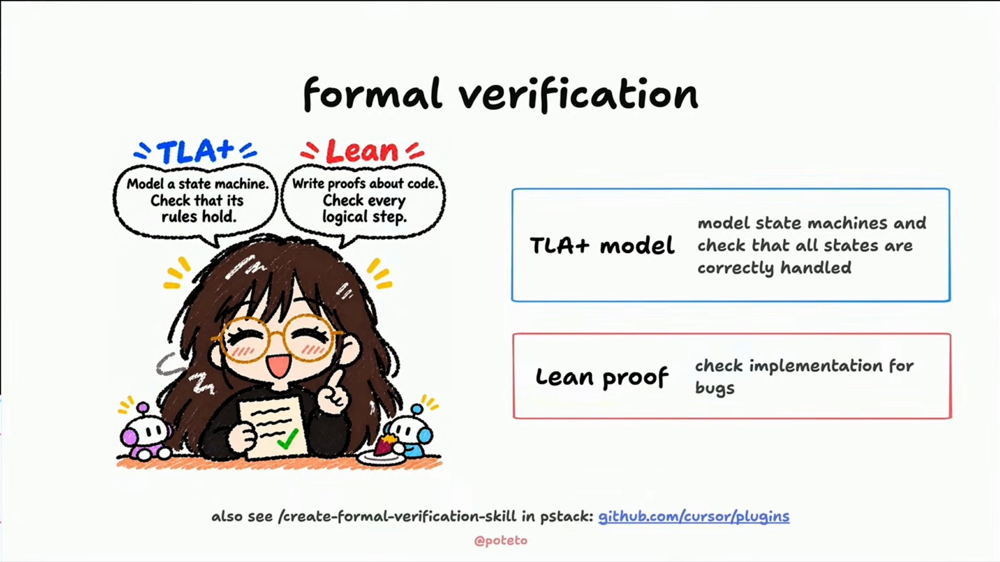

最后一步，是用 Bombadil 这个库基于属性来测试界面本身：它用随机输入数据对应用施加高压负载，找出潜在的失效。

**链接：**github.com/antithesishq/bombadil。

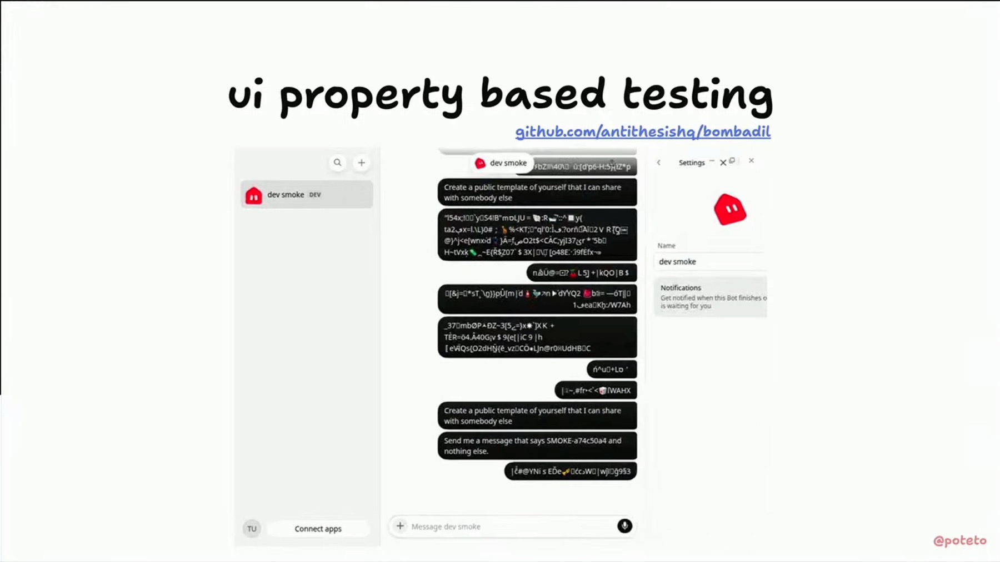

## 这一切加起来意味着什么

那么，这些努力给 Grok Bot 团队带来了什么？

上个月，他们向生产环境推了大约 11,000 个 PR，现在大约每天发布一个新的稳定版本。

仅十月一个月，就有 227 个人提交了至少一个 PR。

只有约 0.5% 的 PR 被拒绝，而应用确实随着时间变快了：启动、文本输入、打开和切换会话，全都比项目刚上线时更快。

每次团队发布新版本，Grok Bot 都会自动跑一遍 Cursor 这个项目——它像真人一样使用应用、找 bug、给每个 bug 开一个修复、然后自己把修复提交上去。

这一切能成立，只是因为代码库现在足够好，以至于大多数 pull request 默认就是高质量的。

## 这对你意味着什么

**记住这几条规则：**

RULE 1：你的代码就是 agent 的记忆。
RULE 2：你还是应该隔一段时间亲自读一读代码。
RULE 3：不要让 agent 在 Markdown 里写那些没人要求它写的东西。
RULE 4：用 agent 写代码时，永远不写注释。

重要规则：每当你修一次 agent 的代码，都不要往规则文件里再加一行。

**Lauren 的最后总结：**

如果你的 agent 循环产出的是「垃圾」，把它自动化并不能解决任何问题，只会产出更多「垃圾」，而且额外浪费资源。

在你开始搭自己的「软件工厂」之前，先把地基打牢：把每一次调整都变成一次检查，而不是一条规则；禁掉那些太容易被滥用的东西；让你的文件夹结构本身传递上下文；扔掉注释；让你的 agent 证明自己工作的有效性。

她花了六个月走到这一步，她保证你花的时间会少得多。

P.S. 我一直在写这类关于 AI 与 agent 的拆解。

想在下一条信息流里看到下一篇，就关注 @0x_kaize。
