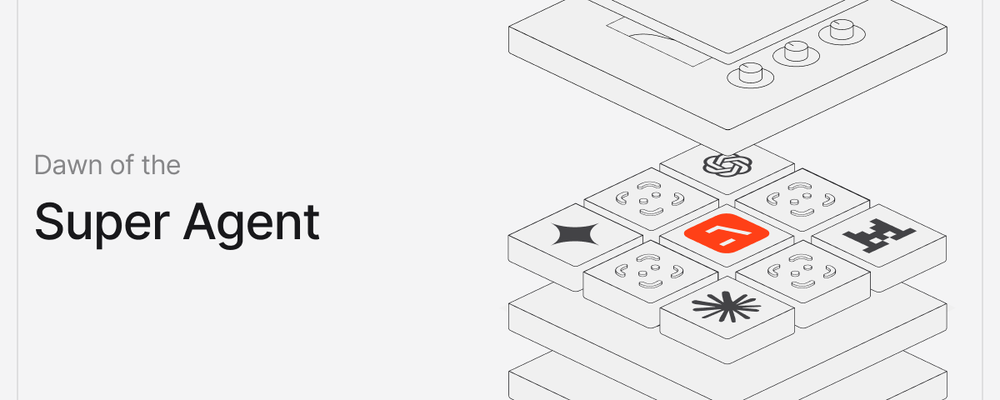

# 超级 agent 的黎明

> 原文：Ashpreet Bedi（[@ashpreetbedi](https://x.com/ashpreetbedi)），《Dawn of the Super Agent》，X 长文，2026-11-16 发布。
>
> 本文为全文翻译，未做删节。分节标题、加粗、列表与配图均对应原文；译注仅在必要处用括号补充。

「一个 agent 能通过协调其他编码 agent，来管理一款技术产品吗？」

几个月前，如果你问我 agent 能不能运营 Agno，我会说：不能。不可能。活动部件太多了。系统太复杂，我不喜欢它的写作风格，而且设计决策上必须有我们参与。

但大概在九月，我们注意到编码 agent 做决策时出现了一次台阶式的提升。它们跑偏的时候少了，做出的设计决策更好了，工作也更彻底。Astra 写文档甚至勉强能看。

我开始把更有野心的活儿交给它们。现在我用一个 super-session（超级会话）来协调一切。

我仍然是手动跑我的 agent：在它们之间传递上下文、检查评审、把事情推到终点。但那一个长时间运行的 super-session，是我的同伙。

现在的问题是：我能把这种协调交给一个超级 agent 吗？超级 agent 最终能替我运营 Agno 吗？我正处在这段旅程的起点，如果你的团队花在管理 agent 上的时间越来越多，那就一起看下去。

## 什么是超级 agent？

超级 agent 坐在你的编码 agent 之上，协调它们的工作。你给它一个结果，它自己想清楚要做什么、用哪些 agent、怎么把它做成。

今天这些都是我手动做的。一步一步来比较合理，所以下面是我认为「超级 agent v1」可以算成功的标准：

**1. 拿到一个 PR，跑我的「评审—修复」循环。**

这是一个巨大的时间黑洞，超级 agent 可以接管。我大部分开发都用编码 agent 完成：Claude 或 codex 写规格，我来评审设计，它们实现并跑测试。PR 一开出来，我就让 claude 和 codex 做评审，把它们发现的问题带回最初那个 agent，让它修掉其中有效、相关的部分。不纠缠细枝末节。然后再评审一次，重复几轮。我想把整条编码 agent 的编排都交给超级 agent，最后拿回一个可以合并的 PR。

**2. 调查一个 issue，提出修复方案。**

截至今天，Agno 有 950 个未关闭的 issue。每当有新 issue 打开，我希望超级 agent 能拉起 codex，复现它、搞清楚发生了什么。如果是 bug，写一个会失败的测试，然后动手修。如果是提问，或者是一个已经修好的问题，就回答并关闭它。如果是值得考虑的新功能，就提出一个 Project（见第 5 条）。

**3. 让 cookbook 和测试保持最新。**

Agno 有很多活动部件，我们用 cookbook 和测试来测这个框架。框架变化时，超级 agent 可以让 cookbook 始终跟上。今天这些很多都是我手动协调的。我希望超级 agent 不用我开口就把它做掉。

**4. 让文档保持最新。**

代码变了，就搞清楚哪些文档要跟着改：更新代码示例、更新解释，并把需要我们介入的地方标出来。

**5. 构建新功能。**

我确信大部分大型功能仍会由人主导；但我也确信超级 agent 可以接手小的功能：加一个模型供应商、加一个 toolkit——这类遵循既有模式、影响半径（blast radius）不大的东西。超级 agent 可以为一个功能提出 Project，拆成 Tasks，派给合适的 agent，然后跟着它们走完实现、测试和评审。我的希望是到 2027 年中后期，它能自己承载实质性的功能开发，只在重大决策时才把我拉进来。

这是第一个里程碑，因为这份工作我熟悉：我自己在做，我知道自己有多少时间花在协调 agent 上。我想把这份协调交出去。

## 超级 agent 长什么样

超级 agent 协调编码 agent 来交付结果。其中很大一部分，是搞清楚工作的范围，并选择怎么完成它：

1. 它可以运行一个编码 agent，并处理来回的交互。

1. 它可以为重复性的操作（比如我的「评审—修复」循环）创建工作流（workflow），并在需要时运行这些工作流。

1. 它可以为大的结果创建项目（project），把工作拆成更小的任务，并跟到底。

举例来说：修一个 issue，超级 agent 可能从 Claude Code 开始。要把一个 PR 弄到可评审的状态，超级 agent 会跑那条「评审—修复」工作流。对于更大的功能，超级 agent 会建一个带 Tasks 的 Project，并把它推进到完成。当一个 agent 做完，超级 agent 需要读懂回来的东西，判断是继续，还是把我拉进来。

很多零件我们已经有了，但我还没有把它们连成一种「可以把手上的活交出去、并且信任它能交付」的形态。我会持续分享什么有效、什么会断。

很快再聊，
Ashpreet
