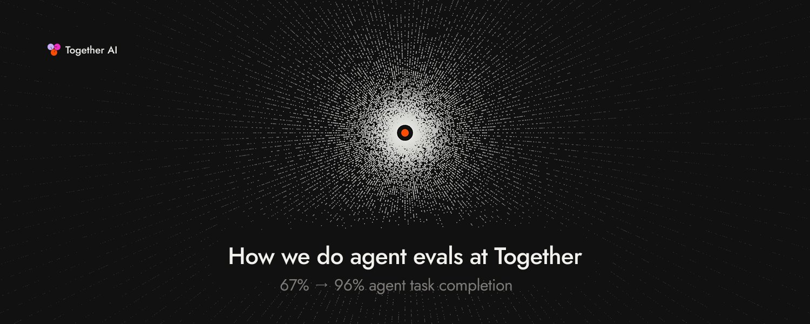
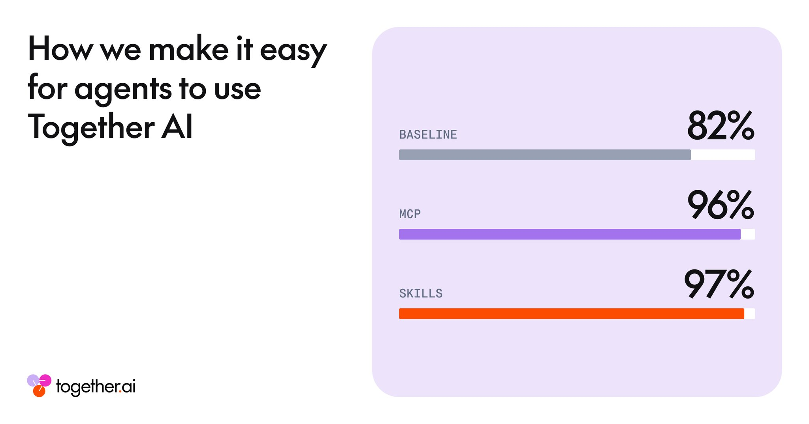
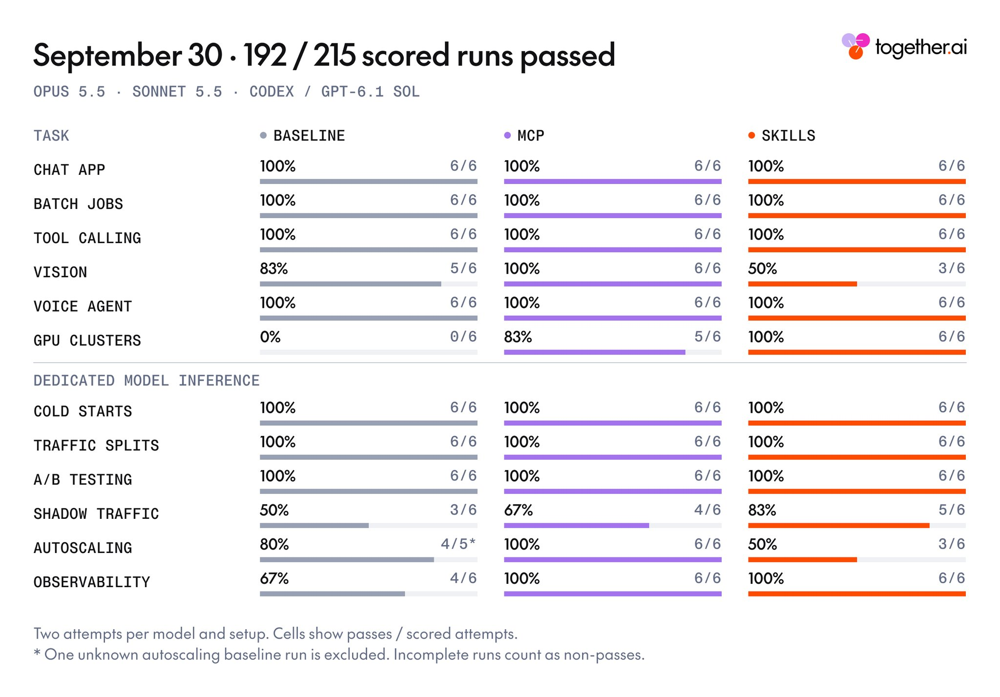
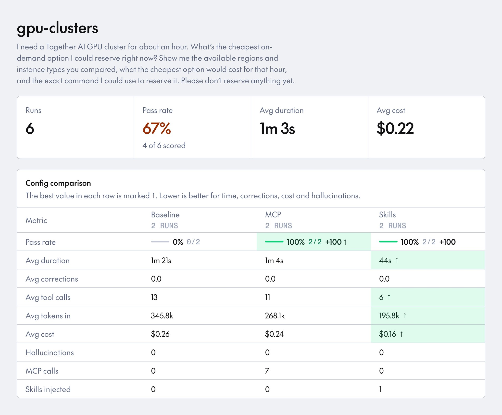
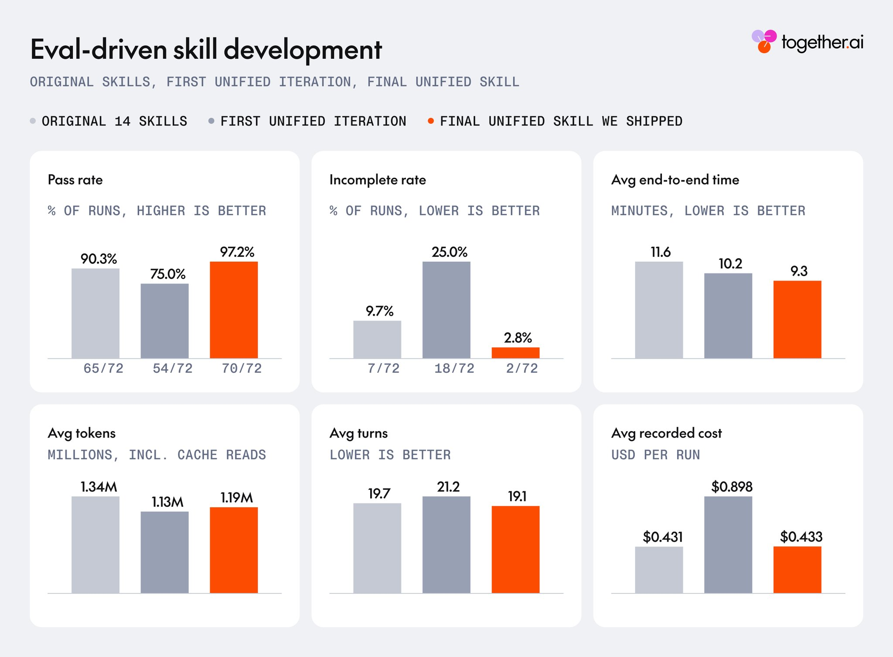
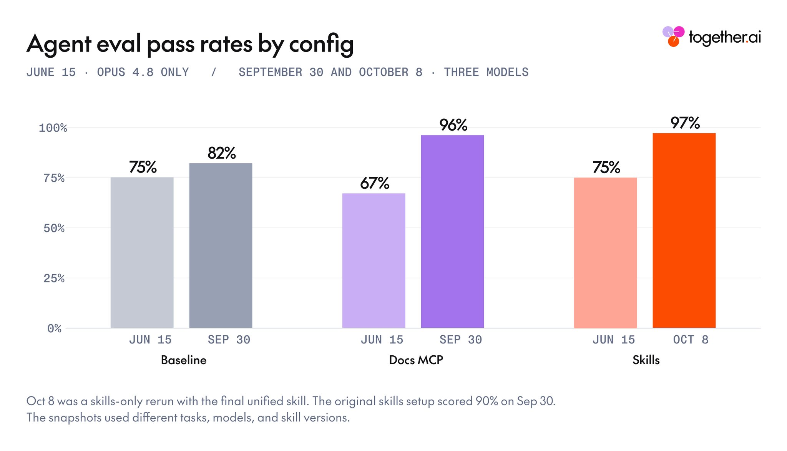

# 我们如何在 Together 做智能体评测

> 原文：Hassan（[@nutlope](https://x.com/nutlope)），《How we do agent evals at Together》，X 长文，2026-11-16 发布。
>
> 本文为全文翻译，未做删节。分节标题、加粗、引用块、列表与配图均与原文一一对应；译文只在此处加了来源说明，正文中未增加任何原文没有的评述。

**太长不看（TLDR）：***本文讲我们怎么让 Together 更容易被智能体（agent）使用：通过自建智能体评测，我们把智能体任务的成功率从 67% 提到了 96%。我们会讲清评测是怎么搭的，以及你如何搭建自己的评测，用来改善你的智能体体验。*

今年早些时候，我们开始看到越来越多的开发者用编程智能体来基于 Together AI 做开发。

不难理解原因：一个开发者要手工把一个应用接到生产推理上，可能要花上几天甚至几周，尤其是刚接触这个平台的人。而对一个用我们 SDK 和 CLI 的智能体来说，这只需要几分钟——至少理论上是这样。

实践中的问题是：我们根本不知道指向我们平台的那些智能体，能不能高效地跟 Together 配合；也不知道它们是不是在撞墙、钻进死胡同，或者干脆直接失败，并在这个过程里白白烧掉 token。

随着开发者把越来越多工作委派给智能体，开发者体验（DX）正越来越等同于智能体体验（AX）。你的软件对智能体越好用，开发者就越容易把它做进自己的产品和工作流里。

GitHub 是优秀 AX 的教科书案例：过去一年里平台上的活动翻了三倍，2026 年大约 40% 的 PR 是智能体开的（而且我们敢打赌，全部提交里由智能体写下的代码行数远不止 40%）。这要归功于 GitHub 出色的 API、CLI 和文档——它们让智能体用起来格外容易。

要在 Together AI 提升我们的 AX，我们需要一种办法来衡量：我们的平台到底有多「智能体就绪」。本文会讲我们怎么跑智能体评测、评测暴露出的两个问题以及我们怎么修的，还有我们学到了什么。

## 我们在 Together 怎么跑智能体评测

**构建任务清单**

在开始评测之前，我们得先知道智能体实际上被要求做什么……这样我们才能，你知道的，搞清楚它们能不能做到这些事。我们先列了一张开发者在 Together 上常做的任务清单，比如跑一个批量推理作业、搭一个语音智能体，或者为某个推理端点管理自动扩缩容。

所谓任务，其实就是一个 prompt，一段你会告诉智能体去做的话。比如：

> 列出可用的 GPU 集群区域和实例类型，打印出最便宜的那个选项，并给出你会在按需预留一小时时实际执行的完整命令。不要真的去预留。

要判定评测通过，智能体必须：

1. 找到最新的价格信息。

1. 调用 regions 这个 API 端点，列出可用区域。

1. 把两边信息合起来，找出最便宜的选项。

1. 产出一条可用的、用于创建集群的 CLI 命令。

这个 prompt 同时要求「可用性」和「价格」，却没提这两类信息分别放在两个不同地方。这很贴近真实情况：普通用户一开始大概并不知道每条信息在哪儿，人类和智能体都容易在这里翻车。

**三种配置**

任务清单建好之后，我们让每个任务跑三种方式：

- **基线（Baseline）：** 智能体只拿到 prompt，没有任何特殊配置，模拟普通开发者的工作流。它可以用自己默认的所有工具，比如从网上抓文档，但我们不给它任何特定的 MCP 连接器或 skill。

- **MCP：** 智能体通过我们的 MCP server 直接访问我们的[文档](http://docs.together.ai/)，这样它撞墙时就知道该去哪儿搜。

- **Skills：** 我们把 [Together skill 包](https://github.com/togethercomputer/skills)交给智能体，里面是为智能体专门写的、关于如何使用我们服务的说明与示例。

**运行矩阵**

每一轮完整评测，都会用三个模型、对每种智能体配置跑一遍所有任务，每个任务尝试两次，所以每种配置下每个任务是六次尝试。下图是我们 9 月 30 日那次运行的情况：

**把运行自动化**

刚开始搭评测时，一切都是手工跑的：开一个新终端，把一个 prompt 粘进 Claude Code，让智能体干活（或者干不成活），然后对每种配置重复一遍。这既手动又枯燥，所以一旦想清楚了想要的系统长什么样，我们就开始自动化。

现在我们让每个智能体都跑在 [Together sandbox](https://docs.together.ai/docs/together-code-sandbox) 里，这样它们就不会干扰我们的本地环境，也不会彼此干扰。GitHub Actions 负责环境准备、启动智能体、事后清理并保存结果；一个代理负责转发智能体发给 Together API 的请求并记录下来，这样我们就能看到智能体调了哪些端点、返回了什么。

**给一次运行打分**

一次运行结束后，一个 LLM 评审（LLM judge）会看任务 prompt 和录下的会话，然后给出三种判定之一：

- **通过（Pass）：** 任务的每项要求都满足了。

- **不完整（Incomplete）：** 智能体尝试了任务，但有些必需步骤没做完或没验证。

- **失败（Fail）：** 智能体早早放弃、违反了明确的约束，或者给出了错误结果（安息吧）。

「失败」和「不完整」的判定并不必然告诉我们问题出在智能体、API 还是证据缺失。它们只是告诉我们该从哪儿开始查。

通过了的运行我们也查。智能体常常能绕过含糊的响应照样把活干完，而这些「绕过去」的过程恰恰告诉我们该修什么，才能提高 token 效率。

为了让这种复查可行，我们做了个结果查看器，用来对比不同模型和配置的表现。对每次运行，它展示 prompt、智能体用了哪些工具、拿到了什么响应，以及所有 API 活动：

## 案例一：GPU 集群定价

还记得前面那个 GPU 集群任务吗？

> 列出可用的 GPU 集群区域和实例类型，打印出最便宜的那个选项，并给出你会在按需预留一小时时实际执行的完整命令。不要真的去预留。

看着挺简单，但我们在去年夏天早些时候跑评测时，Sonnet 4.6 在这个任务上 15 次只通过了 4 次——还是开着 skill 的情况下。

我们的复盘发现，失败的运行里都是同一个模式：Sonnet 把我们 CLI 参考文档里的示例输出当成了实时库存——那段示例里只列了一个区域和两种 GPU 类型。它还跳过了 regions 查询，直接说出它以为最便宜的选项，却从没去价格页核实过。

问题在我们这边。第一，那段示例输出没有恰当标注，所以没有任何东西告诉智能体「要跑那条命令去取真实数据」。第二，我们的 skill 文件指向的是 GPU 集群的营销页，而不是价格表，于是 Sonnet 打开了营销页，没看到任何真实价格，就只好对最便宜的 GPU 瞎猜了一个。

能力更强的模型能绕过这个问题。同一时期，Opus 4.8 在同样的配置下 14 次通过了 13 次。根据 transcript，它注意到 list_regions 的响应里没有价格，于是不断搜索，直到在我们文档里找到。这就是为什么用能力较弱的模型测试产品至关重要；如果我们只用 Opus 测，发现这个缺口会慢得多。

**把失败隔离出来**

为了修它，我们把失败隔离了出来：把 GPU 集群这个 skill 从完整 skill 包里单独抽出来，再写一个更窄的 prompt，只复现这一个问题。拿旧版 skill 文件测，它每次都会失败，于是我们既有可靠的复现步骤（用旧 skill），也有一个简单的办法去测每个新版本（更新 skill）。

我们迭代了好几轮，最后落在一个很小的改动上：在 skill 里加两句话，把智能体指向价格表，并说明如何配合实时的 regions API 使用：

> 查询 *GET <https://api.together.ai/v1/compute/regions>*，或运行 *tg clusters list-regions --json*，可得到实时的区域清单、支持的实例类型，以及兼容的 CUDA/驱动组合。当前的按需费率与预留费率见 [GPU Cluster 价格表](https://www.together.ai/pricing#gpu-clusters)。

改动之后，凡是开着 skill 配置的模型，这个任务都是 100% 通过。

**找出我们 API 的缺口**

同一个 GPU 任务还暴露出我们 API 里的一个问题。在最近一次基线运行中，Opus 5.5 拿到了「不完整」判定，而 transcript 显示它撞了两次死胡同，这两次都不是模型的错。

运行开头很顺。智能体调用 */v1/compute/regions* 拿到了区域和实例类型。然后为了找价格，它调用了 */v1/compute/instance-types*，API 返回了一个 *400*，消息如下：

> Region is required. Example: *us-central-8*. Use */v1/clusters/regions* to get list of regions.

于是智能体照着错误信息做了：

1. 它用第一次查询到的某个区域重试了这个请求。结果拿到的不是实例类型，而是一个 *404*。

1. 它调用了错误信息建议的 */v1/clusters/regions*……但这条路由根本不存在，所以又是一个 *404*。

我们自己的错误信息把智能体引到了一条不存在的路由上，而那次本该成功的重试也失败了。一个开发者如果照着这条信息手工操作，同样会卡住。我们后来把错误信息改成了指向 /v1/compute/regions，并修掉了第一个 404 背后的路由 bug。

## 案例二：重建我们的 skill 包

我们过去维护着 14 个独立的 Together skill，每个产品面向一个。它们很难用：你得事先知道哪些 skill 适用于你的工作流，然后一个个安装、一个个调用。这些 skill 还互相重叠，重复同样的 SDK 指引和安装说明，而且每一个都长到——同时加载几个就会把智能体的上下文撑大。

上个月，我们把这 14 个 skill 合并成了一个[统一版本](https://github.com/togethercomputer/skills)。它在底层仍然是模块化的：为了避免上下文膨胀，智能体先读一个很短的 router，只有当 router 说某个内容相关时，才去打开对应的产品指南、参考文件或示例脚本。

我们希望「一个 skill 胜过 14 个」，但为了确认，我们在开着 skill 的情况下，用评测任务跑了一遍这个统一 skill。我们的基准是 9 月 30 日的结果：用 14 个 skill 配置时，所有运行合计 90% 通过率。

但新 skill 扑街了：72 次运行只通过 54 次（75%），「不完整」从 7 次变成 18 次，每次运行的成本还翻了一倍多。

于是我们把评测 transcript 全都翻了一遍，只在运行结果指出问题的地方改 skill。反复出现的是三个问题：

- **上下文太多：** 第一版统一 router 大约 14,000 字符，每个任务都会加载，而且它让智能体把每份指南全文读完。（说好的避免上下文膨胀呢……）结果运行加载的 skill 内容比 14 个独立 skill 时多了 57%。我们把 router 砍到 6,000 字符以下，并在每份产品指南末尾加了一个菜单，简述每个参考文件和脚本里有什么，这样智能体只打开自己需要的部分。

- **产品信息过时：** 代码示例里用到的一些模型已经不再在 serverless 上提供服务，还有一份产品指南在讲一个已废弃的功能。智能体白白浪费轮次去恢复、去重试那些永远不会成功的请求。我们把每个示例都换成了确认在线的模型，要求智能体去查目录而不是反复重试，还建了一个云端智能体，在产品变化时自动更新 skill。

- **示例代码有 bug：** 脚本里的小问题——比如把 JPEG 字节存成 .png 文件名——会让每个用它的智能体翻车。我们从源头修掉了这些问题，并加了一个自动化，定期对代码示例做在线测试、保持其新鲜。

这些修复落地后，统一 skill 在 72 次运行中通过了 70 次，比第一次尝试高了 22 个百分点，也比最初的 14 个 skill 高了 7 个百分点。运行耗时平均比原来用 skill 时少了 20%，每次运行的成本也回落到起点水平。

## 四个月评测之后，我们处在什么位置

回到六月，我们的文档和 skill 几乎帮不上智能体什么忙。6 月 15 日，用 Opus 4.8 跑，基线通过率是 75%。文档 MCP（67%）和 skill（75%）都没能提升表现。

到 9 月 30 日，横跨三个模型，基线慢慢爬到了 82%。文档 MCP 到了 96%，skill 到了 90%，而新的统一 skill 在 10 月 8 日打到了 97%。

这不是一次受控对比：这些快照用的是不同的模型和任务，所以其中一部分提升无疑来自底座模型本身的进步，也来自我们对 CLI 和 SDK 的改进。这大概能解释基线那 7 个百分点的上升；但有引导的配置涨了 20 多个百分点，这部分额外收益我们归功于评测挖出来的文档与 skill 修复。

## 我们学到了什么

如果你只是扫一眼这篇文章，这里是太长不看版：

- **智能体可访问性会带来使用量：** 学 GitHub：开发者在 web 界面上能手工做的每件事，都应该能通过你的 CLI 或 SDK 以编程方式做到。我们发现智能体用 CLI 表现最好，因为 CLI 通过 help 文本给自己做了文档。说到这个——

- **文档是产品的核心部分：** 如果你的平台没有被准确记录，或者你的文档不可被智能体获取（比如通过 llms.txt、一个 skill 包，或者一个 MCP server），那它对智能体来说可能就不可用。CLI 的 help 文本和 API 错误信息也算在内，而这些通常是智能体被绊住时最先去看的地方。

- **指引比用哪个前沿模型更重要：** 9 月 30 日，三个模型（Claude Sonnet、Opus 和 GPT Sol）的最终成绩彼此只差几个百分点。加上我们的文档／skill 之后，通过率分别从 82% 提到了 96% 和 97%。

- **反过来说，只用强模型有时会掩盖问题：** Opus 能绕过我们 API 和 skill 包里的缺口，而 Sonnet 一头栽了进去——这正是我们发现问题、修掉问题的方式。跑评测时，务必把能力光谱上不同档位的模型都测一遍。

- **提升 AX 往往只需要一个小修复：** 在 skill 文件里加两句话，就让我们的 GPU 集群评测从 15 次通过 4 次（Sonnet）变成三个模型全部 100% 通过。修复很小，但如果不是走了评测流程，我们可能永远发现不了它。

## 跑你自己的评测

如果你在运营一个开发者平台，智能体正在用你的产品——至少它们肯定在努力用。想知道这件事进行得如何，最好的办法就是搭建你自己的评测系统。

为了帮你做到这一点，我们把自己搭评测用的包开源了。你列出一组任务（智能体 prompt），并决定如何给运行打分（用代码测试，或者用 LLM 评审）。这个包会启动智能体、跑任务，并把一切记进一个本地看板，这样你就能对比不同配置和过去的运行。它会在下周放出，同时还会有一篇新博客讲怎么用它。

**参考来源**

原帖：<https://x.com/nutlope/status/2122378712649748694>（Hassan @nutlope，2026-11-16）。

原文中引用的链接：[Together 文档](http://docs.together.ai/)、[Together skill 包](https://github.com/togethercomputer/skills)、[Together sandbox](https://docs.together.ai/docs/together-code-sandbox)、[GPU 集群价格表](https://www.together.ai/pricing#gpu-clusters)。

原文配图直链（已全部转存至本仓库 assets/2026-11-16-how-we-do-agent-evals-at-together/）：https://pbs.twimg.com/media/HXQxvTkWsAAT-1k.jpg（封面）、https://pbs.twimg.com/media/HXQvlHdWUAEmOPw.jpg、https://pbs.twimg.com/media/HXQtxFzWUAAXHW5.jpg、https://pbs.twimg.com/media/HXQt959W4AEhBDO.jpg、https://pbs.twimg.com/media/HXQuCqbXUAAMhCs.jpg、https://pbs.twimg.com/media/HXQuLMRXYAIfc1L.jpg。
