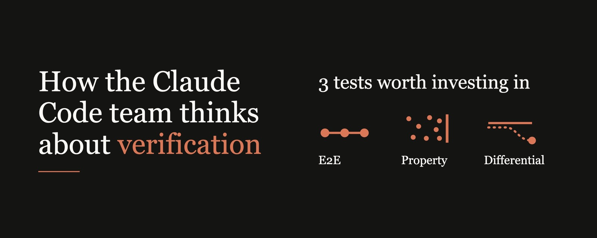
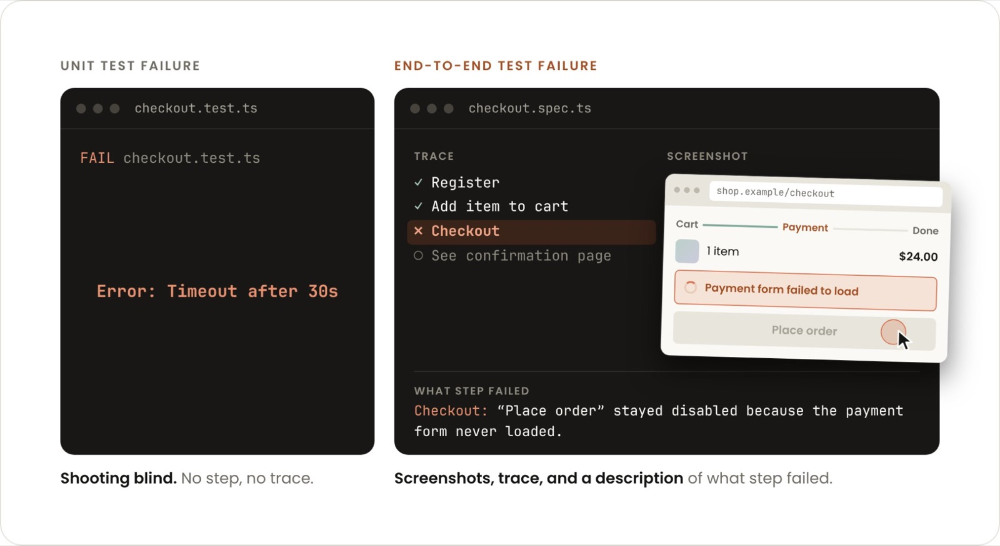
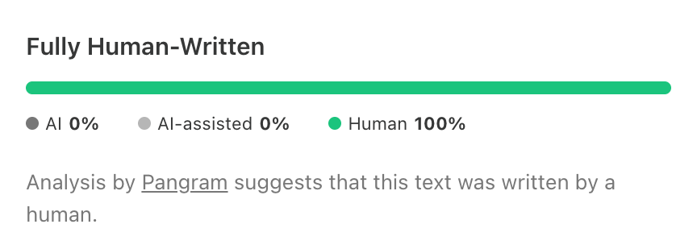

# Claude Code 团队是怎么看待"验证"的

> 原文：Addy Osmani（[@addyosmani](https://x.com/addyosmani/status/2122590683055993308)），《How the Claude Code team thinks about verification》，X 长文，2026-11-17 发布。
>
> 本文为全文翻译，未做删节。分节标题、加粗、配图与链接均对应原文；译注仅在必要处用括号补充。

在 Claude Code 团队，我们绝大部分代码（约 90%）由 [Claude 编写和评审](https://claude.dev/blog/solving-code-review-at-anthropic/)。在这样的规模下，如何让智能体用证据来验证自己的工作，就变得极其重要。

验证回路（verification loop）是让你能把更多工作交给 Claude 的基本构件。没有它，你一次基本只能跑一两个 Claude，因为所有东西都得自己检查。有了它，你可以并行跑几十个甚至上百个。

这是因为，给智能体一条[验证自己产出](https://claude.com/blog/building-verification-loops-in-claude-code-with-skills)的途径，是提升质量的有效办法。围绕结构化文件生成的内部测试显示，相比标准的提示循环，让一个独立的评分者按评分标准（rubric）检查 Claude 的工作，[能把任务成功率最多提高 10 个点](https://claude.com/blog/claude-managed-agents)，在最难的问题上收益最大。

过去验证起来很贵的东西（测试、基准、规格、真实的端到端运行），现在向智能体索取变得很便宜。和代码一样，智能体能很快生成测试、基准和规格。而这些测试和基准一旦生成，就是作为软件运行的，可以频繁跑，不额外消耗多少 token。

你也可以用结果闭环，反过来提升智能体在该任务上的表现。比如，如果智能体反复通不过某个检查用户数据日志的测试，你可以在 CLAUDE.md 里加一个 hook 或一条更明确的规则，避免以后重犯。这（大体上）能让问题不再发生。

那么，既然验证对高速产出高质量代码如此关键，该用哪些类型的测试，又该怎么把它们铺到整条流水线里？本文回答这两个问题，并分享 Claude Code 团队自己用的流程。

## 测试并非生而平等：值得投入的 3 类测试

不论你选哪类测试，都有几种失败模式要避开。

测试如果不稳定（flaky），你就会把智能体训练成"再跑一遍"，而不是去修出错的代码。测试如果太慢，智能体在一批改动里跑的测试就少，定位问题会更难。更重的测试最好放在提交改动之前跑。

那么接下来，我认为最值得投入的就是下面这三类测试。

**端到端测试（E2E）**

如果只能专攻一类测试，选端到端。这类测试描述真实的用户流程，比如把商品加入购物车、结账、跳到确认页。

端到端测试之所以有效，是因为它很难被糊弄——整个功能要么能用，要么不能用。它还有明确的完成判据，能具体告诉你哪里坏了。

单元测试更快、更稳定，但完全可能全部通过，功能却依然坏着。原因是智能体和测试都没理解完整的任务。

有了端到端测试，就可以有效地把"手和眼"交给智能体，让它直接对着真实运行的系统操作。你可以写一个 skill，用 [CDP](https://chromedevtools.github.io/devtools-protocol/)、模拟器或 API 测试框架（API harness）来启动、驱动和检查应用。

功能地图（feature map）可以当作智能体的向导和评分标准，因为它通常从用户视角列出功能，并说明路径、快捷键、选择器和预期结果。

**属性测试：不可能被破坏的约束**

很多测试基于"你猜哪里会出问题"。属性测试关注的是人容易漏掉的边界情况——而这恰恰是智能体经常栽跟头的地方。

你先写下一句你认为不可能出错的断言，然后用测试库（JS/TS 用 [fast-check](https://fast-check.dev/)，Python 用 [Hypothesis](https://hypothesis.readthedocs.io/en/latest/)，Rust 用 [proptest](https://proptest-rs.github.io/proptest/) 等）生成成千上万个输入，试图把它证伪。

几乎每个软件项目里都有大量这样的属性，比如：

- 往返编码：把 X 编码再解码回来，得到的还是 X。解析和序列化同理。

- 不变式：必须永远为真的事，比如"账户余额永远不会变成负数"。

- 幂等性：某个动作（迁移、归一化、重试）做两次，效果和做一次相同。

- 等价性：优化后的代码与朴素但正确的代码产出相同结果。

属性测试库是让智能体保持诚实的好办法：它构造的边界情况，和写出原代码的那个智能体并不共享同一套偏差。当规格已经和生产行为脱节、不再是可靠的验证来源时，属性测试在重写场景里尤其有用。

**差分测试：旧系统就是判据**

差分测试在[大规模迁移](https://claude.com/resources/articles/ai-code-migration)场景里特别有效——这类场景功能预期保持不变。做法是拿同样的输入分别跑旧系统和新系统，看结果是否不同。如果不同，就说明有 bug 或破坏性改动需要修。

差分测试的关键是用随机生成的输入，或者生产流量样本。你还需要把无关因素（比如空白字符）归一化，并维护一份"已批准差异"清单，用在那些新环境本来就该与旧环境不同的情况。

## Claude Code 团队是怎么看待验证的

我们之前写过[ Anthropic 的代码评审是怎么做的](https://claude.dev/blog/solving-code-review-at-anthropic/)，本文则想更深入地讲我们如何验证自己的工作。

**验证意味着把改动跑起来**

把应用端到端跑一遍，比测试更重要。你不会没在模拟器里试过就发一个 iOS 改动，Claude 也一样。

Claude 能像人或者 QA 工程师那样测试整个应用。Web 改动让它用 Claude Chrome 扩展，移动端用 iOS 或 Android 的 MCP，桌面端用 computer use，后端工作则让它在本地把服务跑起来。

为了把"怎么启动模拟器、怎么跑你的应用"固化成可执行的东西，建一个叫 verify 的 skill。放在仓库的 `.claude/skills/` 目录里，越靠近相关代码越好，需要几个就加几个。Claude 知道在提交改动前要用 verify 这个 skill。

然后投入精力把 verify skill 做得又快又可靠。让 Claude 反复迭代它、对它做压力测试。它是你的冒烟测试装置，所以你希望它坚如磐石。

当你让 Claude 能端到端地冒烟测试自己的改动，效果会好很多。你会看到它像人一样反复迭代，更快地抓到真实的错误。我们在 Anthropic 几乎所有改动都是这么测的。

**测试失败需要人来处理**

没人能读完每一个改动，所以我们把"失败"当作判断哪些需要人看的一种手段。Claude 跑检查，并尝试修掉任何失败项。如果某项检查在三轮之后仍然失败，Claude 就停下来，交给人。

**代码所有者自己写检查**

拥有这段代码的人来写它的检查，并不断打磨，直到它能标出"所有者本人也会标出的问题"。当某个检查拉来一位评审者时，它应该说清原因，别让评审者自己从 diff 里去猜。

**可靠性检查由 diff 触发**

我们维护一份 39 条的可靠性清单，每条都有一个能从 diff 里读出的触发条件、一个检查，以及它背后的事故或 PR。其中一条是"--resume 能加载旧的 transcript"。当会话存储或消息类型发生变化时，我们就会问：新字段能否安全加载，因为旧的 transcript 里没有这个字段。

Claude 读 diff，只检查触发条件命中的那些条目——通常是 3 到 10 条——这样没人需要去背过去的故障。

**一个评审者，多轮**

我们不靠堆更多评审者来改进评审。在主评审之上再加一个更贵的第二评审，往往不如把主评审调好。取而代之，我们有一份 [REVIEW.md](https://code.claude.com/docs/en/code-review-customize)，写明针对这段代码评审者该关注什么。

我们还认为评审和验证的各轮应该层层递进。每一轮都指向之前轮次的上下文和过去的失败，而不是从头把一切再查一遍。这样更便宜，也能查出更多。

**改动不能修改自己的检查**

如果一项改动能修改评判它的那个检查，这个检查就是坏的。Code Review 从基线分支或默认分支读取 REVIEW.md 文件，[绝不从 PR 的改动里读](https://code.claude.com/docs/en/code-review-customize)。Claude Code 团队确保"给改动把关"的规则放在改动本身动不了的分支上。

Claude Code 团队还规定评审只针对具体提交。如果评审进行时有人又推了新东西，评审结果就不再有用。对一个过时提交的"通过"毫无意义。

团队还先跑便宜的检查。如果智能体没在本地测试就推上去，它就占用了共享的评审和 CI 时间，而那个 bug 它本可以自己抓到。在我们团队，Claude 在开 PR 之前会跑测试、构建和 linter。你可以用一个 [hook](https://code.claude.com/docs/en/hooks) 在 Claude 收工时跑测试来强制这一点，或者设一个"测试全绿"的 [/goal](https://code.claude.com/docs/en/goal)。

**新门禁从 observe 模式开始**

在我们自己的仓库里，我们给每个提交打上"它是怎么被验证的"标记。标记里甚至有"none"，这样我们能查出没经过验证的提交。

我们还做了一个提交门禁，如果本次会话里没有 /code-review 或 /verify，它可以拦住提交。我们给它设了 off、observe、enforce 三种模式。

observe 模式会记录下"本来会被拦住"的提交，这样我们可以复核误报，确保没人受影响。

enforce 模式会真的拦住提交。任何提交都可以在提交信息里说明自己为什么没被验证。如果一次会话里已经被拦了两次，下一个就放行，免得 Claude 卡死——Claude Code 并非完美。

**用真正重要的东西检验你的检查**

Claude Code 团队还定期评审"评审者本身"。我们跟踪：合并后被回滚的改动有多少、合并前被维护者打回的改动有多少，以及一个规模匹配、"保持干净"的改动子集。

这也可以用正式的评测来做。在我们的[代码评审那篇文章](https://claude.dev/blog/solving-code-review-at-anthropic/)里，我们讲过 Code Review 团队如何基于过去的事故和回滚搭建评测。他们为每个样本把仓库还原到评审当时的状态，并提供一句话的答案要点，说明 bug 是什么。只有正确描述了该 bug 的发现才计分。他们用"已合并且稳定"的改动作为对照，防止过度标记。他们的调参集与用于评估系统的固定测试集是分开的。

他们还分别评估了原始发现、验证之后、以及最终评审三个环节的召回率。这样能看出系统是否在丢掉它已经发现过的 bug。把这几项合成一个端到端总分的评测，捕捉不到这种差别。

除了正确性，我们关心的另一个维度是"这个改动有多重要"。好的评审者能抓到大部分技术上正确的问题，但人们真正在意的是：某个 bug 是必须修、应该修，还是吹毛求疵（nit）。

Code Review 就是这个思路，它会把问题标成 [Important（重要）、Nit（吹毛求疵）或 Pre-existing（既有）](https://code.claude.com/docs/en/code-review-pull-requests)。"pre-existing"这个标记的意思是：评审者不该让作者为本来就存在的 bug 负责。

最后，Claude Code 团队把召回率往上调，直到再提一点就是在过拟合评测、而不是真的在抓 bug 为止。

**把漏掉的问题变成规则**

在 Claude Code 仓库里，我们有两种把漏掉的案例变成规则的方法。第一种是从人工代码评审意见和 PR 回滚中提取模式，找出共性问题。这些问题必须至少出现在两个 PR 里，并且能从 diff 上识别出来，才会被当作候选规则。会有三个智能体尝试证伪它，最后由人在 PR 里评审并批准。

第二种方法：拿三个 bug 查找器去重放一个与已知事故关联的 PR。如果至少两个查出了该 bug，说明它是可检测的 bug。如果在一个很小的 diff 上仍然漏掉，那就是一个值得写进 REVIEW.md 的规则缺口。

不稳定的测试同样处理。Claude 不许跳过它们、不许加 sleep 或者重试到通过。如果找不到根因，就删掉该测试，并写下原因。

规则也需要清理。测试套件、验证步骤和 .md 文件，你不管它们就只会变多，所以我们定期清理。

## 好的测试，好的结果。

我们发现，给智能体一个带强反馈回路的自我验证方式，效果天差地别。把验证层当成任何其他系统来对待：让它处在被它评判的改动够不到的地方；用对你真正重要的那些 bug 来给它打分；它漏掉什么就写下教训，让同样的事不再发生第二次；并定期修剪这些教训，让它们始终值得跑。

做到这些，你的工作就从"读每一个 diff"转变为"定义什么叫完成，并复核证据"——而这正是让你能同时跑很多 Claude 的原因。

---

## 参考来源

- 原推文：https://x.com/addyosmani/status/2122590683055993308
- 原文（X 长文）：https://x.com/i/article/2122515769007435776
- 原文提及：《Solving code review at Anthropic》 https://claude.dev/blog/solving-code-review-at-anthropic/
- 原文提及：《Building verification loops in Claude Code with skills》 https://claude.com/blog/building-verification-loops-in-claude-code-with-skills
- 原文提及：《Claude managed agents》 https://claude.com/blog/claude-managed-agents
- 原文提及：《AI code migration》 https://claude.com/resources/articles/ai-code-migration
- 原文提及：Claude Code 文档（code review customize / hooks / goal / pull requests） https://code.claude.com/docs/en/code-review-customize
- 配图直链：https://pbs.twimg.com/media/HXS3lWqbkAAWZHW.jpg （封面）、https://pbs.twimg.com/media/HXT0UI1aEAABki1.jpg （E2E 与单元测试失败对比）、https://pbs.twimg.com/media/HXS_404aQAAle_6.png （Pangram 检测徽章）

## 术语对照

| 原文 | 译文 |
| --- | --- |
| verification loop | 验证回路 |
| E2E (end-to-end) test | 端到端测试 |
| property test | 属性测试 |
| differential test | 差分测试 |
| invariant | 不变式 |
| idempotency | 幂等性 |
| round-trip encoding | 往返编码 |
| flaky test | 不稳定测试（flaky） |
| rubric | 评分标准 |
| smoke test | 冒烟测试 |
| feature map | 功能地图 |
| commit gate | 提交门禁 |
| observe / enforce mode | 观察模式 / 强制执行模式 |
| recall | 召回率 |
| nit | 吹毛求疵的意见（nit） |
| pre-existing | 既有问题 |
