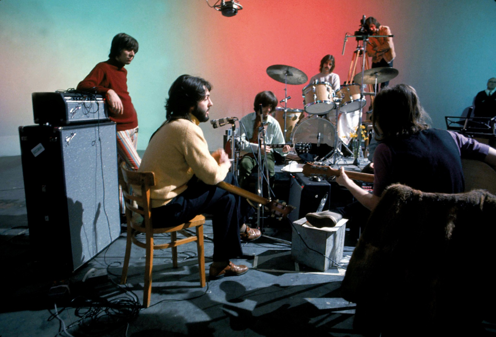
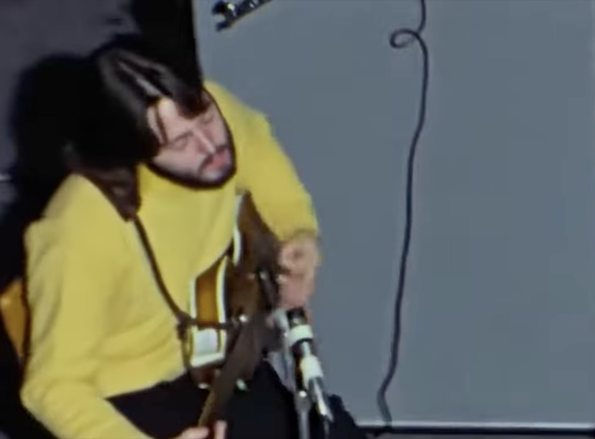
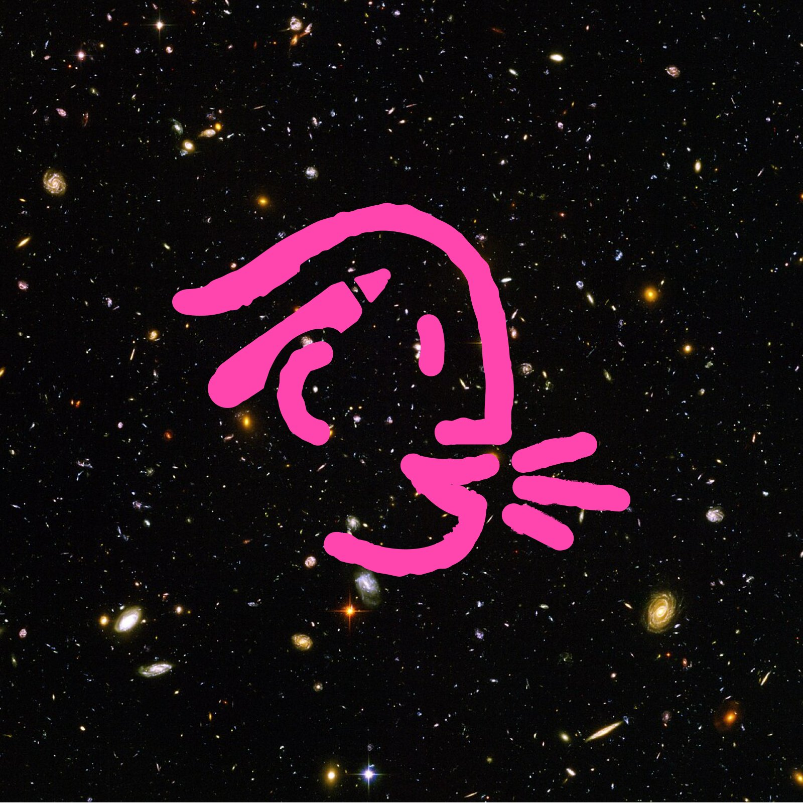
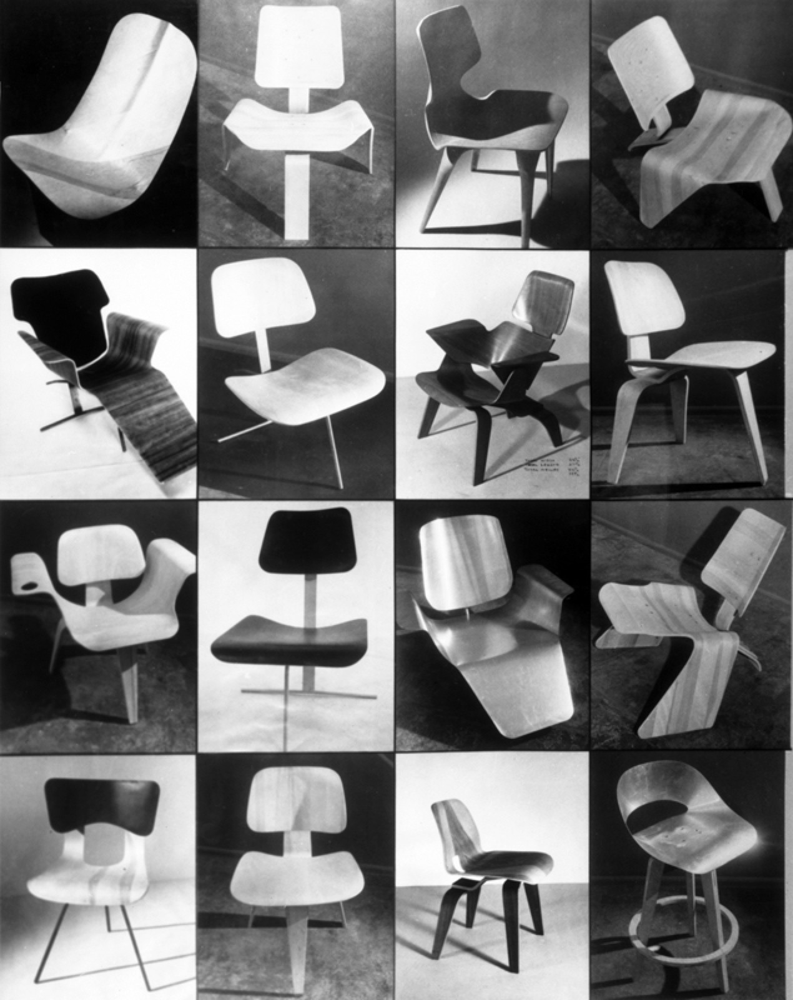
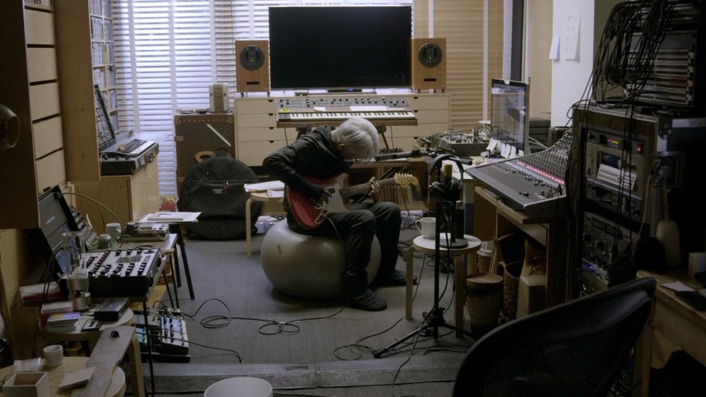
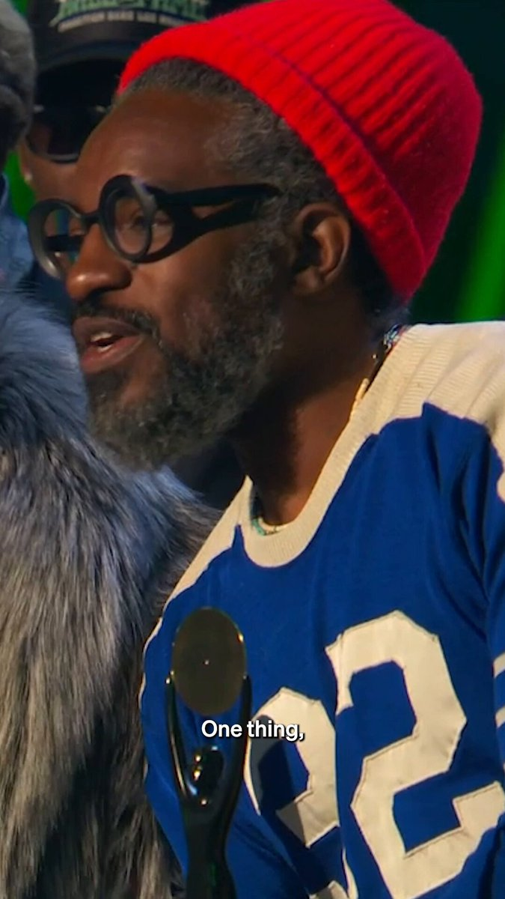

# 要工作室，不要工厂

> 原文：Anton Herasymenko（[@antoherasymenko](https://x.com/antoherasymenko/status/2122706379987165590)），《Studios over Factories》，X 长文，2026-11-17 发布。
>
> 本文为全文翻译，未做删节。分节标题、加粗、配图与链接均对应原文；译注仅在必要处用括号补充。

每当我想起设计工具和创作过程，我常会重看 Peter Jackson 那部披头士纪录片里著名的一幕——它记录了《Get Back》这首曲子诞生的过程。

Paul McCartney 弹着贝斯，一边自言自语地嘟囔。同一段 riff，他绕了一圈，又一圈，再一圈。每过一遍，雾就散开一些，字句开始拼到一起。

这一幕可以在[这里](https://www.youtube.com/watch?v=X94t4hTajCc&list=RDX94t4hTajCc&start_radio=1)观看。

那是一个极度袒露、近乎神圣的瞬间。McCartney 处在一种玩耍的状态里——[松开了（unclenched）](https://howtounclench.com/)、不加审查，直觉直接开口说话。他感到的东西和流出来的东西之间，没有任何摩擦。一旦你在做东西的时候体验过这种状态，你就会一直想找回它。

抵达这种状态本身就是一段旅程。很多人在路上卡住了，因为手做不到脑子看见的东西。我常想，有多少想法，仅仅因为我们没能翻过「乐器」那道门槛，就永远困在体内。不过有时候，它们会逃走，去找别的手。

## 工厂

我们大多数设计工具是为终点线造的。它们默认你已经知道自己要做什么。

但在进入生产之前，还有一段混乱而脆弱的阶段：你还在找那个想法。它需要完全不同的环境与心境（set and setting），而我们为它造的东西少得可怜。

即便有了 AI，我们的新工具大多仍然像工厂。我们有 prompt 输入框和节点图，一半时间花在打磨措辞、或者把输入一个个连起来。它多多少少能用，但心流没了。大多数时候，它不像在探索一个想法，更像在给一台机器排障。

随着 AI 在后台接手越来越多的生产工作，我们终于有机会去造别的房间了。一些可以瞎折腾、可以犯错、可以只为了看看会发生什么而动手的空间。那些怪异又原创的东西，就是在这些地方出生的。

## 把想法嘟囔出来

创作性的探索会在好几个地方跟你较劲。有脑子里的评论家，有手里的乐器，还有想法与想法之间的张力。前两个是障碍，第三个就是寻找本身。

语音界面可以让乐器消解掉；如果设计得当，它也能让评论家安静下来。传统工具逼你离开感受、进入逻辑模式，只为去找一个按钮。Raycast 这类快捷指令和启动器想让工具变得隐形，但语音走得更远。当我只是把半成形的念头嘟囔出声，我就还连着直觉。它有效的原因，和自由言说（free-speaking）与「晨间笔记」（morning pages）一样：你留在流里，内心那个评论家一句话也插不进来。

一旦评论家安静了、乐器消失了，真正的探索才开始。这就是「视觉分叉」（visual branching）让我兴奋的地方。当我得亲手设计每一个版本时，探索一个方向要花好几天。现在我可以同时把十个版本的想法摊在桌上。并排放在一起，它们会开始互相争辩，而在这场争辩里，我更容易看清这个想法究竟想成为什么。这种摩擦值得保留。循环还是老样子（做出来，看看感觉如何），只是更快了。

## 小房间

现在就轮到我们决定，要从下一代创作工具里得到什么。与其继续优化工厂，不如把寻找的乐趣放在第一位。

机器可以让任何东西看起来像任何东西。而那种感受——一个属于人的视角，让人看着作品并在其中认出自己——仍然要靠我们自己去发现。技术是易逝的，人的那部分才是永恒的。最好的作品，通常出现在我们一只脚踩在一边、另一只脚踩在另一边的时候。

这就是为什么工具既重要，又完全不重要。Brian Eno 曾说，录音棚本身就是一件乐器，一个参与作品的房间。在我看来，创作工具就该是这样：一个安全的、安静的地方，你在里面玩，并和它建立起一段关系。

工厂节省时间。工作室把时间花得很美——而不知怎的，只有这样的时间，最后会被我们记住。

> 「伟大的事情都始于小小的房间。我们就是从一个很小的房间开始的。」——André 3000 与 Big Boi 代表 Outkast 接受摇滚名人堂入选（Rock Hall 2025，[@rockhall](https://x.com/rockhall/status/1987399853866209290)，含 49 秒现场致辞视频）。

**参考来源**

- 原文推文（X 长文）：https://x.com/antoherasymenko/status/2122706379987165590
- 长文正文：https://x.com/i/article/2122281085643919360
- 作者主页：https://x.com/antoherasymenko
- 原文引用：《Get Back》名场面视频 https://www.youtube.com/watch?v=X94t4hTajCc&list=RDX94t4hTajCc&start_radio=1
- 原文提及：unclenched https://howtounclench.com/
- 原文文末嵌入：摇滚名人堂推文 https://x.com/rockhall/status/1987399853866209290
- 配图直链：https://pbs.twimg.com/media/HXQ6JRMXwAArC_C.jpg （封面）、https://pbs.twimg.com/media/HXPyesOWQAEBOgf.jpg （McCartney）、https://pbs.twimg.com/media/HXRLeZtXoAAuQhq.jpg （《Animals》封面）、https://pbs.twimg.com/media/HXUQZG-WoAEVTX8.jpg （粉色涂鸦）、https://pbs.twimg.com/media/HXRELliW4AAiEHZ.jpg （Eames 椅原型）、https://pbs.twimg.com/media/HXRIwzOWEAABarv.jpg （坂本龙一）、https://pbs.twimg.com/amplify_video_thumb/1987399595132145664/img/woWO6qleCLJriMIO.jpg （嵌入视频封面）

**术语对照**

| 原文 | 译文 |
| --- | --- |
| studios over factories | 要工作室，不要工厂 |
| set and setting | 环境与心境 |
| the finish line | 终点线（成品交付那一刻） |
| node graphs | 节点图 |
| the flow | 心流 |
| the critic (inner critic) | 评论家（内心审查者） |
| free-speaking | 自由言说 |
| morning pages | 晨间笔记 |
| visual branching | 视觉分叉 |
| unclenched | 松开（不使劲、不设防） |
| mumble ideas into existence | 把想法嘟囔出来 |
