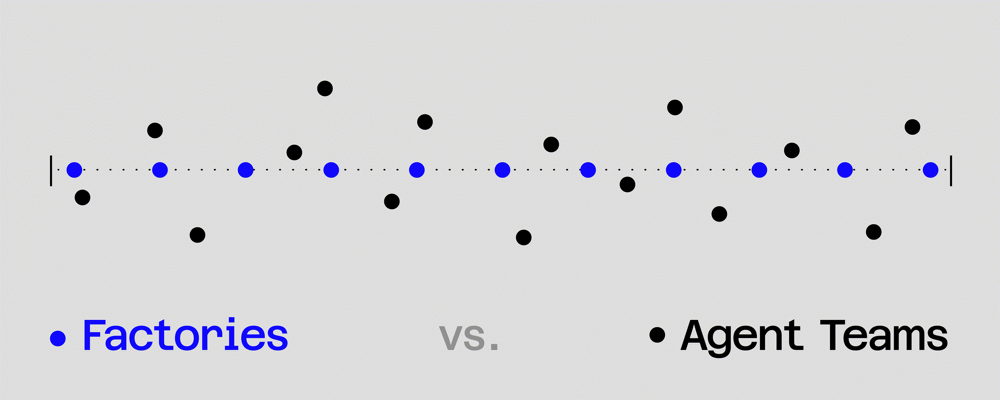

# 软件工厂 vs. agent 团队

> 原文：Zach Lloyd（[@zachlloydtweets](https://x.com/zachlloydtweets)），《Software factories vs. agent teams》，X Article，2026-11-23 发布。
>
> 本文为全文翻译，未做删节。分段与链接均对应原文；原文正文 13 段，配 1 张封面图。

软件开发经历了两年快速变化，我们又来到一个十字路口。关于未来，有两种相互竞争的想象：

第一种想象是软件工厂（例如 Warp Factories）。它是用代码定义的闭环系统，持续测量并改进云端的 coding agent。软件工厂是开发者基础设施。平台团队在软件工厂上做「工厂工程」，优化整个产品的开发流程。目标是：从 agent 榨出最大生产力，同时压低成本、提升质量。这是一种部署 agent 的系统设计思维。

第二种想象是 agent 团队（例如 Devin Bots）。这种方式下，由个人管理 agent 来编排复杂任务。比如你有一个「幕僚长」agent，把某个 coding 项目交给它。它把项目拆成子任务，分给不同的 agent（例如一个设计师、一个实现者），汇报进度，最后交付。这类团队还可以有「常驻」agent，主动修问题、响应事件等等。和软件工厂不同，这里的用户体验更偏向「管理」agent，就像你管理一个人或一个团队。

哪个更好，取决于你怎么理解这个问题。

我把问题理解为：如何安全地部署 coding agent，让产品吞吐量和质量最大化，同时让成本最小化？我认为这才是企业真正关心的。出现了一种能大规模构建软件的神奇新技术，企业要确保自己用好它，拿到尽可能大的竞争优势。

说白了：这是一个优化问题。我们有了一个新的工程原语，也就是 coding agent。我们要尽可能用好这个原语。

一旦用优化的框架看问题，马上就需要测量。毕竟，你只能优化你能测量的东西。要测量，就需要可靠、标准化的数据。要数据，就需要一定程度的集中化和标准化，否则数据太嘈杂、太异构，什么都做不了。要集中，就得搬到云上，并用代码定义「工厂」是什么。你的工厂必须开放、灵活，这样才有自由度去测试不同的模型、harness 和 skills。你需要实验手段，看不同配置是否表现更好。然后你还要能把学到的东西回灌进系统，让它随时间不断变好。

问题界定清楚了，解法的形状就明显得多。相比 agent 团队，工厂工程这条路更适合解决这个优化问题，因为它把测量、可重复性和标准化放在中心。它允许长期按有原则的方式改进，而这正是 agent 团队缺少的。你希望工厂像工程系统那样扩展，而不是像不断膨胀的组织那样扩展。别让你的 agent 在一家大公司里上班。

工程化的路之所以可行，恰恰因为 agent 不是人。在软件开发史上，我们第一次可以直接测量、评分并改进代码和产品的交付方式。不要把这个机会浪费掉。不要把这项技术拟人化，不要把它当队友对待。

再说，你更愿意工程化一个 agent 系统，还是管理一支 agent 团队？我职业生涯大部分时间既做建设者，也做管理者。你猜我更喜欢哪个。

想深入了解工厂工程，可以看看 Warp Factories 的开放基础设施方案，以及我们新开的课程：从零开始搭建一座软件工厂。

---

**参考来源**

- 原文：<https://x.com/zachlloydtweets/status/2124903221621612762>（X Article 正文：<https://x.com/i/article/2124902057081528320>）
- 作者：Zach Lloyd，Warp 创始人兼 CEO
- 全文抓取自 fxtwitter API 的 `article.content.blocks`（13 个段落 + 1 张封面图）

**术语对照**

| 原文 | 译文 | 备注 |
| --- | --- | --- |
| software factory | 软件工厂 | 用代码定义的 agent 闭环系统 |
| agent team | agent 团队 | 由人管理的一组 agent |
| factory engineering | 工厂工程 | 平台团队在工厂上做的优化工作 |
| coding agent | coding agent | 按原文保留 |
| harness | harness | 驱动 agent 的运行框架，保留原文 |
| engineering primitive | 工程原语 | 新出现的基础构件 |
| throughput | 吞吐量 | — |
