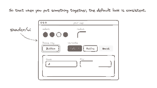
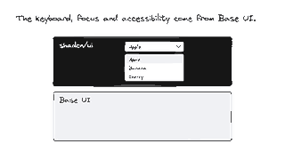
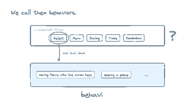
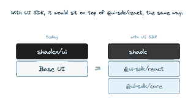

# 组件库的下一层：UI SDK 如何为 AI Agent 重新定义 UI 组件

> **核心判断：UI SDK 试图把 UI 组件的可复用抽象，从「Select、Dialog、Tabs 这样的成品组件」向下移动到「焦点移动、键盘导航、选择、弹层、拖放」这些交互行为。**
>
> 这不是简单地再造一个组件库。它要解决的是：当 Agent 不只使用现成组件，还要持续生成产品特有的界面时，怎样让这些新界面也能复用成熟的交互逻辑、可访问性规则和测试能力；进一步，怎样让 Agent 不再只能通过截图和坐标操作界面，而是直接读取组件状态、调用组件动作。

本文以用户提供的视频为主线，按时间提取关键帧；随后用 UI SDK、Base UI、shadcn/ui 的官方文档和代码仓库补足技术细节。视频中明确讲到的内容与本文进一步推导的架构判断会分开说明。

## 一、先看关键帧：视频真正想表达什么

### 00:19 — shadcn/ui 提供设计系统的默认值

视频先把 shadcn/ui 定义为一组帮助开发者建立设计系统的默认值：颜色 token、圆角、focus ring，以及组件的不同 variant。它解决的是界面「看起来是否一致」的问题。

关键不只是有一套好看的样式，而是开发者拿到的是可以修改、扩展并归自己所有的代码。shadcn/ui 官方也把自己描述为组件代码分发平台，而不是传统意义上只通过依赖包提供黑盒组件的组件库。

### 00:31 — shadcn/ui 与 Base UI 分工：外观和交互不是一回事

这张图是理解整个视频的起点：

- shadcn/ui 决定 Select 的视觉呈现和设计语言。
- Base UI 提供组件背后的键盘行为、焦点管理和可访问性能力。

也就是说，界面看起来是什么样，与界面在键盘、屏幕阅读器和各种交互状态下如何工作，是两个可以分层处理的问题。

### 01:34 — 抽象层向下移动：从组件下沉到 Behavior

视频提出关键问题：如果 Agent 要构建一个组件库里没有的界面，应该给它更多成品组件，还是让它获得组件内部更小的构造单元？

UI SDK 选择后者。它把「用方向键移动焦点」「打开一个弹层」等独立交互能力称为 **Behavior**。

### 01:48 — 50 多种行为，经过测试，再组合成组件

这里有两个重要信息：

1. UI SDK 的核心层提供 50 多种行为，覆盖键盘导航、焦点、选择、拖放等交互。
2. 这些行为不是只给开发者调用的零散函数；它们经过测试，可以被组合成组件。

视频随后补充：UI SDK 还用同一套行为构建了自己的组件库。

### 02:49 — 两种底层组件路线的对照

视频把两种架构并排展示：

- 当前路线：shadcn/ui 建立在 Base UI 之上。
- UI SDK 路线：shadcn/ui 可以建立在 @ui-sdk/react 之上，而 @ui-sdk/react 再使用 @ui-sdk/core。

这里的重点不是「新方案一定替代旧方案」，而是 UI SDK 希望成为另一种底层组件构建基础。

### 03:45 — 多框架适配，以及 shadcn/ui 的未来选择

视频最后把架构拉远：UI SDK 的核心行为层可以服务多个框架，框架适配器之上再建立组件和设计系统。视频说，未来可以在 shadcn/ui 中像选择 Base UI 一样选择 UI SDK。

注意：这里的「soon」是视频发布时对未来集成的描述。本文核查到的 shadcn/ui 官方文档目前明确确认的是 Base UI 默认、Radix 继续支持；尚不能把 UI SDK 选项当成已经正式发布的 shadcn/ui 功能。

## 二、视频的完整论证链

视频并不是从「我们写了 50 个 helper」开始，而是从组件库在 Agent 时代遇到的新问题开始。

| 时间 | 视频讲述 | 背后的问题 |
| --- | --- | --- |
| 00:00–00:33 | 解释 shadcn/ui 与 Base UI 的分工 | 设计样式与交互行为可以分层 |
| 00:36–01:06 | 因为用户需求，逐步支持 Web Components、Vue、Svelte、Solid | 同一套组件在多个框架中重复实现，维护成本上升 |
| 01:08–01:31 | Agent 开始构建界面，也开始操作界面 | 传统组件库主要面向人类开发者，新的使用者是 Agent |
| 01:32–01:55 | 把抽象层从组件下沉到 Behavior | Agent 需要的是能构造新组件的交互原语 |
| 01:56–02:31 | 同一套行为构建多框架组件，也允许 Agent 生成新组件 | 生成出来的组件也应该保持一致的行为和质量 |
| 02:36–03:51 | 对照 Base UI 和 UI SDK，并讨论 shadcn/ui 的未来底座 | UI SDK 希望成为跨框架、Agent 原生的组件基础层 |

这条论证可以压缩成四步：

1. **设计系统解决一致性。** shadcn/ui 提供默认视觉、代码和可定制组件。
2. **组件库解决常见交互。** Base UI 把 Select、Dialog、Tabs 等常见组件的交互和可访问性做好。
3. **Agent 需要构建长尾界面。** 产品中的 Kanban、时间轴、复杂选择器、数据画布等，不可能全部预先做成标准组件。
4. **行为层解决组合问题。** 把交互拆成经过验证的基础行为，Agent 就能组合出新组件，而不是每次从 DOM 事件、焦点和 ARIA 开始重造。

## 三、三个名字，实际上是三个不同层次

这三个项目很容易被放在一起比较，但它们并不处于完全相同的抽象层。

| 项目 | 所在层次 | 核心职责 | 不负责什么 |
| --- | --- | --- | --- |
| shadcn/ui | 设计系统与代码分发层 | 提供组件代码、样式默认值、主题和设计语言；代码进入项目后由开发者拥有和修改 | 不等于底层交互行为引擎 |
| Base UI | Headless React 组件层 | 提供可组合、无样式、关注可访问性的 React 组件 | 不提供完整视觉设计系统，也不是跨框架核心行为层 |
| UI SDK | 行为与组件构建基础层 | 提供可组合的交互行为、Primitive、框架适配器、预制组件，以及 Agent 操作桥接 | 不替代产品自己的设计语言和业务语义 |

### 1. shadcn/ui：把组件代码和设计语言交给应用

shadcn/ui 的价值不只是「一套现成的 React 组件」。它把组件源码分发到应用项目中，让团队直接拥有并修改这些代码。

因此它更接近一种组件库构建方式：

- 用 token 统一颜色、圆角、字体和间距。
- 用 variant 统一 Button、Input 等组件的表现。
- 通过可组合的组件结构形成产品自己的 UI。
- 允许开发者修改组件内部实现，而不必等待上游库暴露某个 API。

它解决的是「如何快速获得一套一致、可控、可继续演进的界面基础」。

### 2. Base UI：把常见组件的交互难题做好

Base UI 是一个无样式的 React 组件库。它不绑定 CSS 方案，开发者可以用 Tailwind、CSS Modules、普通 CSS 或其他方式定义外观。

它的重点是组件交互和可访问性。例如一个 Select 并不只是一个按钮加一个列表。它还涉及：

- 焦点何时进入列表，关闭后回到哪里。
- 方向键如何移动高亮项。
- Home、End、Escape 等按键如何工作。
- 当前值、选中项和展开状态如何暴露给辅助技术。
- 弹层与触发器之间如何建立语义关系。

Base UI 把这些细节封装在成熟组件里，开发者不必每次自己实现。它遵循 WAI-ARIA 设计模式，并在不同设备、浏览器和屏幕阅读器环境中测试。

### 3. UI SDK：把组件内部的交互拆成可组合的行为

UI SDK 把抽象层再向下移动一层。

它的核心不是某个完整的 Select，而是 Select 可能使用的几种行为：

- 焦点移动。
- 键盘导航。
- 输入匹配。
- 单选、多选和范围选择。
- 弹层定位与关闭。
- 拖放和重新排序。
- 移动、缩放、画布视口。
- 状态变化和辅助技术播报。

官方文档列出的行为包括：

| 行为 | 例子 | 解决的问题 |
| --- | --- | --- |
| createRovingFocus | 方向键移动焦点 | 一组项目只占一个 Tab 停靠点，并按方向键移动 |
| createTypeahead | 输入文字定位选项 | 用户输入名称时快速找到匹配项 |
| createFocusRecovery | 恢复焦点 | 当前焦点元素被删除后，把焦点送回合理位置 |
| createSelection | 单选、多选、范围选择 | 统一维护选中项和选择范围 |
| createPopup | Popover、菜单弹层 | 处理打开、关闭、定位和焦点恢复 |
| createReorder | 列表重排 | 支持指针和键盘两种重排方式 |
| createResize | 调整尺寸 | 从边缘或角点改变元素大小 |
| createArea | 二维取值区域 | 在二维区域中选择一个值，例如颜色面板 |

这些行为是更小的交互单元。它们不是视觉组件，也不直接决定按钮是什么颜色，而是负责「这个控件应该怎样工作」。

## 四、UI SDK 的技术架构：Behavior → Primitive → Adapter → Component

UI SDK 不只是把函数放进一个 npm 包。它还定义了如何把多个行为组织成一个组件，以及如何把同一组件映射到不同框架。

~~~mermaid
flowchart TB
  A["@ui-sdk/core Behaviors 焦点、键盘、选择、弹层、拖放"]
  B["Primitive 组件状态 + API/Actions + Slots"]
  C["Framework Adapters React / Vue / Svelte / Solid / Web Components"]
  D["Component Parts DOM、ARIA、状态属性、事件绑定"]
  E["产品组件 Select、Popover、Color Picker、Kanban 等"]
  F["Design System 颜色、字体、间距、圆角、Variants"]
  G["Agent Bridge snapshot / query / act"]

  A --> B --> C --> D --> E --> F
  B -. "暴露语义化状态与动作" .-> G
  G -. "读取 / 调用 / 观察" .-> E
~~~

### 1. Behavior：只负责一类交互能力

例如 createRovingFocus 负责焦点如何在一组元素之间移动。它不需要知道这个控件最后会被叫作 Menu、Tabs、Toolbar，还是一个完全自定义的时间轴。

这让一个行为可以被多个组件复用。

如果每个组件都自己实现方向键导航，团队就会在多个地方重复解决同样的问题：焦点边界、循环移动、RTL 方向、动态增删项目、不可见项目等。行为层把这些逻辑集中起来，减少重复实现。

### 2. Primitive：把行为组织成一个有状态的组件定义

UI SDK 使用 definePrimitive 组织组件。一个 Primitive 主要包含三类东西：

- **state：** 组件状态，例如是否打开、当前值、选中项。
- **api：** 组件可以执行的动作，例如 open、close、setValue、toggle。
- **slots：** 组件由哪些部分构成，以及每个部分暴露什么属性、状态和事件。

官方示例中的 Popover 就是把 createPopup、popupState、popupTrigger、popupContent 组合进一个 Primitive。弹层的打开、Escape 关闭、点击外部关闭和焦点恢复由底层行为处理；Primitive 再定义触发器与内容区域。

这一步很重要：**Behavior 是交互能力，Primitive 是组件契约。**

如果只有一堆行为函数，开发者仍然需要自己决定状态如何流动、组件由哪些部分组成、动作如何暴露。Primitive 把这些内容收敛成一个可以被适配器消费的定义。

### 3. Adapter：同一套 Primitive 接入不同框架

UI SDK 为不同框架提供适配器：

- @ui-sdk/react
- @ui-sdk/vue
- @ui-sdk/svelte
- @ui-sdk/solid
- @ui-sdk/web

适配器通过 createParts 把 Primitive 的 slot 映射成框架中的组件或 Web Component。

例如，一个 Primitive 可以定义 trigger 和 content 两个 slot；React 适配器把它们渲染成按钮和 div，Vue、Svelte、Solid 以及 Web Components 使用各自的渲染方式。

这并不意味着「一份 UI 代码在所有框架里完全不变」。真正复用的是底层状态与交互行为；各框架仍然需要自己的渲染适配和应用层组合。

### 4. Component：预制组件和自定义组件共享底层能力

UI SDK 不只提供核心行为，也用相同的行为层构建了预制组件库。官方发布说明称，组件库包含 50 多个现成组件，覆盖 React、Vue、Svelte、Solid 和 Web Components。

所以 UI SDK 有两种使用方式：

1. 直接使用它已经提供的 Select、Date Picker、Menu 等组件。
2. 让 Agent 根据产品需求，组合底层行为，生成一个新的组件。

第二种方式才是这套架构面向 Agent 的关键。

## 五、为什么 Agent 需要 Behavior，而不只是更多组件？

传统组件库的思路是：开发者先定义常见 UI 模式，再把这些模式包装成组件。应用开发时，从组件库中选择并组合。

这个模式有一个天然边界：**组件库只能预先覆盖一部分需求。**

真实产品经常会出现组件库没有的交互：

- 一个带多选、拖动和分组的资源选择器。
- 一个可缩放、可连接节点的流程画布。
- 一个可以拖动时间范围的时间轴。
- 一个支持键盘重排的复杂 Kanban。
- 一个同时包含搜索、树形层级和多选的业务选择器。

如果 Agent 只能使用现成组件，它会被组件库的目录限制。如果 Agent 可以自由写代码，它又可能从零实现焦点、键盘、ARIA、弹层和拖放，产生大量细微但真实的错误。

UI SDK 试图在两者之间建立一条路：

~~~mermaid
flowchart LR
  A["产品需求 一个新的业务组件"]
  B["Agent 理解组件结构"]
  C["选择基础 Behaviors"]
  D["组合成 Primitive"]
  E["通过框架 Adapter 渲染"]
  F["运行交互与可访问性测试"]
  G["得到可用的新组件"]

  A --> B --> C --> D --> E --> F --> G
  F -. "失败则修正组合" .-> C
~~~

Agent 不必每次从原始 DOM 事件开始，而是选择经过测试的行为，组合成自己的交互模式。

这会改变组件库的边界：

- 过去：组件库的边界，决定 Agent 能构建什么。
- 现在：组件库提供基础行为，Agent 可以构建组件库尚未收录的组件。
- 质量控制：底层行为有测试，生成的 Primitive 仍需要通过组件级测试和产品验收。

换句话说，UI SDK 想把「组件目录」变成「组件生成能力」。

## 六、一个更大的变化：Agent 不只是构建 UI，也要操作 UI

视频后半段有一句很关键的话：Agent 正在构建界面，也正在操作界面。

这实际上是两个不同的问题：

| 任务 | Agent 需要什么 |
| --- | --- |
| Build UI | 理解行为、组合组件、生成结构和样式 |
| Use UI | 读取组件状态、理解可执行动作、调用动作并确认结果 |

如果 Agent 只能通过截图和鼠标坐标操作页面，它需要反复观察像素、寻找按钮、点击、等待、重新截图。页面结构稍有变化，坐标就可能失效。

UI SDK 还提供了 Agent Bridge，把组件的语义化状态和动作暴露给 Agent。

### 1. 三个核心操作：snapshot、query、act

- **snapshot：** 读取页面上已注册组件的类型、标签、状态和可用动作。
- **query：** 根据文字、标签或组件类型查找组件及其选项。
- **act：** 对指定组件调用动作，例如 setValue、clear 或 press。

一个输入框可以向 Agent 暴露类似这样的信息：

~~~json
{
  "ref": "c1",
  "component": "input",
  "label": "Project name",
  "value": "Apollo",
  "actions": ["setValue", "clear"]
}
~~~

Agent 不必猜测「输入框在哪个坐标」，而是可以直接表达：

~~~ts
await agent.act({
  steps: [
    { ref: "Project name", action: "setValue", args: ["Atlas"] }
  ]
});
~~~

动作会经过组件自己的 API 和 change callback，而不是绕过组件直接修改 DOM。

### 2. WebMCP：让浏览器里的 Agent 发现这些工具

UI SDK 可以通过 registerTools，把 snapshot、query、act 注册到浏览器的 document.modelContext API。

当浏览器支持 WebMCP 时，浏览器内置 Agent 可以发现页面提供的工具，并通过这些工具读取和操作 UI。

这意味着 UI 不再只是供人类观看的像素集合。它可以同时暴露一套机器可读的组件语义和动作接口。

### 3. 权限不是可选项

Agent Bridge 可以设置 allow 回调，逐步批准或拒绝 Agent 的动作。组件还可以用 data-agent-confirm 标记需要人确认的动作。

这很重要，因为 act 可能触发保存、提交、删除等有后果的操作。不能因为动作被包装成结构化工具，就默认它是安全的。

还要注意：

- snapshot 和 query 会返回页面标签、文案和用户输入；官方工具注解将这些结果标记为不可信内容，Agent 不应把它们当成系统指令。
- 没有配置 allow 时，Bridge 会接受支持的动作；应用应显式设置 allow 白名单。注册 WebMCP 工具时还必须提供独立的 allow，不能只依赖页面内 Bridge 的权限回调。
- data-agent-hidden 会让区域从 snapshot 和 query 中完全隐藏；data-agent-secret 会保留组件，但把已填写的值显示为 [redacted]。密码、银行卡和一次性验证码字段默认按 secret 处理。
- data-agent-confirm 用来标记必须由用户确认的动作。确认文案会进入 Agent 可见的组件信息，Agent 需要请求用户批准后才能继续。
- act 按步骤顺序执行；如果后续步骤失败，前面已经完成的动作不会自动回滚。多步写操作应设计幂等性、审计和补偿机制。
- 高风险操作应保留人工确认、审计和撤销能力。

因此，Agent Bridge 不只是「让 Agent 点击更快」，也是把 UI 操作纳入明确的权限边界。

## 七、官方 Benchmark：结构化 UI 工具能减少多少操作成本？

UI SDK 官方文档给出了一组对比实验：在一个项目设置页面中，让 Agent 修改项目名称、可见性、成员和通知设置，最后保存。

对比方式是：

- 其他组件库：Agent 使用浏览器工具读取无障碍树，再点击和输入。
- UI SDK：Agent 使用 UI SDK 的 Agent Bridge。

React 场景的数据如下：

| 指标 | Base UI + 浏览器工具 | Ark UI + 浏览器工具 | UI SDK + Agent Bridge |
| --- | ---: | ---: | ---: |
| 工具调用 | 17 | 19 | 2 |
| Token | 291.1k | 330.3k | 21.8k |
| 时间 | 56 秒 | 58 秒 | 13 秒 |
| 成本 | $0.138 | $0.143 | $0.021 |

官方给出的 UI SDK 对比结果是：工具调用减少 88%，Token 减少 92%，时间缩短 77%，成本降低 85%。

Vue 和 Svelte 的官方实验也呈现相似趋势：UI SDK Bridge 使用 2 次工具调用，其他方案使用 17 次。

但这组数字需要正确理解：

1. 这是 UI SDK 官方自己的 Benchmark，不是独立第三方评测。
2. 每列取 3 次运行的中位数，使用相同任务、系统提示词和 Claude Sonnet。
3. 它验证的是一个具体的项目设置任务，不代表所有页面、所有 Agent、所有业务任务都能获得相同收益。
4. UI SDK 自己也用浏览器工具跑过同一界面，结果与其他组件库接近，说明主要差异来自 Agent Bridge，而不只是组件渲染性能。

这组实验最值得关注的不是某个百分比，而是工具接口的变化：

**当 Agent 能够读取结构化组件状态并直接调用语义化动作时，浏览器自动化中大量「观察—定位—点击—再观察」的步骤可以被合并。**

## 八、测试层：Behavior 可复用，必须同时可验证

把交互拆成更小的行为，只有在行为本身经过验证时才有意义。

UI SDK 提供了 @ui-sdk/core/testing。官方文档中的 checkPattern 可以检查一个组件是否符合常见的可访问性模式，包括：

- 角色和名称。
- 状态和属性。
- 组件不同部分之间的引用关系。
- 键盘交互。
- 焦点行为。

测试工具还可以模拟输入、检查焦点、检查辅助技术属性，并读取 Primitive 的状态和服务端输出。

从 UI SDK 仓库的测试说明看，它的测试不只包含普通单元测试，还覆盖：

| 测试类型 | 主要关注点 |
| --- | --- |
| Behavior | 交互行为是否符合预期 |
| Accessibility | 角色、名称、状态等可访问性要求 |
| Screen reader | 屏幕阅读器相关行为 |
| Right to left | RTL 环境下的方向键和布局行为 |
| Server rendering | 服务端 HTML 输出和 hydration |
| Custom rendering | 自定义元素与部件渲染 |
| Kitchen sinks | 多行为组合后的整体表现 |
| Leak specs | 资源和监听器泄漏 |
| Unit tests | 独立工具函数和内部逻辑 |
| Bundle size / Performance | 体积和性能预算 |

这里有一个重要的工程含义：

- Behavior 测试验证可复用的基础交互。
- Primitive 测试验证行为组合后的状态与部件契约。
- 框架测试验证 React、Vue、Svelte、Web Components 等适配是否一致。
- 产品验收仍然需要检查业务语义、视觉、边界条件和高风险操作。

测试工具并不意味着「用了 UI SDK 就自动拥有完整可访问性」。组件仍然需要正确的名称、角色、语义和业务状态；开发者也需要确认组合出来的交互符合产品预期。

## 九、UI SDK 与 Base UI：是替代关系，还是不同路线？

视频明确给出了建议：

- 如果项目已经使用 shadcn/ui + Base UI，而且运行良好，不需要为了 UI SDK 迁移。
- 如果正在开始一个新项目，特别是要做 Agentic Interface、Generative UI 或非 React 框架组件，可以评估 UI SDK。

这与官方项目状态相吻合。

### 当前可以确认的状态（截至 2026-11-28）

1. shadcn/ui 已在 2026 年 7 月将 Base UI 设为新项目默认底层组件库。
2. Radix 仍然受到支持，现有项目不需要迁移。
3. Base UI 是成熟的无样式 React 组件库，官方发布记录显示其 1.9.0 于 2026 年 10 月发布。
4. UI SDK 于 2026 年 11 月 12 日发布，目前仍处于 Beta 阶段。
5. 本文核对的 UI SDK 仓库中，@ui-sdk/core 的 package.json 版本为 0.1.0-beta.19。公开 API 仍可能变化。
6. 视频提到 UI SDK 将来可以成为 shadcn/ui 的一个底层选项，但目前不能把它当成已正式发布的 shadcn/ui 选择项。

### 选择建议

| 场景 | 更合理的选择 | 原因 |
| --- | --- | --- |
| 现有 shadcn/ui + Base UI 项目 | 继续使用 Base UI | 已经稳定运行，没有必要为新抽象层付出迁移成本 |
| 普通 React 产品，主要使用标准组件 | Base UI 或现有成熟组件库 | 组件覆盖和生态成熟度更重要 |
| 新建 Agent-first 产品 | 评估 UI SDK | 需要生成新组件，也需要让 Agent 结构化操作组件 |
| 需要 React 之外的框架适配 | 评估 UI SDK | 同一套行为可以通过不同 Adapter 接入多个框架 |
| 大量产品专属交互 | 重点评估 UI SDK 的 Behavior 层 | 能复用基础交互，而不是重复造轮子 |

## 十、深入解读：UI SDK 真正改变的是 UI 的抽象单位

我认为这项工作的意义不在于「多了一个组件库」，而在于它把 UI 系统的核心抽象从成品组件移动到了交互语义。

### 1. 从组件目录转向行为空间

传统组件库的能力主要体现在组件目录中：它提供多少种按钮、弹层、菜单、表格和输入框。

但 Agent 生成界面时，需求不一定落在已有组件目录中。产品真正需要的是某种交互组合，而不是某个固定名称的组件。

因此，更有扩展性的抽象可能是：

- 组件是可复用的交互配方。
- Behavior 是配方中的基础能力。
- Primitive 是配方的状态和动作契约。
- Adapter 是配方进入具体框架的方式。
- Design System 是配方最终呈现出的视觉语言。

这使得组件库从「提供多少成品」转向「提供多少可靠的构造能力」。

### 2. 从面向开发者的组件，转向 Agent 可理解的组件契约

普通组件的 API 首先服务开发者。例如 Select 暴露 value、open、onValueChange 等属性。

Agent 要使用组件，则还需要知道：

- 页面上有哪些组件？
- 每个组件的业务标签是什么？
- 当前值和可选值是什么？
- 组件允许执行哪些动作？
- 哪些动作需要人确认？
- 执行后状态有没有真正改变？

UI SDK 的 Agent Bridge 正是在组件 API 之外增加一层机器可读的交互契约。

这意味着组件不仅要对人类开发者好用，也要对 Agent 可发现、可理解、可操作。

### 3. 从像素自动化转向语义化自动化

截图和坐标是通用的，但它们表达的信息很有限。Agent 需要从视觉中猜测按钮、表格、输入框和状态。

语义化组件接口则直接表达：

- 这是一个 Select。
- 它的标签是 Region。
- 当前值是 Asia Pacific。
- 它支持 setValue。
- 这次修改的结果是成功还是失败。

这更像是给 UI 建立一套工具协议，而不是让 Agent 模拟人的鼠标操作。

它并不会取代所有浏览器自动化：画布绘制、复杂拖动、非结构化页面和第三方站点仍可能需要传统浏览器工具。但在应用能够主动暴露组件契约时，语义化工具通常更直接、更稳定，也更容易做权限控制。

### 4. 多框架支持的价值不只是减少重复代码

同一个行为在 React、Vue、Svelte、Solid 和 Web Components 中重复实现，会造成行为差异和维护成本。

把行为放在共同核心层，可以让不同框架共享一套交互规则，再由适配器处理框架差异。

这使得团队有机会把「交互正确性」从某一个框架的组件实现中抽离出来，成为跨框架的基础设施。

不过，Adapter 并不会自动消除所有框架差异。渲染时机、响应式模型、事件语义和服务端渲染仍然需要各自验证。

## 十一、落地时应注意的边界

UI SDK 的方向很有吸引力，但不应把它理解为「Agent 从此可以随意生成高质量 UI」。

### 1. 它不是设计系统

UI SDK 负责交互行为和组件构建基础。颜色、字体、间距、密度、视觉层级、品牌语言，仍然需要由设计系统决定。

如果没有设计 token 和样式约束，Agent 仍然可能生成一组行为正确但视觉不一致的组件。

### 2. 它不是业务组件的自动生成器

行为层可以减少交互实现的重复劳动，但它不会替 Agent 理解业务规则。

例如一个审批组件，除了选择、弹层和焦点行为，还需要正确理解审批权限、金额规则、状态转换和审计要求。这些属于业务模型，不是通用 UI Behavior。

### 3. Behavior 组合也可能出错

单个行为经过测试，不代表任意组合都正确。两个行为可能争夺焦点、产生状态冲突，或者在边界条件下互相干扰。

因此需要 Primitive 级、框架级和业务级测试，不能只依赖基础行为的测试结果。

### 4. Agent Bridge 需要严格的权限边界

Agent 能够调用组件动作，就意味着 UI 动作变成了可执行工具。保存、删除、提交、授权等动作必须有清晰的权限策略。

建议至少做到：

- 默认只读；需要写操作时再逐步开放。
- 按组件、动作和数据范围设置 allow 规则。
- 对不可逆动作设置人工确认。
- 记录动作来源、输入和执行结果。
- 对敏感状态做脱敏。
- 不把页面中的用户输入当作可信指令。

### 5. Beta 阶段不适合盲目替换成熟基础设施

UI SDK 当前仍处于 Beta，公开 API 可能变化。生产系统应先用小范围组件验证稳定性、测试覆盖和升级成本。

尤其是现有 Base UI 项目，应该以真实收益为迁移依据，而不是为了追逐新架构而迁移。

## 十二、实践建议：怎样开始使用这套思路？

如果要在新项目中试验 UI SDK，可以按以下顺序推进：

1. **先确定设计系统。** 先定义 token、字体、间距、颜色、圆角和组件变体，不要把样式问题交给 Behavior 层。
2. **先使用现成组件。** 从 UI SDK 提供的 Select、Menu、Dialog、Date Picker 等组件开始，验证基础体验。
3. **只为长尾需求创建自定义 Primitive。** 当现成组件无法表达产品交互时，再组合 Behavior。
4. **保留明确的组件契约。** 每个 Primitive 都应清晰定义 state、actions 和 slots。
5. **把测试纳入生成流程。** 检查键盘导航、焦点恢复、ARIA、RTL、SSR 和框架适配。
6. **再接入 Agent Bridge。** 先开放 snapshot 和 query，再开放低风险 act，最后才考虑高风险操作。
7. **用任务成功率评估收益。** 不只统计工具调用和 Token，还要统计错误率、人工接管率、权限拒绝、回滚和实际任务完成率。

对一个成熟产品来说，先把一两个具有代表性的自定义组件做成试点，比一次性替换整个组件体系更稳妥。

## 结论

UI SDK 提出的方向可以概括为：

**组件不再只是预先写好的界面模板，而是由可复用行为构成、能被 Agent 理解和操作的交互契约。**

shadcn/ui 关注设计语言和代码所有权；Base UI 关注成熟 React 组件的交互与可访问性；UI SDK 则进一步把组件内部的交互能力拆出来，提供跨框架复用和 Agent 组合的基础。

它的长期价值取决于三件事能否同时成立：

1. 行为足够细，能够覆盖真实产品中的长尾交互。
2. 行为和组合足够可靠，能通过测试而不只是视觉上看起来正确。
3. 组件能够向 Agent 暴露明确的状态、动作和权限边界。

如果这三点成立，未来的组件库就不只是「开发者从目录里挑选组件」，还可以成为 Agent 生成和操作界面的可靠运行时基础。

UI SDK 目前仍在 Beta，但它提出的问题值得整个 UI 工具链认真对待：**当 Agent 成为界面的构建者和使用者时，我们是否还应该把「组件」作为 UI 系统最底层的抽象？**

---

## 参考资料

### 视频来源

- 用户提供的 UI SDK 介绍视频，时长约 3 分 51 秒。本文关键帧由该视频提取。

### UI SDK 官方资料

- [UI SDK 官方网站](https://ui-sdk.dev/)
- [Introducing UI SDK（2026-11-12）](https://ui-sdk.dev/docs/core/changelog/introducing-ui-sdk)
- [Core：UI SDK 的设计与工作方式](https://ui-sdk.dev/docs/core)
- [All Behaviors：行为目录](https://ui-sdk.dev/docs/core/behaviors)
- [Define a Primitive](https://ui-sdk.dev/docs/core/kernel/define-a-primitive)
- [Testing](https://ui-sdk.dev/docs/core/testing)
- [Built for Agents](https://ui-sdk.dev/docs/agents)
- [WebMCP](https://ui-sdk.dev/docs/agents/connect-an-agent/webmcp)
- [Permissions](https://ui-sdk.dev/docs/agents/connect-an-agent/permissions)
- [UI SDK GitHub 仓库](https://github.com/vercel-labs/ui)
- [UI SDK 测试说明](https://github.com/vercel-labs/ui/blob/main/tests/README.md)

### Base UI 与 shadcn/ui

- [Base UI：About](https://base-ui.com/react/overview/about)
- [Base UI：Releases](https://base-ui.com/react/overview/releases)
- [shadcn/ui：Base UI as the Default（2026-07）](https://ui.shadcn.com/docs/changelog/2026-07-base-ui-default)
- [shadcn/ui：Introduction](https://ui.shadcn.com/docs)

## 术语对照

| 英文 | 中文 | 含义 |
| --- | --- | --- |
| Behavior | 行为 | 可复用的一类交互能力 |
| Primitive | 原语 / 组件原语 | 组合状态、动作和组件部件的定义 |
| Adapter | 适配器 | 将 Primitive 映射到具体 UI 框架 |
| Headless | 无样式 | 提供交互和语义，不强制规定视觉样式 |
| Roving Focus | 焦点游移 | 一组元素通常只有一个 Tab 停靠点，方向键在组内移动焦点 |
| Focus Recovery | 焦点恢复 | 当前焦点元素消失后，把焦点恢复到合理位置 |
| Agent Bridge | Agent 桥接层 | 把组件状态和动作暴露给 Agent |
| WebMCP | Web 模型上下文协议 | 让网页向支持它的 Agent 注册可发现工具 |
| Generative UI | 生成式 UI | 根据任务或上下文动态生成界面 |
| Agentic Interface | Agent 原生界面 | 不仅供人操作，也能被 Agent 以结构化方式理解和操作 |
